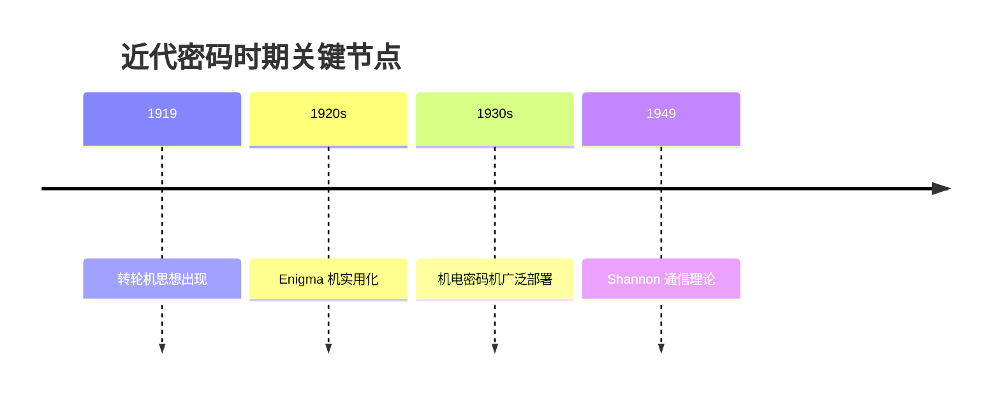

# 密码学发展简史（近代密码时期与现代密码学概念的发展）

## 近代密码时期

**它是什么？** ==近代密码时期==指从 20 世纪初到 50 年代左右这段历史阶段，代表技术是**机电转轮密码机**（Rotor，简称转轮机）。1919 年之后的几十年里，密码人员用转轮机取代手工编码，首次实现**自动编解码**的保密通信。

**为什么需要？** 手工密码速度慢、易出错、密钥空间有限。转轮机把"多表替换"机械化：每个转轮有 26 个触点，一按字母、一转一度，累加出**周期极长的多表替换**，理论上密钥空间可达 $26!^n$ 量级（$n$ 为转轮数），靠人脑与纸笔几乎无法穷举。

**它还不是科学。** 这一阶段被看作==科学密码学的前夜==：密码技术更像一种**艺术**——设计与分析靠直觉、经验和技巧，没有严格的==推理与证明==。安全与否凭"信念"，而非数学论证；这也是它与后续"现代密码学"的根本分水岭。

> [!IMPORTANT]
> 判断题陷阱："加密和解密都是在计算机控制下进行的。"——**错**。转轮机时代靠的是**机械/机电装置**，受"计算机"控制是后来的事；题目订正为"==密钥=="，强调控制加解密的是密钥，而非某台机器。

## 现代密码学概念的发展

三条主线把"艺术"升级为"科学"：

| 时间 | 事件 | 意义 |
|---|---|---|
| 1949 | Shannon《保密系统的通信理论》 | ==奠定现代密码学理论基础==，引入熵、完善保密等概念 |
| 1976 | Diffie–Hellman《密码学的新方向》 | 提出公钥新思想，==开创公钥密码学新纪元== |
| 1976 后 | DES 公布 | 密码研究由秘密走向**公开**，学界快速迭代 |

**算法公开的意义**：① 增强算法安全性；② 推广应用；③ 增强用户信心；④ 促进技术发展。这正是 Kerckhoffs 原则的体现——==安全性应依赖密钥，而非算法保密==。

> [!TIP]
> 记忆链：**1949 奠基 → 1976 公钥诞生 → DES 公开推动研究**。三者共同把密码学从"技巧"变成"可证明的科学"。

> [!NOTE]
> 与近代密码时期对比：过去是**艺术**（直觉、经验、秘密设计），现在是**科学**（公开算法、数学证明、密钥承载安全性）。现代密码学还形成两大分支：**密码编码学**（==设计密码算法与协议==）与**密码分析学**（研究破译）。

## 一个判断题小练

> 判断：密码编码学的任务是设计密码算法与协议。（√）

**为什么对？** 密码编码学（Cryptography）负责设计安全的算法与协议；密码分析学（Cryptanalysis）才负责攻击与破译。两者合起来构成广义"密码学"。
