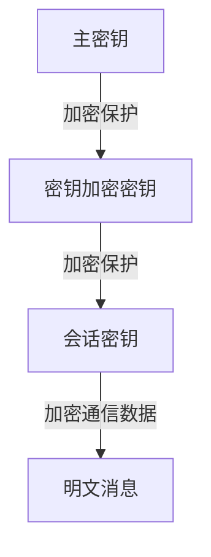

# 密钥管理技术、原则、典型的密钥层次结构及密钥种类（对用户而言）

## 什么是密钥管理

密钥管理是指在授权各方之间==建立、维持和终止密钥关系==的一整套技术与程序。它不仅决定“用什么密码算法”，更决定密钥能否在整个生命周期中保持安全。

典型内容包括：密钥的生成、存储、分配与协商、使用、备份与恢复、更新、撤销、存档和销毁。密码系统的整体安全性通常不依赖算法保密，而依赖==密钥的保密性与正确管理==。

> [!IMPORTANT]
> 密钥管理的核心不是“保管一个密钥”，而是让密钥在产生到销毁的整个过程中始终可控、可追溯、不可泄露。

## 为什么需要密钥管理

即使采用安全性很高的密码算法，如果密钥被窃取、重复使用或分配错误，攻击者仍可直接解密通信或伪造签名。

例如，对称密码中同一密钥既用于加密又用于签名，攻击者获得密钥后便能同时伪造合法消息；公钥密码中即使公钥可以公开，私钥仍必须严格保护。因此，不同场景需要分别确定密钥的用途、寿命、分发方式和保存位置。

## 密钥管理原则

| 原则 | 含义 | 解决的问题 |
|---|---|---|
| 全程安全原则 | 在产生、存储、备份、分发、使用、更新、终止和销毁的全过程中保护密钥 | 防止任一环节泄露 |
| 最小权利原则 | 只分发用户完成当前事务所需的最小密钥集合 | 限制攻击后的破坏范围 |
| 责任分离原则 | 一个密钥专职一种功能 | 避免加密密钥被用于签名等 |
| 密钥分级原则 | 将密钥划分为主密钥、二级密钥、初级密钥 | 减少高价值密钥数量，简化管理 |
| 密钥更新原则 | 密钥到期、受到威胁或成员变化时及时更新 | 限制密钥长期使用带来的风险 |

> [!TIP]
> 可概括为：**全程保护、最少授权、一钥一职、层次管理、按需更新。**

## 典型密钥层次结构

- **主密钥**：层次结构中的最高层密钥，用于加密其他密钥，必须受到最严格保护。
- **密钥加密密钥（KEK）**：用于加密会话密钥或其他下层密钥。
- **会话密钥**：为一次通信或数据交换协商产生，专门保护该次任务的通信或文件数据；任务结束后通常立即销毁，也称数据加密密钥。

这种分层结构的意义在于：即使下层密钥泄露，攻击者通常仍需获得上层密钥才能利用；同时，可以只对少量主密钥实施高强度保护。

## 密钥种类与保护要求

| 密钥类型 | 主要用途 | 需要保护的性质 |
|---|---|---|
| 对称密钥 | 加密、解密、认证或签名 | 秘密性、真实性、完整性 |
| 公钥 | 加密验证、签名验证、公钥认证 | 真实性、完整性 |
| 私钥 | 解密、签名 | 秘密性、真实性、完整性 |

> [!WARNING]
> 对称密码中的“同一个密钥”意味着知道它就能推导出对应功能；公钥虽不要求保密，但被篡改或替换后会造成严重攻击。公钥密码用于密钥分配确实能解决部分传统对称密钥分发困难，但并未消除私钥保护、身份认证和公钥可信性等管理问题。

## 密钥生成与更新

密钥一般由密钥生成器借助随机源产生，以获得良好的随机性和不可预测性。随机源退化、种子重复或生成过程可预测，都会使密码算法失去安全基础。

密钥通常应在以下情况下更新：有效期结束、安全受到威胁、通信成员发生变化。若攻击者已经获得旧密钥，仅继续使用旧密钥无法恢复安全。

## 容易混淆的要点

1. **密钥管理不等于密钥备份**：备份用于故障恢复；即使有备份，也必须严格控制访问权限。
2. **密钥分级不等于密钥分类**：分级描述保护层次，分类描述功能或用途。
3. **使用公钥密码不等于无需密钥管理**：公钥的真实性、私钥的秘密性仍需管理。
4. **IBE 简化了公钥查找**：用户公钥可直接取自身份信息，但身份绑定、私钥安全交付和第三方信任问题仍然存在。

## 算对了的例子

某系统采用三级密钥结构：主密钥 $K_0$ 加密密钥加密密钥 $K_1$，再由 $K_1$ 加密本次会话密钥 $K_s$：

$$
K_1=\operatorname{Enc}_{K_0}(K_1'),\qquad
K_s=\operatorname{Enc}_{K_1}(K_s')
$$

其中，$K_0$ 存放于受严格保护的密钥存储区，$K_1$ 用于保护会话密钥，$K_s$ 只保护当前通信。若会话结束，应销毁 $K_s$；当 $K_s$ 疑似泄露时，可更新会话密钥，而不必直接更换主密钥。这样既满足最小权利原则，也体现了分级保护和按需更新原则。
