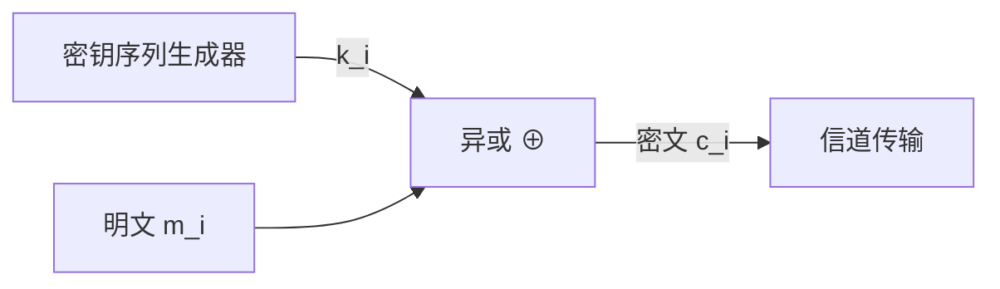
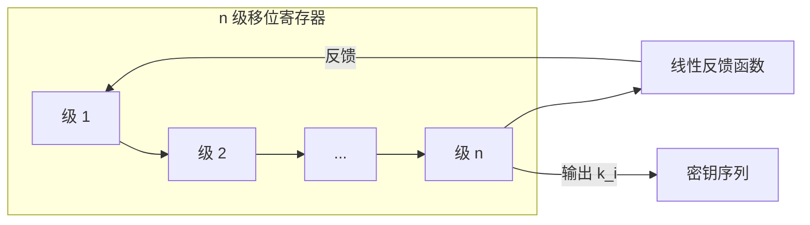

# 流密码的概念、特点及与分组密码的区别

## 流密码的概念

流密码（序列密码）的核心思想是：==用一个密钥序列与明文序列逐位叠加来产生密文==。设明文序列为 $m = m_1 m_2 \cdots m_n$，密钥序列为 $k = k_1 k_2 \cdots k_n$，密文序列为 $c = c_1 c_2 \cdots c_n$，则加密过程为：

$$
c_i = m_i \oplus k_i \quad (i = 1, 2, \dots, n)
$$

解密过程与加密过程完全对称：

$$
m_i = c_i \oplus k_i \quad (i = 1, 2, \dots, n)
$$

这里 $\oplus$ 表示二进制异或（模 2 加）。解密之所以成立，是因为 $(m_i \oplus k_i) \oplus k_i = m_i \oplus (k_i \oplus k_i) = m_i$。

> [!IMPORTANT]
> 流密码的安全性完全取决于密钥序列的不可预测性，而不在于“叠加”操作本身。设计流密码体制的关键，就是设计一种产生密钥序列的方法。

### 为什么需要流密码

分组密码一次处理固定长度的明文块（如 64 bit、128 bit），如果明文长度不是分组长度的整数倍，就需要填充。而流密码按位（或按字节）处理，天然适合实时通信场景——电话语音、无线链路、视频流等。这也就是为什么 A5 算法（GSM）、RC4 算法（WLAN 初期标准）都选择流密码。

## 与分组密码的区别

| 对比维度 | 流密码 | 分组密码 |
|---------|--------|---------|
| 处理单位 | 逐位/逐字节 | 固定长度分组（如 128 bit） |
| 核心部件 | 密钥序列生成器（如 LFSR） | 混淆与扩散网络（如 S 盒、P 盒） |
| 典型算法 | A5、RC4、ZUC | DES、AES、SM4 |
| 适用场景 | 实时流式传输、硬件资源受限 | 块数据处理、磁盘加密 |

## 密钥序列生成器：LFSR

> [!NOTE]
> LFSR（线性反馈移位寄存器）是产生流密码密钥序列的一种主要工具。给定前一状态的输出，将该输出的==线性函数==再用作输入的移位寄存器。

一个 $n$ 级 LFSR 的结构如下：

反馈函数的一般形式为：

$$
f(a_1, a_2, \dots, a_n) = c_1 a_1 \oplus c_2 a_2 \oplus \cdots \oplus c_n a_n
$$

其中 $c_i \in \{0, 1\}$，通常用反馈多项式 $p(x) = 1 + c_1 x + c_2 x^2 + \cdots + c_n x^n$ 来表示。当反馈多项式是==本原多项式==时，$n$ 级 LFSR 的输出序列周期可达最大值 $2^n - 1$（除去全零状态）。

> [!TIP]
> 判断改错题常把“移位寄存器”偷换为“指令寄存器”。指令寄存器是 CPU 内部保存当前指令的部件，与密码学毫无关系。

## 一个算对了的例子

设 3 级 LFSR，反馈函数 $f(a_1, a_2, a_3) = a_1 \oplus a_3$（即新级 1 = 级 1 ⊕ 级 3），初始状态 $(1, 0, 1)$：

| 时钟 | 状态 $(a_1,a_2,a_3)$ | 输出 $a_3$ |
|------|---------------------|-----------|
| 0 | (1, 0, 1) | 1 |
| 1 | (0, 1, 0) | 0 |
| 2 | (1, 0, 1) | 1 |
| ... | 周期为 $2^3 - 1 = 7$ | — |

用输出序列 $k = 1,0,1,\dots$ 与明文 $m = 1,1,0$ 异或，得密文：

$$
c = (1\oplus1,\ 1\oplus0,\ 0\oplus1) = (0, 1, 1)
$$

解密时用相同的 $k$ 与 $c$ 异或，即可恢复 $m$。

> [!WARNING]
> 实际使用的流密码不允许直接以 LFSR 输出作为密钥序列——线性结构使得攻击者通过解线性方程组即可破译。实用算法（如 A5、ZUC）都会在 LFSR 基础上加入非线性组件（如非线性滤波、钟控等）。
