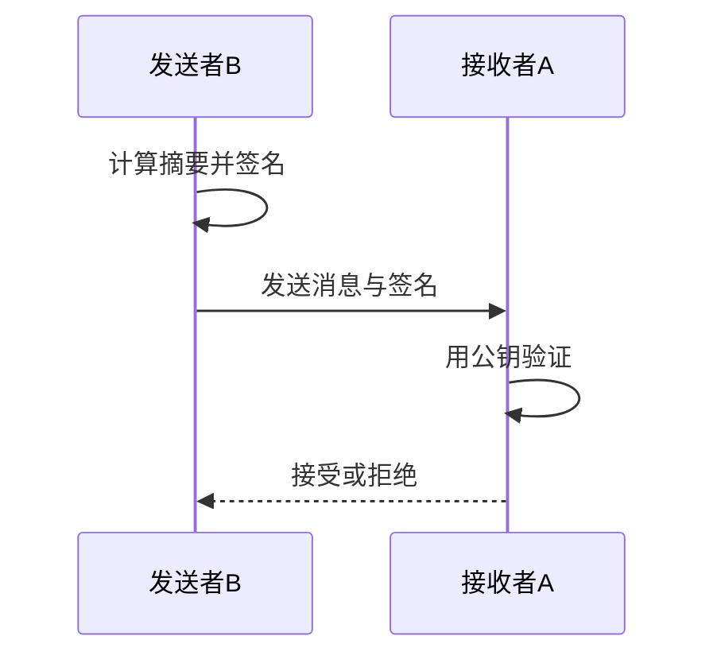
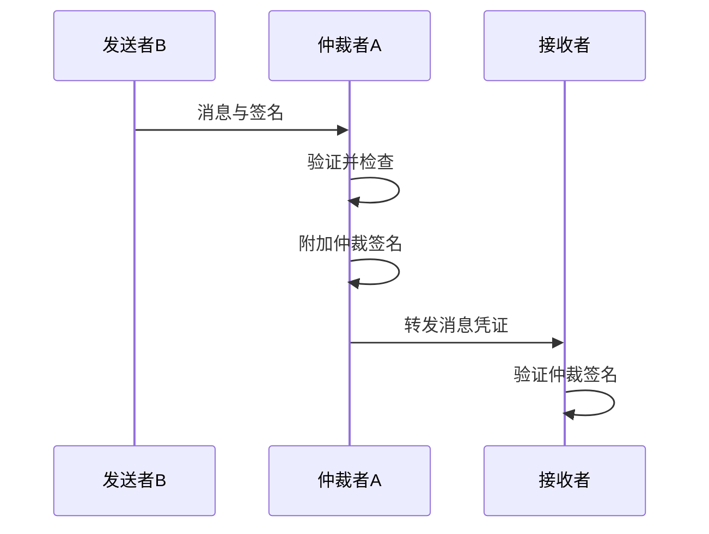

# 两类数字签名函数、直接数字签名及其缺点、仲裁数字签名技术

## 两类数字签名函数

数字签名方案通常由**密钥生成算法、签名算法、验证算法**组成。设消息为 $m$，签名者的私钥为 $sk$、公钥为 $pk$，则签名过程可写为
$$
\sigma=\operatorname{Sign}_{sk}(m),
$$
验证过程为
$$
\operatorname{Verify}_{pk}(m,\sigma)\in\{\text{接受},\text{拒绝}\}.
$$

按签名函数对消息的处理方式，可分为两类：

| 类型 | 基本形式 | 主要特点 |
|---|---|---|
| 直接数字签名 | $\sigma=\operatorname{Sign}_{sk}(m)$ | 只涉及通信双方，验证者用签名者公钥验证 |
| 仲裁数字签名 | 发送者、接收者之外引入仲裁者 $A$ | 消息或签名经仲裁者检查、转发，仲裁者参与不可否认性的实现 |

这里的“两类”是按**签名函数及协议结构**分类，不是按数学困难问题分类。按实现所依赖的数学问题，常见算法又可分为基于 RSA、基于离散对数、基于 ECC 的签名算法。

> [!IMPORTANT]
> 数字签名主要提供==真实性、完整性和不可否认性==，本身不必然提供消息机密性；需要保密时，还应另外加密。

## 直接数字签名及其缺点

直接数字签名中，发送者 $B$ 使用自己的私钥签名，接收者 $A$ 使用 $B$ 的公钥验证。例如，可先计算消息摘要，再对摘要签名：
$$
h=H(m),\qquad \sigma=\operatorname{Sign}_{sk_B}(h).
$$
接收者重新计算 $H(m)$，并验证 $\sigma$。实际系统通常采用“**先散列、后签名**”，避免直接处理长消息，也降低某些代数攻击风险。

直接数字签名的主要缺点有：

- **依赖签名者私钥的保密性**：私钥泄露后，攻击者可能伪造签名。
- **签名者可能否认**：签名者可以声称私钥早已泄露，从而否认签名；仅验证数学等式难以判断签名时间和私钥状态。
- **私钥更换带来争议**：签名者可能通过更换密钥，主张旧公钥对应的签名无效。
- **依赖公钥真实性**：若验证者拿到的是伪造公钥，签名验证也会失去意义，因此还需要证书等公钥基础设施。

> [!WARNING]
> “私钥签名、公钥验证”不等于“公钥加密、私钥解密”。签名与公钥加密的目的、算法流程和安全要求不同，不能简单地把签名理解为 RSA 加密的逆过程。

## 仲裁数字签名技术

仲裁数字签名引入可信第三方仲裁者 $A$。发送者 $B$ 不直接把消息交给接收者，而是先交由仲裁者检查；仲裁者确认消息来源和内容后，附加自己的签名或认证信息，再转发给接收者。这样，接收者不仅依赖发送者的签名，也依赖仲裁者的确认。

一种典型流程是：

1. $B$ 对消息签名，并将消息、签名及必要的发送信息交给 $A$。
2. $A$ 验证 $B$ 的签名，检查消息是否有效。
3. $A$ 对“消息、发送者、时间戳”等信息签名，形成仲裁凭证。
4. $A$ 将消息及仲裁凭证发给接收者。
5. 接收者验证仲裁者签名；发生争议时，可依据仲裁记录判断责任。

时间戳用于表明仲裁者确认的时间，减少签名者事后以“密钥已泄露”为由否认签名的空间。若消息需要保密，还应对消息内容加密，不能因加入仲裁者就默认获得机密性。

| 对比项 | 直接数字签名 | 仲裁数字签名 |
|---|---|---|
| 参与者 | 发送者、接收者 | 另含可信仲裁者 |
| 验证依据 | 发送者公钥 | 仲裁者确认及相关签名 |
| 通信开销 | 较小 | 较大 |
| 主要信任问题 | 依赖私钥与公钥管理 | 依赖仲裁者可信、可用 |
| 适用场景 | 一般电子签名 | 争议处理要求较高的场景 |

> [!NOTE]
> 仲裁者不一定等同于现代证书机构 CA。CA 主要负责绑定身份与公钥；仲裁数字签名中的仲裁者则直接参与消息或签名的检查、确认和转发。

## 算法列举与示例

考试要求“列举 5 个数字签名算法”时，可答：**离散对数签名算法、ElGamal、Schnorr、Neberg-Rueppel、Okamoto**。其中后四者通常都可归入离散对数类签名方案，因此“列举五个算法”和“列举三类实现方法”不是同一个问题。

以 ElGamal 型签名的一个简化计算为例，取 $p=11$、生成元 $g=2$，签名者私钥 $x=3$，则公钥
$$
y=g^x\bmod p=2^3\bmod 11=8.
$$
若消息摘要 $m=5$，选择临时秘密数 $k=7$，满足 $\gcd(k,p-1)=\gcd(7,10)=1$，则
$$
r=g^k\bmod p=2^7\bmod 11=7.
$$
由签名方程
$$
m=xr+ks\pmod{p-1}
$$
可得
$$
5=3\times7+7s\pmod{10},
$$
即 $7s\equiv4\pmod{10}$。因为 $7^{-1}\equiv3\pmod{10}$，所以
$$
s\equiv3\times4\equiv2\pmod{10}.
$$
签名为 $(r,s)=(7,2)$。验证时：
$$
g^m=2^5\equiv10\pmod{11},
$$
$$
y^r r^s=8^7\times7^2\equiv10\pmod{11},
$$
两边相等，签名验证通过。

> [!TIP]
> 计算离散对数类签名时，模数要分清：$r$ 通常模 $p$ 计算，$s$ 通常模 $p-1$ 计算；临时数 $k$ 还必须可逆且不能重复使用。
