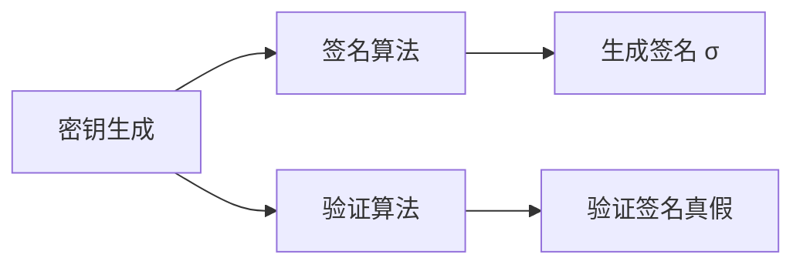

# 数字签名的设计要求、满足的条件、方案描述及与消息认证的不同

## 数字签名的设计要求

先想一个问题：手写签名的作用是什么？无非是让文件上的签名**只有本人能做出来**，而**别人都能验证**。数字签名要在电子世界里复现这两个性质。

数字签名必须满足以下条件：

| 要求 | 含义 |
|------|------|
| 不可伪造性 | 除了签名者本人，任何人都不能产生该签名 |
| 可验证性 | 任何人都能验证签名是否有效 |
| 不可否认性 | 签名者事后不能抵赖自己签过名 |
| 消息完整性 | 签名与消息绑定，消息被篡改后签名失效 |

> [!IMPORTANT]
> ==数字签名的核心功能是实现不可否认性（抗依赖性）==，这是加密和消息认证码（MAC）都做不到的。

## 数字签名的方案描述

一个数字签名方案由三个算法构成：

- **密钥生成**：签名者生成自己的公私钥对 $(PK_A, SK_A)$，公开 $PK_A$，私藏 $SK_A$。
- **签名算法**：用==自己的私钥== $SK_A$ 对消息 $m$ 计算签名 $\sigma = \text{Sign}_{SK_A}(m)$。
- **验证算法**：验证者用签名者的==公钥== $PK_A$ 验证 $\text{Verify}_{PK_A}(m, \sigma)$ 是否为真。

> [!TIP]
> 记忆口诀：**“签名用私钥，验证用公钥；加密刚好反过来。”**

以 RSA 签名为例：签名时计算 $\sigma = H(m)^d \bmod n$（$d$ 是 A 的私钥），验证时检查 $\sigma^e \bmod n = H(m)$（$e$ 是 A 的公钥）。

## 数字签名与消息认证的区别

| 对比项 | 消息认证（MAC） | 数字签名 |
|--------|----------------|----------|
| 密钥类型 | 对称密钥（双方共享） | 签名用私钥、验证用公钥 |
| 能否让第三方验证 | 不能 | 能 |
| 能否实现不可否认性 | 不能 | ==能== |
| 效率 | 快 | 慢 |

**为什么 MAC 不能不可否认？** 因为通信双方共享同一把钥匙，任何一方都能生成同样的 MAC 值，事后无法向第三方证明“这一定是对方发的”。而数字签名只有签名者持有私钥，任何人只要有公钥就能独立验证，所以签名者赖不掉。

## 常见的坑

> [!WARNING]
> **加密与签名的密钥方向极易混淆。** 若 A 想给 B 发机密邮件，加密时用 ==B 的公钥==；若 A 想让 B 确信邮件是 A 发的，则签名时用 ==A 的私钥==。判断题考的就是这个区分。

> [!CAUTION]
> **“数字签名算法必须加密强度高”是错误说法。** 签名与加密是两种独立的密码学任务，安全强度之间没有必然的依赖关系。McEliece 体制本身不便于构造数字签名，但其变体可以，判断题说的是“适用”，不矛盾。

> [!NOTE]
> **数字签名也可用于身份认证。** 验证者要求对方对随机挑战值签名，能正确签名就证明对方持有私钥，从而确认身份。

**算一个例子**：设 RSA 签名方案中 $n = 15$（$p=3, q=5$），$e = 3$，$d = 3$。A 想对消息 $m = 2$ 签名。签名：$\sigma = 2^3 \bmod 15 = 8$。B 收到 $(m=2, \sigma=8)$ 后验证：$8^3 \bmod 15 = 512 \bmod 15 = 2$，等于 $m$，签名有效。

数字签名就是密码学里的“手写签名”——它不保密，但能让发件人无法赖账，让收件人无从伪造。
