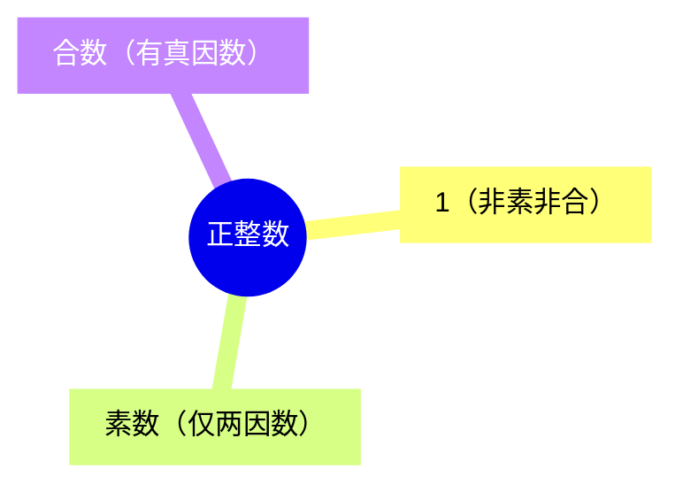

# 因数、倍数、素数和合数的基本概念

在密码学中，RSA 等算法的安全性建立在“大整数难以分解”这一事实上。要理解它，必须先回到最基础的积木块：因数、倍数、素数与合数。

## 因数与倍数

> [!IMPORTANT]
> 设 $a, b$ 为整数，$b \neq 0$。若存在整数 $m$ 使得 $a = mb$，则称 ==$b$ 是 $a$ 的因数==（$b$ 整除 $a$），记为 $b \mid a$；此时 $a$ 是 $b$ 的倍数。

如果 $a=mb$，且 $b$ 既不等于 $a$ 也不等于 $1$，那么 $b$ 称为 $a$ 的**真因数**。例如 $12 = 3 \times 4$，其中 $3$ 和 $4$ 都是 $12$ 的真因数。

想一想：如果把正整数按“能怎么被整除”来分类，会分成哪几类？

## 素数与合数

根据定义 2.1，一个大于 $1$ 且只能被 $1$ 和它本身整除的整数，称为**素数**（常用 $p$ 表示）；否则称为**合数**。由此，正整数集合被严格分为三类：==素数、合数和 $1$==。注意，$1$ 既不是素数也不是合数。

若正整数 $a$ 有一个因数 $b$，且 $b$ 本身是素数，则称 $b$ 为 $a$ 的**素因数**。如 $12 = 3 \times 4$ 中，$3$ 是素因数，而 $4$ 不是。

| 概念 | 核心特征 | 举例 |
| :--- | :--- | :--- |
| **素数** | 大于 $1$，只有 $1$ 和自身两个因数 | $2, 3, 79$ |
| **合数** | 大于 $1$，存在真因数 | $4, 12, 300$ |
| **$1$** | 只有一个因数，自成一类 | $1$ |

### 判定技巧

定理 2.1 指出，大于 $1$ 的整数 $a$ 的大于 $1$ 的最小因数一定是素数。定理 2.2 进一步给出了实用的素性检验依据：==正整数 $n$ 是素数当且仅当它不能被任何满足 $1 < d \le n^{1/2}$ 的整数 $d$ 整除==。

> [!TIP]
> 判断 $79$ 是否为素数：只需检查 $\le \sqrt{79} \approx 8.8$ 的素数（即 $2, 3, 5, 7$）。$79$ 均不能被它们整除，故 $79$ 是素数。这就是考题中“素性检验”的基本原理。

## 最大公因数

设 $m, n, d$ 为正整数，若 $d \mid m$ 且 $d \mid n$，则 $d$ 是 $m, n$ 的**公因数**。其中最大的那个，记为 $\gcd(m, n)$ 或 $(m, n)$。

> [!NOTE]
> 若 $(a,b)=d$，则 $(a/d,\; b/d)=1$。证明思路：设 $c=(a/d, b/d)$，由整除性质推导出 $cd \le d$，因 $d \ge 1$，故 $c \le 1$，从而 $c=1$。这说明提取最大公因数后，剩下的部分必然互素。

计算 $\gcd$ 常依赖带余除法：若 $a = bq + r$，则 $d \mid a$ 且 $d \mid b \iff d \mid b$ 且 $d \mid r$。

> [!WARNING]
> 不要把“因数”和“素因数”混淆！求欧拉函数 $\varphi(n)$ 时，必须将 $n$ 分解为**素因数**的幂次乘积。例如课件订正题：$\varphi(300) = \varphi(2^2 \times 3 \times 5^2)$，而不是用合数因子去套公式。

这些基础概念直接支撑后续定理：Fermat 定理要求模数 $p$ 必须是素数；ElGamal 加密中需要选取大素数 $p$ 及生成元 $g$；而平方剩余的定义也明确限定了 $p$ 是素数。可以说，没有素数，就没有现代公钥密码学。
