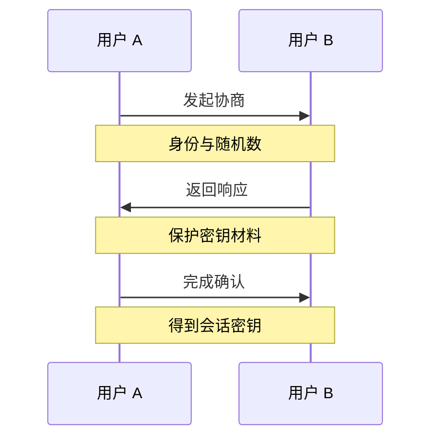

# 无中心的密钥分配与端—端密钥协商协议

## 它是什么

==无中心的密钥分配==是指不依赖可信第三方（KDC），由通信双方 A、B 直接协商建立会话密钥 $K_s$ 的方式。它属于**密钥管理**中的“分配”环节；密钥管理还包括密钥的产生、存储、更新和销毁等问题。

端—端密钥协商协议的目标是：让通信两端得到相同、保密的会话密钥，并尽量确认对方身份及密钥的新鲜性。会话密钥通常只保护本次通信，长期密钥则用于认证或保护协商过程。

## 为什么需要

有中心的密钥分配中，用户通过 KDC 获得会话密钥，适合用户多、统一管理的网络，但 KDC 可能成为性能瓶颈或单点故障。无中心方案不必为每次通信访问 KDC，适合双方已具备安全协商条件的场景。

不过，“无中心”不等于“无前提”：双方仍需可信的长期密钥、公钥证书或其他初始安全信息，否则无法可靠识别对方。

## 怎么做

课件将 A、B 建立会话密钥概括为以下三步：

1. **A 发起请求**：A 向 B 表明建立会话的意图，并发送协议所需的身份、随机数等信息。
2. **B 响应并协商**：B 根据双方已有的长期密钥或公钥信息处理请求，返回受保护的响应及密钥协商材料。
3. **双方形成会话密钥**：A、B 根据协商结果得到相同的 $K_s$，必要时通过确认消息验证对方确实掌握该密钥，随后用 $K_s$ 保护端—端数据。

> [!IMPORTANT]
> 三步的核心不是“发三条普通消息”，而是==利用已有安全基础，协商出双方共享且新鲜的会话密钥==。具体报文字段应以课件图示为准，答题时先写清“发起—响应—建立”的完整过程。

## 一个正确的例子

设 A、B 已安全共享长期密钥 $K_{AB}$，A 产生随机会话密钥 $K_s$ 和随机数 $N_A$。A 先向 B 发起协商；B 响应后，A 用长期密钥保护 $K_s$ 并发送给 B，同时携带与本次会话绑定的随机数信息。B 解密并校验后得到同一个 $K_s$，再返回基于 $K_s$ 的确认。双方确认成功后，使用 $K_s$ 加密本次通信。

这里长期密钥 $K_{AB}$ 用于保护协商，$K_s$ 用于保护业务数据；随机数用于区分不同会话，降低旧报文重放的风险。

## 与相近概念的区别

| 对比项 | 无中心密钥分配 | 有中心密钥分配 |
|---|---|---|
| 是否依赖 KDC | 不依赖 KDC 逐次分配 | 通常由 KDC 参与 |
| 协商主体 | A、B 两端 | 用户与 KDC 等参与方 |
| 初始信任基础 | 长期密钥、证书等 | 用户与 KDC 的共享秘密等 |
| 主要特点 | 减少中心瓶颈 | 便于统一管理 |
| 主要风险 | 初始信任建立较复杂 | 中心故障或受攻击影响较大 |

> [!NOTE]
> “端—端”强调密钥最终由通信两端使用，并不自动保证协议安全；还必须考虑身份认证、密钥新鲜性和报文完整性。

## 常见的坑

> [!WARNING]
> 不要把无中心分配写成“A 直接用明文把 $K_s$ 发给 B”，也不要把长期密钥当作会话密钥长期使用。只完成密钥交换而没有认证，可能遭受中间人攻击；没有随机数、时间戳或序号等新鲜性机制，则可能遭受重放攻击。

> [!TIP]
> 名词解释先答“密钥的产生、分配、存储、销毁等问题”；协议题则抓住“无 KDC、双方已有信任基础、三步协商、得到新鲜 $K_s$”四个关键词。
