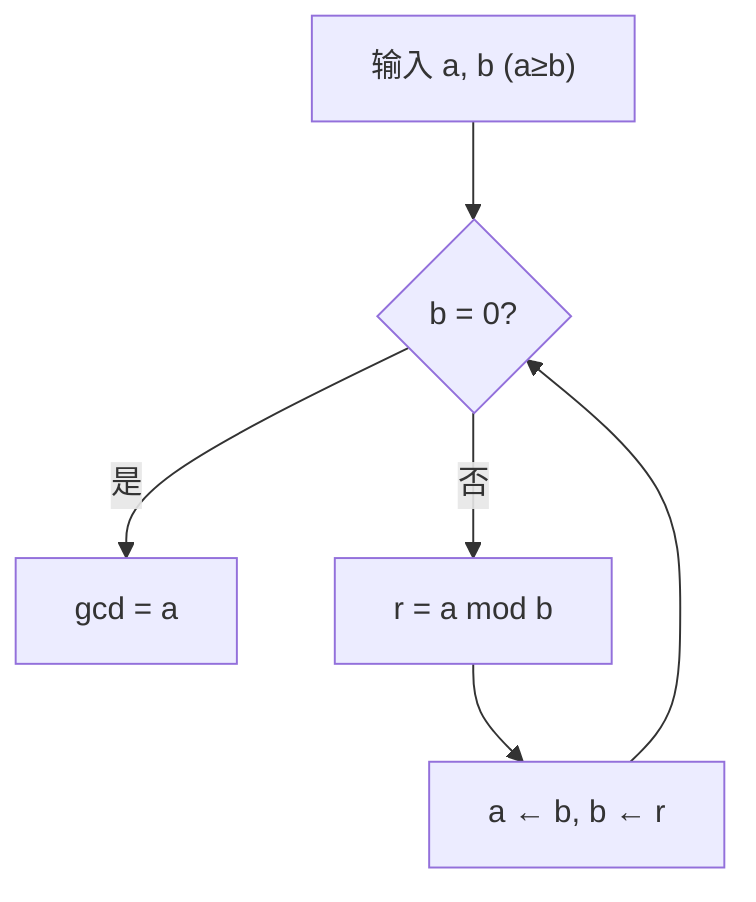

# 最大公因数(gcd)的概念及欧几里德算法求最大公约数

## 什么是最大公因数

给定两个正整数 $m$ 和 $n$，如果 $d \mid m$ 且 $d \mid n$，那么 $d$ 就是 $m$ 和 $n$ 的公因数（公约数）。在所有公因数中最大的那个，就叫做 $m$ 和 $n$ 的**最大公因数**，记作 $\gcd(m,n)$。

比如 $\gcd(24,36)=12$，$\gcd(24,25)=1$。特别地，如果 $\gcd(a,n)=1$，我们说 $a$ 与 $n$ ==互素==。这在密码学里非常关键——RSA 里要选 $e$ 满足 $\gcd(e,\varphi(n))=1$，模逆元存在的充要条件也是互素。

## 为什么需要欧几里得算法

试除法找公因数，数字一大就傻眼。那能不能把大问题化小？

观察一个事实：如果 $a = bq + r$，那么 $a$ 和 $b$ 的公因数，恰好也是 $b$ 和 $r$ 的公因数。为什么？因为 $d \mid a$ 且 $d \mid b$ 时，$d$ 必整除 $r = a - bq$；反过来也一样。

于是得到一个让数字"自动变小"的递推式：

> [!IMPORTANT]
> $$\gcd(a,b) = \gcd(b, a \bmod b)$$
> 反复使用，直到余数为 $0$，此时的除数就是最大公因数。

这就是**欧几里得算法**（辗转相除法）的核心思想。

## 算法流程

每一步都把"被除数、除数"替换成"除数、余数"，问题规模单调递减，必然在有限步内收敛到余数为 $0$。

## 算一遍：gcd(44, 32)

$$\gcd(44,32) = \gcd(32,12) = \gcd(12,8) = \gcd(8,4) = \gcd(4,0) = \boxed{4}$$

课件里写成了链式：$\gcd(44,32)=\gcd(44\bmod 32, 32)=\gcd(12,32)=\cdots$，注意这和 $\gcd(b, a\bmod b)$ 是同一回事，只是参数顺序写法不同，别被绕晕。

> [!TIP]
> 验证小技巧：算出 $d$ 后，检查 $d$ 确实整除原来的两个数。$4 \mid 44$，$4 \mid 32$，✓。

## 欧几里得 vs 扩展欧几里得

| | 欧几里得算法 | 扩展欧几里得算法 |
|---|---|---|
| 求什么 | $\gcd(a,b)$ | $\gcd(a,b)$ 及 $x,y$ 使 $ax+by=\gcd$ |
| 何时用 | 判断互素、求最大公因数 | 求模逆元 $a^{-1} \bmod n$ |
| 密码学场景 | RSA 验证 $\gcd(e,\varphi(n))=1$ | 求 RSA 私钥 $d = e^{-1} \bmod \varphi(n)$ |

> [!WARNING]
> 当 $\gcd(a,n) \neq 1$ 时，$a$ 关于模 $n$ 的乘法逆元**不存在**，此时扩展欧几里得算法算出的 Bézout 系数不构成逆元。例如 $2$ 在模 $4$ 下没有逆元——$2x \equiv 1 \pmod 4$ 无解。

> [!NOTE]
> 欧几里得算法的正确性依赖于辗转相除的等式，而扩展版在此基础上"回代"出系数。考试若考"简述 Euclid 算法的思想"，答那句核心公式 $\gcd(a,b)=\gcd(b,a\bmod b)$ 即可。

最大公因数本身只是工具，但它判定的"互素"关系贯穿整个公钥密码学——Euler 定理、Fermat 定理、RSA、模逆元，全都要先过这一关。
