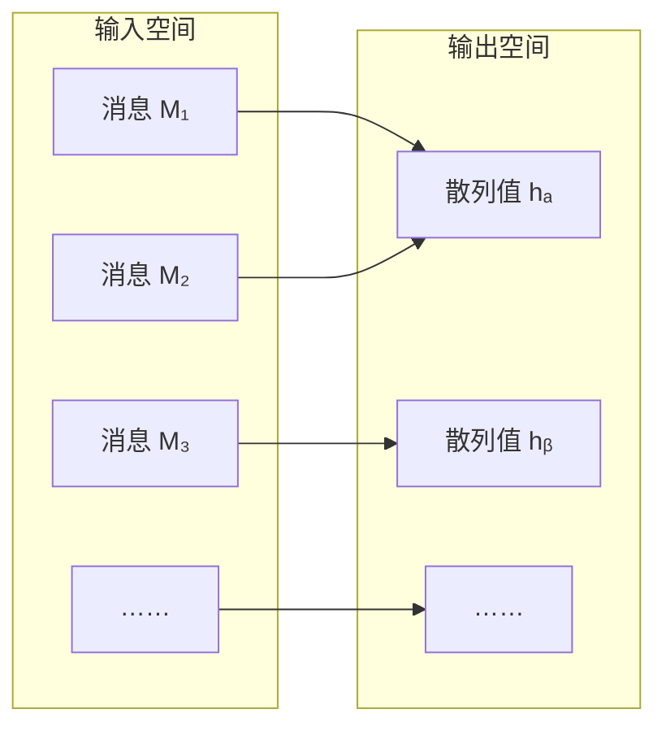
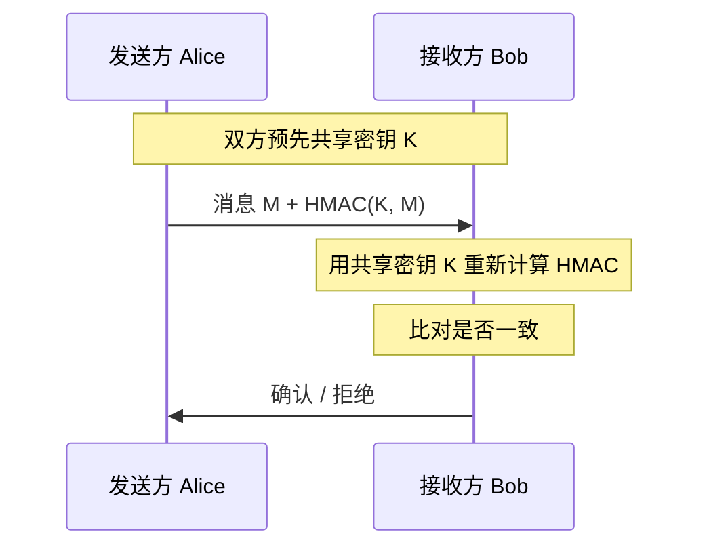

# Hash函数的定义、单向性、多对一映射及无碰撞性等性质与应用

## Hash 函数的定义

Hash 函数（散列函数 / 杂凑函数）在密码学中是一个将**任意长度**的消息映射为**固定长度**输出的函数。记作：

$$h = H(M)$$

其中 $M$ 是任意长的输入消息，$h$ 是固定长度的输出，称为散列值、消息摘要或数字指纹。

> [!IMPORTANT]
> 密码学 Hash 函数是一种将 **任意长度** 的消息压缩为 **某一固定长度** 的消息摘要的函数。

这和一个普通压缩函数有什么区别？关键在下面几个安全性要求。

---

## 三个核心安全性质

Hash 函数要安全，必须同时满足三个性质。缺了哪一个，它在密码学里就用不了。

### 单向性（Preimage Resistance）

==已知 $h$，求满足 $H(x)=h$ 的 $x$ 在计算上不可行。==

也就是说，从散列值倒推原消息是"算不出来的"。注意不是"理论上不存在逆"，而是“计算量太大，不可能在有效时间内完成”。

**为什么需要它？** 设想一个认证场景：用户把秘密值 $S$ 和消息 $M$ 拼起来做散列 $C=H(S \parallel M)$。如果 Hash 函数没有单向性，攻击者截获 $M$ 和 $C$ 后，就能反推出 $S \parallel M$，从而得到秘密值 $S$。整个认证体系就崩溃了。

### 弱无碰撞性（Second Preimage Resistance）

给定消息 $M$，要找到另一个 $M' \neq M$ 使得 $H(M')=H(M)$，在计算上不可行。

也就是：==给定输入，找不到另一个输入产生相同的散列值==。

### 强无碰撞性（Collision Resistance）

要找到**任意两个不同**消息 $M$ 和 $M'$ 使得 $H(M)=H(M')$，在计算上不可行。

> [!WARNING]
> 两种无碰撞性容易混淆，考察方式很直接：
> - **弱无碰撞**：先给定一个 $M$，让你找另一个碰撞。
> - **强无碰撞**：没有指定 $M$，让你随便找两个碰撞即可。
> 
> 强碰撞比弱碰撞要求更严。凡是能做到强无碰撞的，一定也满足弱无碰撞。考题中常会出一个判断题：“寻找两个不同消息 $x,x'$ 使 $H(x)=H(x')$ 不可行称为随机碰撞”——这是错的，应叫**无碰撞性**。

---

## 多对一映射的必然性

输入空间无限大（任意长度），输出空间有限（160bit 或 256bit 等固定长度）。根据鸽巢原理，必然存在大量不同消息映射到同一个散列值。

==碰撞客观存在，安全性要求的是"你找不到它们"==。这和普通校验函数有本质区别——CRC 也有碰撞，但攻击者可以很轻松地构造出来。

---

## 主要应用

### 数字签名

对长消息直接签名效率很低。实际做法是**先算 Hash，再对摘要签名**。由于单向性和无碰撞性，攻击者无法伪造另一个消息让摘要相同，签名就间接保护了整个消息。

### 消息认证码 — HMAC

HMAC 的核心思想：==把散列函数嵌入到消息认证码的构造中==。

基本结构：

$$\text{HMAC} = H\big(K \oplus \text{opad} \;\|\; H(K \oplus \text{ipad} \;\|\; M)\big)$$

> [!NOTE]
> 实际应用中，密钥与消息的组合方式不一定是 $h(m \parallel k)$，不同实现有不同的拼接策略。HMAC 是一种标准化的安全构造（RFC 2104），在 IPSec、SSL 等协议中大量使用。

HMAC 的使用流程：

### 完整性检测

Hash 函数可以用于完整性检测——文件传输前后计算散列值做对比。这和 CRC 的区别在于：CRC 只防信道偶然差错；==密码学 Hash 能防人为篡改==，因为攻击者无法在修改数据的同时保持散列值不变。

> [!CAUTION]
> 考题中可能会出现“Hash 函数不可以用于完整性检测”这种说法——应判为**错误**。它可以用于完整性检测，只是不能像 MAC 那样提供身份认证。

---

## 常见标准

| 代际 | 代表算法 | 输出长度 |
|------|---------|---------|
| 第一代 | MD5（RFC 标准）、SHA-1、RIPEMD-160 | 128bit / 160bit |
| 第二代 | SHA-2 系列、Whirlpool | 256bit / 512bit |

> [!TIP]
> 记住这个分类：**第一代** = SHA-1 / RIPEMD-160 / MD5；**第二代** = SHA-2 / Whirlpool。考试填空题常直接考这个归属关系。

SHA-1 早在 1994 年便为美国政府采纳，至今仍是许多系统的核心组件。但随着碰撞攻击的出现，目前已经**不推荐在新系统中使用 SHA-1**，逐步向 SHA-2、SHA-3 迁移。

---

## 一个算对了的例子

假设消息 $M = \text{"hello"}$，使用 SHA-1：

- 散列值（十六进制）：`aaf4c61ddcc5e8a2dabede0f3b482cd9aea9434d`
- 输出长度：160bit = 20 字节

如果你把 $M$ 改成 `"Hello"`（首字母大写），SHA-1 输出会变成完全不同的值。这种"输入扰动一点、输出雪崩式变化"的特性，称为**雪崩效应**，也是 Hash 函数设计中的重要指标。

再比如考题中提到的 Two-Track-MAC 算法基于带密钥的 RIPEMD-160，它的**密钥和输出 MAC 值都是 20 字节**——这正是 RIPEMD-160 的 160bit = 20 字节输出长度决定的。理解了输出长度，这类数量关系题就很容易应对。
