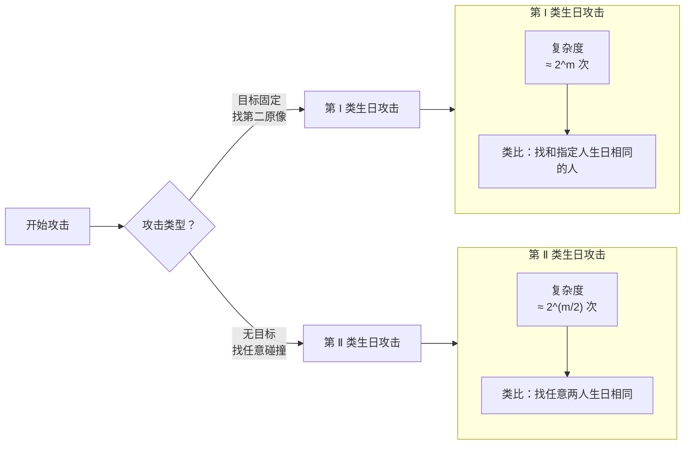

# 单向杂凑函数的安全性要求及生日攻击原理

好的，我们开始。

---

## 单向杂凑函数的安全性要求

要理解杂凑函数为何需要层层设防，可以先把自己放在攻击者的角度思考：假如我想攻破一个 Hash 函数，究竟能怎么攻击？

常见攻击目标有三种难度递增的“找茬”方式：

1.  **原像攻击（求逆）**：给定一个哈希值 $h$，试图找出一条消息 $x$，使得 $H(x) = h$。
2.  **第二原像攻击（碰瓷）**：给定一条消息 $x$，试图找出另一条消息 $y \neq x$，使得 $H(y) = H(x)$。
3.  **碰撞攻击（约架）**：随便找出任意两条不同的消息 $x$ 和 $y$，使得 $H(x) = H(y)$。

对应这三种攻击难度，Hash 函数必须满足三条核心安全性要求，三者层层递进，是考试区分辨析的重点。

### 三条核心安全性要求

我们用标准术语和一道典型的判断题来记住它们：

> [!IMPORTANT]
> **三条安全性要求的定义与判正**
>
> *   **单向性**：已知 $h$，求使得 $H(x) = h$ 的 $x$ 在计算上不可行。抵抗的是==原像攻击==。
> *   **弱抗碰撞性**：已知 $x$，找出 $y (y \neq x)$ 使得 $H(y) = H(x)$ 在计算上不可行。抵抗的是==第二原像攻击==。
> *   **强抗碰撞性**：找出任意两个不同的 $x$、$y$，使得 $H(x) = H(y)$ 在计算上不可行。抵抗的是==碰撞攻击==。

**易错点辨析**

题目里经常混用“无碰撞性”来挖坑：
*   **判断题11**：题干描述“寻找两个不同消息产生相同输出在计算上不可行”，但结论说这是“随机碰撞的”。错误，应订正为：==**无碰撞性**==。
*   **判断题37**：把同一描述说成是“弱无碰撞”。错误，订正为：==**强无碰撞性**==。

**一个核心坑点**：说“找个不同的 $y$ 产生相同输出”时，必须先看清楚题干有没有给定“已知 $x$”这个前提——
*   有前提“已知 $x$” → **弱抗碰撞性（第二原像）**。
*   没有前提，随便找两个就行的 → **强抗碰撞性（碰撞）**。

---

## 生日攻击原理

为什么强抗碰撞的难度比弱抗碰撞低得多？答案藏在概率论里的**生日悖论**中。

### 生日问题回顾

> **问题**：一个班上至少有多少人，才能使“至少有两人生日相同”的概率大于 50%？
> *   直觉答案：183 人（365/2）。
> *   真实答案：仅需 ==**23 人**==。

二者的数量级完全不同。这个巨大的差异来自“两两比较”的组合爆炸——当人数为 $k$ 时，不同的“人对”有 $C(k,2)$ 个，增长速度远超过 $k$。

### 第Ⅱ类生日攻击

把生日问题的逻辑套用在 Hash 上，就形成了**第Ⅱ类生日攻击**：不给定目标哈希值，而是随机选择输入，力求找到**任何**一对碰撞。

假设 Hash 的输出长度为 $m$ 比特，那么可能的输出共有 $2^m$ 个，类比为“一年有 $2^m$ 天”。我们要找的 $k$，就是那个“只要这么多人，就有超过一半概率出现重复生日”的临界值。

根据概率推导，忽略低阶项后，临界值近似为：

$$ k \approx \sqrt{2 \times 2^m \times \ln 2} \approx 2^{m/2} $$

> [!IMPORTANT]
> **第Ⅱ类生日攻击复杂度总结**
>
> 对输出长度为 $m$ 比特的强抗碰撞 Hash 函数，其安全强度本质上只有 **$m/2$ 比特**。无论算法多么精妙，攻击者平均只需尝试 $O(2^{m/2})$ 次就能大概率找到一对碰撞。
>
> 这也是设计 Hash 函数时必须让输出足够长（如 SHA-256）的根本原因之一。

### 第 I 类生日攻击

这是对**弱抗碰撞性**（第二原像）的攻击。已知消息 $x$，想找到 $y \neq x$ 满足 $H(y) = H(x)$，相当于“在一个班上找到一个人，他的生日和**指定的某一天**（比如 1 月 1 日）相同”。

### 算对一次：一个例题

> **题**：设某 Hash 函数输出为 64 比特。若你想发起一次第Ⅱ类生日攻击，大约需尝试多少次，就有 50% 以上的概率找到一对碰撞？

**解**：
输出长度 $m = 64$，可能的输出总数 $N = 2^{64}$。
临界值 $k$ 按公式计算：

$$
k \approx 2^{m/2} = 2^{64/2} = 2^{32} \approx 4.29 \times 10^9
$$

**答案**：大约需要尝试 $2^{32}$ 次。可以看到，64 比特输出听起来很大，但在生日攻击下，安全强度仅相当于 32 比特的对称密钥级别。

> [!WARNING]
> **常见误区**
> 直接把 $k = 2^{62}$ 这类错误答案写在卷子上。第Ⅱ类生日攻击的复杂度是 $2^{m/2}$，不是 $2^m$ 除以什么别的数。忘记开根号就是掉坑。
