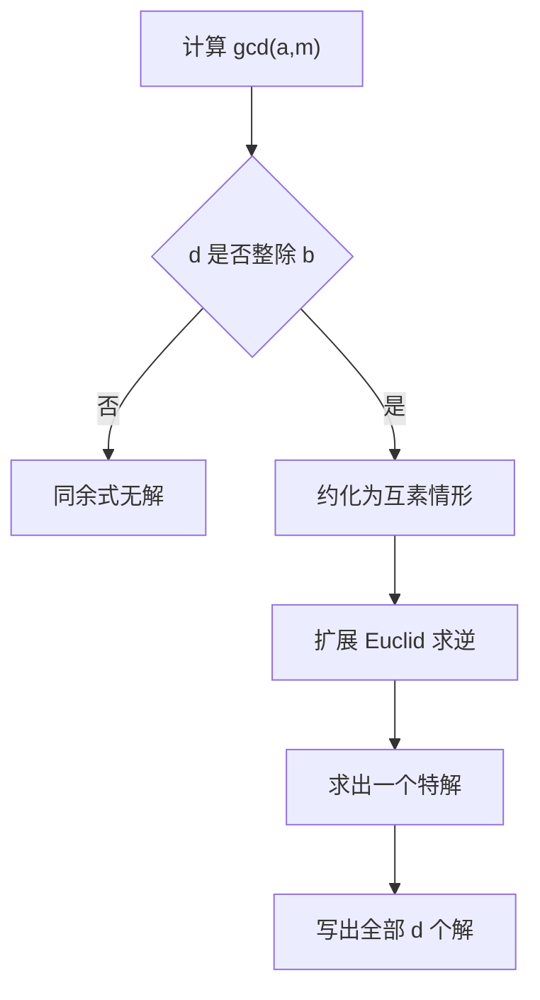

# 模运算的定义、一次同余式及其求解方法

## 模运算：把整数分成剩余类

给定正整数 $m$，若 $a-b$ 能被 $m$ 整除，则称 $a$ 与 $b$ 模 $m$ 同余，记作

$$a\equiv b\pmod m\iff m\mid(a-b).$$

等价地，$a=b+km$。除以 $m$ 所得余数取在 $0\sim m-1$ 时，称为最小非负剩余。模 $m$ 的全体整数被分成 $m$ 个剩余类，通常用集合

$$\mathbb Z_m=\{0,1,\ldots,m-1\}$$

表示。同余式可以像普通等式一样进行加、减、乘运算：若 $a\equiv b\pmod m$、$c\equiv d\pmod m$，则 $a+c\equiv b+d\pmod m$，且 $ac\equiv bd\pmod m$。

> [!IMPORTANT]
> 模运算研究的是==余数之间的关系==，不是把 $a\bmod m$ 当作普通除法。密码算法中的大量计算都在有限集合 $\mathbb Z_m$ 或有限域 $GF(p^n)$ 中进行。

## 一次同余式及其求解

一次同余式的一般形式为

$$ax\equiv b\pmod m.$$

设 $d=\gcd(a,m)$。它有解的充要条件是 $d\mid b$；有解时，在模 $m$ 意义下恰有 $d$ 个不同解。特别地，当 $\gcd(a,m)=1$ 时，$a$ 存在模 $m$ 的逆元 $a^{-1}$，于是解唯一：

$$x\equiv a^{-1}b\pmod m.$$

求逆元通常使用扩展 Euclid 算法。其基础是

$$\gcd(a,m)=\gcd(m,a\bmod m),$$

并回代得到整数 $s,t$，使 $as+mt=\gcd(a,m)$。若 $\gcd(a,m)=1$，则 $as\equiv1\pmod m$，所以 $a^{-1}\equiv s\pmod m$。

> [!WARNING]
> ==同余式不能随意约分==。由 $ac\equiv bc\pmod m$ 一般只能推出
> $$a\equiv b\pmod{m/\gcd(c,m)}.$$
> 只有 $\gcd(c,m)=1$ 时，才能直接消去 $c$ 而保持模数 $m$ 不变。

## 与相近概念的区别

| 概念 | 核心含义 | 与一次同余式的关系 |
|---|---|---|
| 模逆元 | 满足 $aa^{-1}\equiv1\pmod m$ | $\gcd(a,m)=1$ 时才存在 |
| Fermat 定理 | $p$ 为素数且 $\gcd(a,p)=1$ 时，$a^{p-1}\equiv1\pmod p$ | 可用 $a^{-1}\equiv a^{p-2}\pmod p$ 求逆 |
| 中国剩余定理 | 模数两两互素时，联立多个同余式 | 一次同余式组的求解工具 |
| 平方剩余 | 存在 $x$ 使 $x^2\equiv a\pmod p$ | 属于二次同余问题，不能套用一次同余式求逆 |

## 算例：求 $3x\equiv5\pmod{11}$

因为 $\gcd(3,11)=1$，解唯一。由扩展 Euclid 算法或直接观察得

$$3\times4=12\equiv1\pmod{11},$$

故 $3^{-1}\equiv4\pmod{11}$。两边乘以 $4$：

$$x\equiv4\times5=20\equiv9\pmod{11}.$$

检验：$3\times9=27\equiv5\pmod{11}$，所以答案为 $x=9+11k,\ k\in\mathbb Z$。

> [!TIP]
> 解题按“先判 $\gcd$、再求逆、最后检验”进行。若遇到“除以 $5,7,11$ 的余数分别为 $4,6,9$”，则列成 $x\equiv4\pmod5$、$x\equiv6\pmod7$、$x\equiv9\pmod{11}$，再用中国剩余定理求解，而不是分别求逆后相加。
