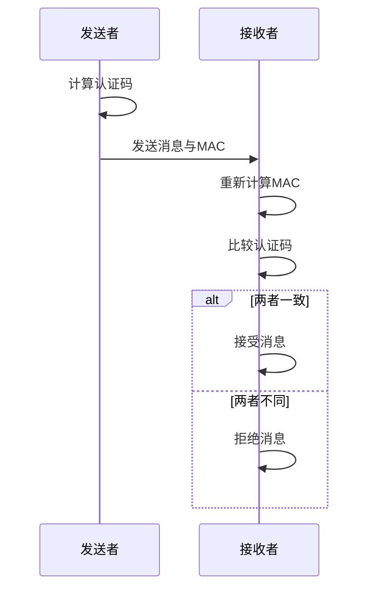

# 消息认证的目的、基于加密技术的消息认证与基于散列函数的消息认证

## 消息认证的目的

消息认证要解决的不是“消息有没有被别人看懂”，而是“收到的消息能不能相信”。其核心目标是让接收者能够验证：

- **真实性**：消息确实来自声称的发送者，入侵者不能用假消息冒充合法消息；
- **完整性**：消息在传输或存储过程中没有被篡改、插入、删除或替换。

因此，“数据认证算法的功能是实现数据的完整性，即消息的真实性”强调的是认证结果；而“检测密文是否被篡改”只是完整性保护在密文场景中的一种表现，不能把它扩大成身份认证或保密。

> [!IMPORTANT]
> ==消息认证主要保护真实性与完整性，不天然提供保密性。==

## 基于加密技术的消息认证

从消息认证的目的看，无论对称密码体制还是公钥密码体制，对消息本身加密都可以看作一种认证手段：接收者用相应密钥解密后，根据消息是否具有合法格式、冗余或约定内容，判断其是否可信。

| 方式 | 基本过程 | 能说明什么 | 主要局限 |
|---|---|---|---|
| 对称加密 | 双方共享密钥，发送者加密，接收者解密检验 | 在密钥仅双方掌握等前提下，可提供来源依据 | 不必然能检测所有篡改，密文变化可能仍解出无意义内容 |
| 公钥加密 | 常用接收者公钥加密、接收者私钥解密 | 主要保证只有接收者能解密 | 任何人都能用公钥加密，不能据此确认发送者 |
| 数字签名 | 发送者用私钥签名，接收者用公钥验证 | 可认证来源和完整性，并支持不可否认 | 与“用公钥加密整个消息”不是一回事 |

> [!WARNING]
> “加密了就一定完整、一定知道是谁发的”是常见误区。公钥加密尤其不能单独证明发送者身份；是否需要保密、认证或签名，应分别判断。

## 基于散列函数的消息认证

散列函数能把任意长度消息压缩成固定长度摘要，但**单纯计算摘要并不等于认证**：攻击者可以同时替换消息和摘要。要让接收者识别伪造，必须把双方共享的密钥引入认证过程。

消息认证码（MAC）是指消息被一个**密钥控制的公开函数**作用后产生的、用作认证符的固定长度数值，也称密码校验和，可写为
$$
\mathrm{MAC}=C_K(M).
$$
发送者发送 $M\parallel \mathrm{MAC}$；接收者用共享密钥重新计算并比较。相同则接受，不同则说明消息或认证码可能被改动。

HMAC 是基于散列函数构造 MAC 的代表，其基本思想是把散列函数嵌入 MAC 的构造过程，而不是简单计算 $H(K\parallel M)$。HMAC 已作为 RFC 2104 公布，并用于 IPSec、SSL 等协议。

> [!TIP]
> 记法：**散列给摘要，密钥参与才成 MAC；MAC 管真实完整，加密才管保密。**

## 一个判断例子

题目：“消息认证算法的功能是接收者能够验证消息在传输过程中是否被修改。”答案为 **√**。

例如双方共享 $K$，接收者收到 $M'\parallel t'$ 后计算 $C_K(M')$。若 $M'$ 被改动而 $t'$ 未相应合法变化，通常有 $C_K(M')\ne t'$，于是拒绝接收。若攻击者不知道 $K$，就难以构造能通过验证的假消息。这里的“伪造”攻击的是**消息的真实性**，不是“身份的真实性”；身份认证是另一类相近但不同的认证目标。
