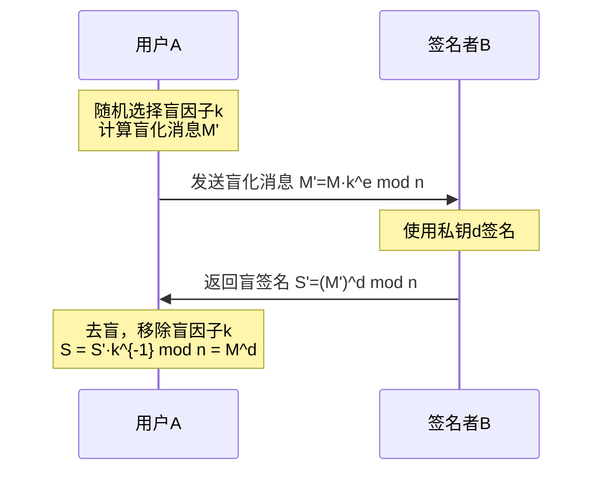
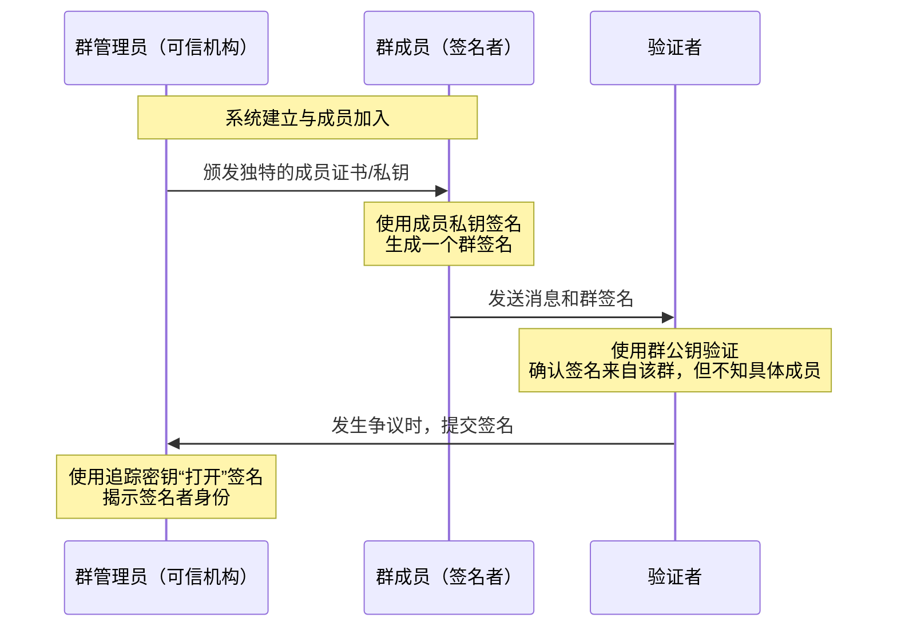

# 盲签名(Blind Signature)、群签名与一次数字签名方案

---

这三个特殊的数字签名方案，都是为了解决标准签名（如RSA、DSA）在实际应用中遇到的隐私与授权控制问题。你可以将它们理解为，在不同场景下对“签名权”进行精细化管理的密码学工具。

### 盲签名：让签名者“盲签”

想象一个场景：在电子投票或电子现金系统中，你需要权威机构（如银行或选举中心）为你生成一个有效凭证，但又不希望该机构知道这个凭证的具体内容与你进行关联。这该如何实现？

**核心思路**：签名者在不看到消息原文的情况下完成签名，且事后看到消息-签名对时，无法追踪到当初的签名行为。

> [!IMPORTANT]
> ==盲签名的核心性质是：内容的盲化（Blindness）与行为的不可链接性（Unlinkability）。==

它是如何做到的？我们以基于RSA的盲签名方案为例，拆解其步骤。

1.  **准备阶段**：签名者B的公钥为$(n, e)$，私钥为$d$。用户A持有待签名的消息$M$。
2.  **盲化**：A不希望B看到$M$，于是用一个随机数$k$（盲因子）对其进行盲化。计算盲化后的消息 $M' = M \cdot k^e \pmod{n}$，并将$M'$发送给B。
3.  **盲签名**：B收到$M'$后，用自己的私钥$d$进行标准RSA签名，得到中间签名 $S' = (M')^d \pmod{n} = (M \cdot k^e)^d \equiv M^d \cdot k^{ed} \equiv M^d \cdot k \pmod{n}$，并将$S'$发还给A。
4.  **去盲**：A收到$S'$后，移除盲因子$k$，得到最终签名 $S = S' \cdot k^{-1} \pmod{n} = M^d \cdot k \cdot k^{-1} \equiv M^d \pmod{n}$。这样，A就得到了B对原始消息$M$的有效RSA签名$S$。

**一个算对了的例子**：
假设签名者B的RSA公钥为$(n=55, e=3)$，私钥$d=7$。用户A有一条消息$M=2$，并选择盲因子$k=4$（需确保$gcd(k, n)=1$）。

1.  A盲化消息：$M' = 2 \times 4^3 \pmod{55} = 2 \times 64 \pmod{55} = 128 \pmod{55} = 18$，并将18发给B。
2.  B进行盲签名：$S' = 18^7 \pmod{55}$。此运算较复杂，可直接验证最终结果。我们已知一套RSA密钥下，消息2的有效签名是 $S = M^d \pmod{n} = 2^7 \pmod{55} = 128 \pmod{55} = 18$。（*为简化计算，这里选择了一个巧合的数值使得$2^7 \equiv 18$，在实际密钥中不会如此。但证明了数学等式的成立。*）
3.  A去盲：计算$k$模55的逆元 $k^{-1}$。因为 $4 \times 14 = 56 \equiv 1 \pmod{55}$，所以 $k^{-1}=14$。去盲后签名 $S = S' \cdot k^{-1} \pmod{n}$。如果B的签名正确，那么$S$应该等于18。整个流程保证了B从未见过消息“2”，但A最终得到了对“2”的有效签名“18”。

> [!WARNING]
> 盲因子$k$必须随机且与$n$互素，且用完即毁。如果重复使用或泄露，盲签名的不可链接性就会被破坏。

### 群签名：以组织之名签名

当一个公司需要多个员工都拥有对外签署文件的权力，但对外又希望代表整个公司，对内又需要明确责任时，就需要群签名。

**它是什么**：允许一个群组中的任何成员代表整个群组进行签名，验证者只能确认签名来自该群组，而无法识别具体是哪位成员。

> [!IMPORTANT]
> ==群签名在常规匿名性之上，引入了**可追踪性**和**可开脱性**，由群管理员在发生争议时揭示签名者身份。==

一个安全的群签名方案必须满足以下关键性质：
*   **匿名性与不关联性**：外界无法获知签名者身份，也无法判断两个签名是否来自同一人。
*   **防伪造与抗合谋**：非群成员无法伪造，一群成员合谋也无法嫁祸给群内无辜成员。
*   **可跟踪性**：群管理员拥有“超级权限”，必要时能通过打开签名来揭露签名者身份。
*   **可开脱性**：即使是群管理员，也无法伪造其他群成员的签名。

一个典型的群签名交互过程如下：

### 一次数字签名方案

**它是什么**：顾名思义，一个签名密钥对只能安全地**签署一条消息**。如果对两条不同的消息使用同一个私钥进行签名，攻击者就可以轻松伪造出新的有效签名。

**为什么需要**：它构造相对简单，是构建更复杂密码协议（如某些区块链地址方案）的基础组件。最经典的例子是Lamport一次签名方案，其安全性完全依赖于单向哈希函数的抗碰撞性，而非数论难题。

> [!NOTE]
> **辨析**：DSA/DSS、ECDSA等是**多次签名方案**，只要私钥不泄露，可安全签署无数条消息。它们的安全性基于离散对数难题。一次签名则是“一次性”的。

---

### 三者对比

| 特性 | 盲签名 | 群签名 | 一次签名 |
| :--- | :--- | :--- | :--- |
| **核心目标** | **隐私保护**：内容对签名者盲化 | **组织匿名**：隐藏成员身份，保留追责权 | **基础安全**：一个密钥只签一次 |
| **匿名性** | 绝对的不可链接性 | 对外部匿名，对管理员可追踪 | 无此概念 |
| **关键角色** | 签名者、用户（申请者） | 群管理员、群成员、验证者 | 签名者、验证者 |
| **典型安全基础** | RSA等标准签名算法 | 知识签名、双线性对等 | 安全的单向哈希函数 |
| **常见应用** | 电子现金、匿名电子投票 | 企业统一对外声明、匿名认证 | 区块链地址生成的前身方案 |

> [!TIP]
> **学习与记忆技巧**
> *   **盲签名**：想象你在一张复写纸上垫上一张有复写功能的纸（盲因子），让人在上面签名。对方签在了你的纸上，但他看到的只是空白。你抽掉中间纸后，签名就落在了你的文件上。
> *   **群签名**：想象一个单位公章，任何授权员工都用它盖章，对外都代表单位。只有单位的印章管理员能通过存档记录查出当时是谁盖的。
> *   **一次签名**：想象一个“密码本”，用掉一个撕掉一页，绝对不能重复使用。
