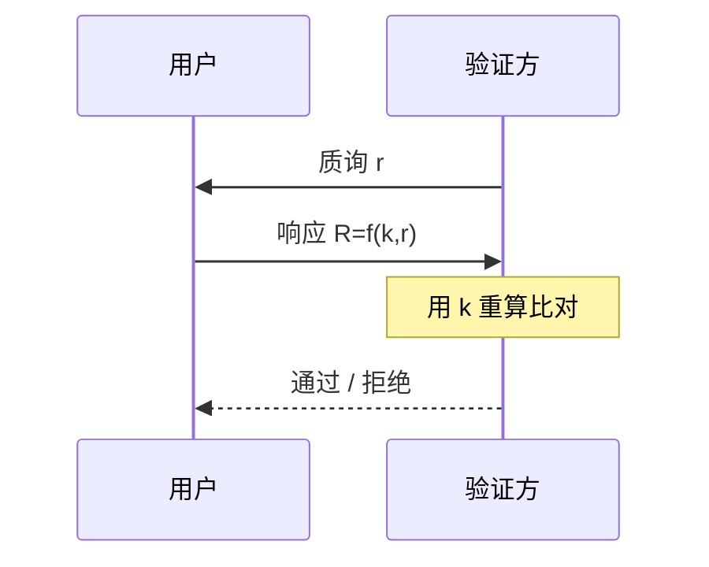
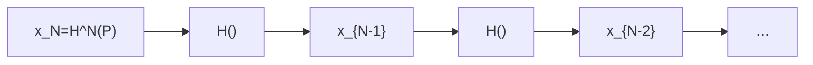
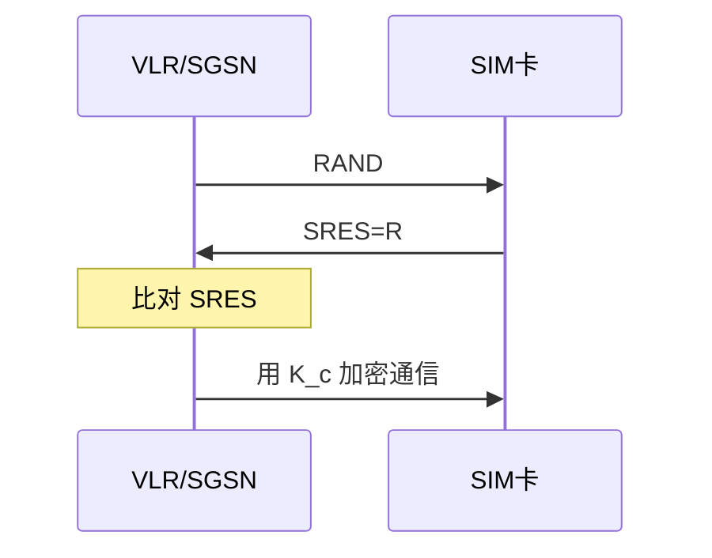

# 基于质询-响应的身份识别方案与S/Key一次性口令身份鉴别方案

## 基于质询-响应的身份识别方案

### 是什么，为什么需要

在纯口令方案里，用户每次提交的 $P$ 都一样，截获一次就能重放。**质询-响应（Challenge-Response）**让验证方每次下发一个随机值 $r$（质询），声称方用 $r$ 和自己的秘密 $k$ 算出响应
$$R = f(k,\,r),$$
验证方用本地保存的 $k$ 重算并比对。由于 $r$ 每次都不同，==$R$ 不能被重放==。

常见实现：$f$ 用分组密码 $E_k(r)$（如 GSM 的 $A3$ 算法）、HMAC 或签名 $Sig_k(r)$。

> [!IMPORTANT]
> 质询-响应的核心是把"传输秘密"改成"用秘密证明自己听过挑战"，==秘密永不离开声称方==。

## S/Key 一次性口令（OTP）

### 思路

质询-响应要求双方共享密钥且都在线计算。**S/Key** 用哈希链实现单向的一次性口令：口令服务器只存种子 $s$，用户端保存
$$x_N = H^N(P),\; H^N(P)=\underbrace{H(H(\cdots H}_{N}(P)\cdots)).$$
第 $i$ 次登录时提交 $x_i=H^{N-i+1}(P)$，服务器算 $H(x_i)$ 与上次保存的值比对，然后把存储更新为 $x_i$，下次要求 $x_{i-1}$。

每次的口令**只用一次**，即使被截获也无法伪造下一次，因为求 $x_{i-1}$ 需要逆 $H$。

> [!NOTE]
> S/Key 是 **"质询=序号 i"** 的特例：质询不再是随机数，而是哈希链上的位置；$f(k,r)=H^{i}(P)$。

### 与相近方案的区别

| 方案 | 质询来源 | 服务器保存 | 是否需在线计算 |
|---|---|---|---|
| 静态口令 | 无 | $P$（或散列） | 否 |
| 质询-响应 | 随机 $r$ | 共享密钥 $k$ | 双方均需 |
| S/Key OTP | 序号 $i$ | 链尾 $H^{i}(P)$ | 仅验证方 |

> [!WARNING]
> 常见坑：① S/Key 的"质询"不是随机数，是链位置，用完即更新；② 链耗尽后需重新初始化；③ 质询 $r$ 必须随机且不重复，否则会被==重放==；④ S/Key 不抗中间人，仍需信道保护。

## GSM/GPRS 认证与密钥交换

GSM 用质询-响应的对称密码版本，只需 2 个式子：

$$R = A3(K_i,\; RAND), \qquad K_c = A8(K_i,\;RAND)$$

其中 $K_i$ 是用户 SIM 卡与认证中心（AuC）共享的**永久密钥**，$RAND$ 由网络侧产生的 128 bit 质询，$R$（SRES，32 bit）为响应，$K_c$ 是本次会话的==加密密钥==。

> [!TIP]
> 记忆：**A3 算响应，A8 生成会话密钥**，输入都是 $(K_i, RAND)$；RAND 由网络给，$K_i$ 永不出 SIM 卡。

> [!CAUTION]
> GSM 只认证用户，不认证网络，且 $A3/A8$ 算法曾被攻破；3G/4G 改用 $f_1\sim f_5$ 完成双向认证。这是常考的"演进对比"点。
