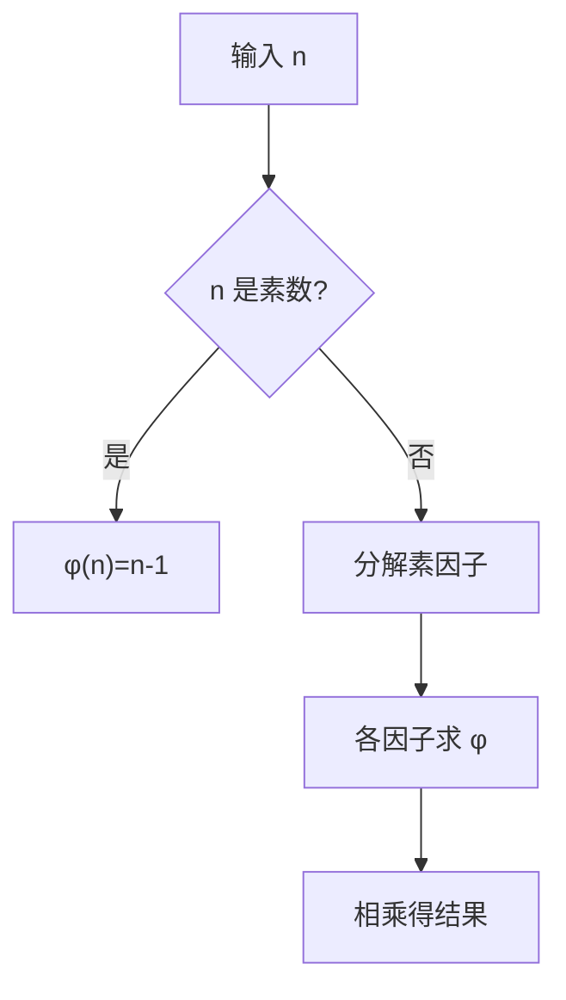

# 费尔玛定理、欧拉函数与欧拉定理

---
requires: [密码学/整除与同余, 密码学/素数]
---

在密码学中，RSA 公钥密码的理论基础正是欧拉定理。要理解它，我们需要先掌握费尔玛定理和欧拉函数。

## 费尔玛定理

如果 $p$ 是素数，且整数 $a$ 不能被 $p$ 整除（即 $\gcd(a,p)=1$），那么：

$$a^{p-1} \equiv 1 \pmod p$$

想一想：为什么这里要求 $p$ 必须是素数？因为素数的性质保证了小于 $p$ 的所有正整数都与 $p$ 互素，从而能构造出完整的乘法群。费尔玛定理是处理==素数模下幂运算化简==的利器。

## 欧拉函数

现实中的密码系统（如 RSA）模数往往是两个大素数的乘积，不再是素数。此时费尔玛定理就不够用了。我们需要一个更通用的工具来衡量“有多少个数可以用来做模逆运算”。

设 $n$ 是一正整数，小于 $n$ 且与 $n$ 互素的正整数的个数称为 $n$ 的欧拉函数，记为 $\varphi(n)$。

> [!IMPORTANT]
> 核心定义：$\varphi(n)$ 就是集合 $\{1, 2, \dots, n-1\}$ 中与 $n$ 互素的元素个数。

### 怎么算？

计算 $\varphi(n)$ 的关键在于**先将 $n$ 分解为素数幂的乘积**，再利用公式：
1. 若 $p$ 为素数，则 $\varphi(p) = p - 1$。
2. 若 $p$ 为素数，则 $\varphi(p^k) = p^k - p^{k-1}$。
3. 若 $\gcd(m, n) = 1$，则 $\varphi(mn) = \varphi(m)\varphi(n)$（积性）。

> [!TIP]
> 解题口诀：**先分解，再套公式，最后相乘**。遇到合数千万别直接硬凑。

### 算对了的例子

以判断题中 $\varphi(400)$ 为例，我们一步步来：

$$400 = 16 \times 25 = 2^4 \times 5^2$$

因为 $\gcd(2^4, 5^2) = 1$，利用积性：

$$\varphi(400) = \varphi(2^4) \times \varphi(5^2)$$

分别代入素数幂公式：

$$\varphi(2^4) = 2^4 - 2^3 = 16 - 8 = 8$$
$$\varphi(5^2) = 5^2 - 5^1 = 25 - 5 = 20$$

最终：$\varphi(400) = 8 \times 20 = ==160==$。

> [!WARNING]
> 常见坑：不要错误地认为 $\varphi(ab) = \varphi(a)\varphi(b)$ 对任意 $a,b$ 都成立！必须满足 $\gcd(a,b)=1$。例如课件中 $\varphi(300)$ 若错拆为 $\varphi(12)\times\varphi(25)$ 虽恰好互素能算，但正确做法应彻底分解为素数幂：$300 = 2^2 \times 3 \times 5^2$，得到 $\varphi(300) = \varphi(2^2)\varphi(3)\varphi(5^2) = 2 \times 2 \times 20 = 80$。

## 欧拉定理

有了欧拉函数，我们将费尔玛定理推广到任意正整数模 $n$：

> [!IMPORTANT]
> 若整数 $a$ 和 $n$ 互素，则 $a^{\varphi(n)} \equiv 1 \pmod n$。

当 $n=p$（素数）时，$\varphi(p)=p-1$，欧拉定理就退化为费尔玛定理。因此，==欧拉定理是费尔玛定理的一般形式==。

| 对比维度 | 费尔玛定理 | 欧拉定理 |
| :--- | :--- | :--- |
| **模数要求** | 必须是素数 $p$ | 任意正整数 $n$ |
| **前提条件** | $\gcd(a,p)=1$ | $\gcd(a,n)=1$ |
| **指数** | $p-1$ | $\varphi(n)$ |
| **密码学应用** | 素域 $GF(p)$ 运算 | RSA 加解密理论基础 |

> [!NOTE]
> 延伸辨析：有限域（伽罗华域）$GF(p^n)$ 中的运算也会频繁用到这些数论基础。RSA 的安全性依赖于大整数的素因子分解的困难性，而其加解密的正确性完全由欧拉定理保证。

> [!CAUTION]
> 高危误区：使用欧拉定理前，务必检查 $\gcd(a,n)=1$ 是否成立！若不互素，该定理失效。
