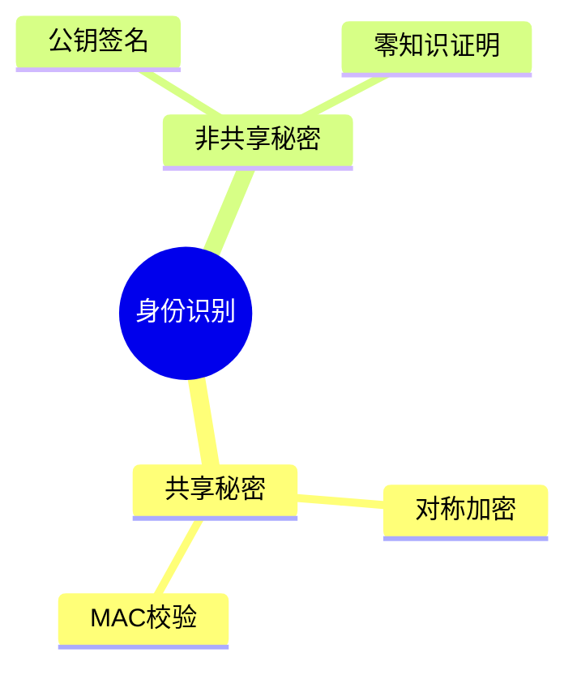

# 身份识别的要素、依据鉴别信息是否共享进行的分类及鉴别方式

# 身份识别的要素、分类及鉴别方式

身份识别（Identity Identification）是密码学与安全协议的基础，旨在确认声称者（Prover）是否为其所声称的身份。在信息系统中，这直接关系到访问控制与责任认定。

## 身份识别的三要素

要完成一次有效的身份识别，必须包含以下三个核心要素：

1.  **声称者（Prover）**：试图证明自己是某人的实体。
2.  **验证者（Verifier）**：负责核实声称者身份的实体。
3.  **鉴别信息（Authentication Information）**：用于证明身份的凭据。

> [!IMPORTANT]
> ==身份认证的核心功能==是验证身份的真实性，确保入侵者不能伪装成他人，同时让接收者能确认消息来源。

## 基于鉴别信息的分类

根据鉴别信息是否由双方共享，身份识别主要分为两类：

| 分类依据 | 类型 | 典型技术 | 特点 |
| :--- | :--- | :--- | :--- |
| **共享秘密** | 对称密钥认证 | 挑战-应答、Kerberos | 双方持有相同密钥 $K$，效率高但需安全分发密钥。 |
| **非共享/公开** | 公钥认证 | RSA、Schnorr、GPS | 基于数学难题，无需共享秘密，支持数字签名。 |

## 鉴别方式与零知识证明

在现代密码学中，**零知识证明（Zero-Knowledge Proof, ZKP）** 是一种高级鉴别方式。它允许声称者在不泄露秘密本身的情况下，向验证者证明自己拥有该秘密。

常见的 ZKP 协议包括 Schnorr 协议及其改进方案 **GPS 协议**（Guillou-Quisquater-Poupard）。

> [!NOTE]
> GPS 算法确实是 Schnorr 方案的改进，主要优化了计算效率和安全性参数。

### 常见误区：抽样 vs 多次验证

在实际应用中，为了防止欺骗者通过猜测通过验证，零知识证明协议**不是**靠“抽样验证”实现的，而是通过**多次重复验证**（迭代）来将作弊概率降低到可忽略水平。

> [!WARNING]
> **易错点**：判断题中若出现“零知识证明通过抽样验证实现”，应判 **×**。正确做法是进行多轮交互验证，每轮都将错误接受概率减半或更低。

## 实例解析

**题目**：判断“身份认证算法可在一定程度上实现信息系统的可用性。”

**解析**：
虽然身份认证主要服务于**真实性（Authenticity）**和**不可否认性**，但它通过阻止未授权访问，防止了恶意用户耗尽系统资源（如 DDoS 中的伪造请求），从而间接保障了合法用户的**可用性（Availability）**。因此，该说法为 **√**。

> [!TIP]
> 记忆口诀：**认证保真实，防伪保可用**。身份认证不仅是“你是谁”，更是系统安全的第一道防线。
