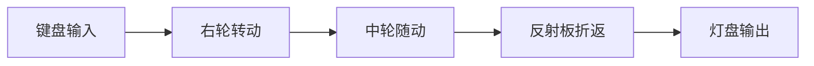

# 轮转密码机（ENIGMA）与转轮加密算法

## 它是什么

先想一个问题：如果每天换一次替换表，手工密码本来得及发吗？二战时德军给出的答案是——让机器自己“翻表”。这就是**轮转密码机 ENIGMA** 与**转轮加密算法**的核心思路。

在《密码学》第 3 章“古典密码学”里，ENIGMA 不再是单表/多表替换，而是**机电式多表替换**：每敲一个字母，右边转轮转一格，整条替换路径就变一次。多个转轮串联后，明文 $P$ 到密文 $C$ 的映射随位置 $i$ 变化，可写成：

$$C_i = E_{k,i}(P_i)$$

其中 $k$ 是转轮起始位置、环设置等密钥参数，$i$ 是击键序号。

## 为什么需要

手工维吉尼亚容易被频率分析打穿；而 ENIGMA 的密钥空间巨大，且每次按键都在换映射。德军以为它“不可破”，也正是南邮课件里强调的：==转轮加密的本质是用机械运动生成动态多表==。

## 怎么做

流程可分三步：

- 按键 → 右轮先转一格；
- 电流穿过若干转轮做逐次替换；
- 遇反射板折返，再倒着穿一轮；
- 点亮另一个字母，即密文。

因为反射板存在，ENIGMA 有性质：$E(E(P))=P$（对合）；也导致==字母绝不会加密成自己==，这反成了破译突破口。

## 与相近概念区别

| 概念 | 映射是否随位置变 | 是否机械自动 | 典型代表 |
|---|---|---|---|
| 单表替换 | 否 | 否 | 凯撒 |
| 多表替换（手工） | 是 | 否 | 维吉尼亚 |
| 转轮加密 | ==每键都变== | 是 | ENIGMA |

## 常见坑与考题对照

> [!WARNING]
> 别把 ENIGMA 和 A5、RC4 混为一谈！ENIGMA 是机电转轮；A5 用于 GSM，RC4 用于早期 WLAN，都是流密码。

课件附题里考过：

> 填空：A5 算法是 GSM 加密标准；RC4 是 IEEE802.11 WLAN 初期标准；流密码国际标准有 ___ 和 ___ 算法。

这里若问“本讲例子”，填的应是历史脉络里的==转轮/ENIGMA 不属于流密码国际标准==，而国际标准常指如 SNOW、ZUC 等；ENIGMA 只作古典/机电多表对照。

## 算对了的例子

设简化双轮：起始位置 $k=(1,0)$，敲 $P=A$ 时右轮在位置 1，映射 $A\to D$；再敲第二个 $A$ 时右轮到 2，映射变 $A\to F$。于是明文 `AA` 得密文 `DF`——不是 `DD`。这就说明：==同一 plaintext 字母在不同位置会出不同 ciphertext==，这正是转轮胜于单表之处。

> [!TIP]
> 记忆：ENIGMA=“会走的多表替换机”，图灵破它，图灵奖纪念他。
