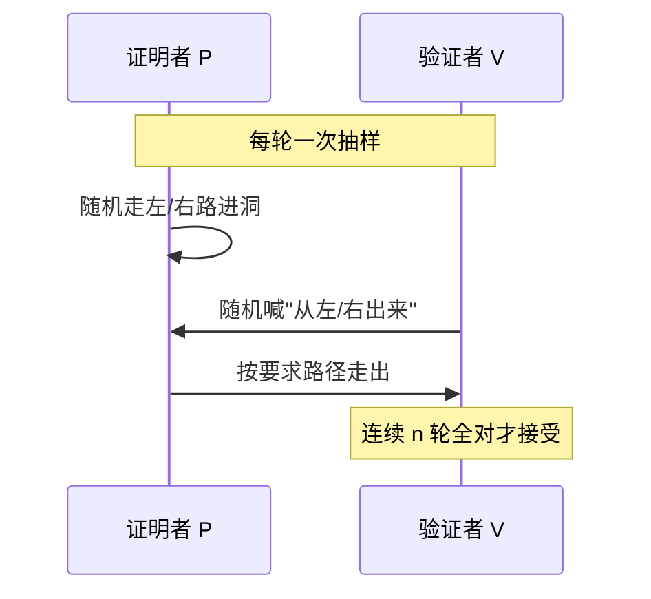

# 零知识证明的基本概念、证明方法与实例（洞穴问题分析）

## 为什么需要零知识证明

身份识别时，证明者 $P$ 想让验证者 $V$ 相信“我知道某个秘密”（如私钥、平方根），但**不想把秘密本身告诉对方**。直接出示秘密会泄露，怎么办？零知识证明就是解决这个矛盾：$V$ 除了“$P$ 确实知道秘密”这一事实外，得不到任何额外信息。

> [!IMPORTANT]
> 零知识证明起源于==最小泄露证明==：$P$ 证明自己掌握秘密，但不泄露秘密；若 $V$ 除“$P$ 能证明”外一无所获，就是零知识证明。

## 交互证明系统

零知识证明建立在交互证明系统之上，由 $P$ 和 $V$ 两方通过信道通信完成。它与数学证明的区别是：数学证明可独立完成，交互证明必须双方交互。要求两条性质：

- **完备性**：$P$ 真知道秘密，$V$ 必接受；
- **正确性**（可靠性）：$P$ 能以一定概率骗过 $V$，则 $P$ 确实知道秘密。

## 洞穴问题（经典实例）

洞穴有一个需要口令才能打开的门，$P$ 向 $V$ 证明自己知道口令，但不说出口令。

- 若 $P$ 知道口令：无论 $V$ 喊哪边都能正确走出（完备性）；
- 若 $P$ 不知道口令：每轮只有 $1/2$ 概率蒙对，$n$ 轮全蒙对的概率仅 $2^{-n}$，可忽略；
- $V$ 全程只看到“$P$ 走出来了”，学不到口令本身（零知识性）。

> [!TIP]
> 口诀：==多次验证==降概率。单轮欺骗概率 $1/2$，重复 $n$ 轮降到 $2^{-n}$。

## 常见坑（考题对照）

> [!WARNING]
> 三个高频判断错误：
> 1. “老师课上讲的定理证明是零知识证明”——错，那是**最大限度**泄露证明（把全部推理都展示出来），恰与最小泄露相反；
> 2. “实际应用靠抽样验证”——错，靠**多次验证**（重复多轮）把欺骗概率压到可忽略；
> 3. “GPS 算法是 Schnorr 的改进方案”——**对**，GPS 是在 Schnorr 身份识别方案上的改进。

## 相近概念辨析

| 概念 | 核心特征 |
| --- | --- |
| 数学证明 | 独立完成，最大限度泄露 |
| 交互证明 | $P$ 产生、$V$ 验证，需通信 |
| 最小泄露证明 | 不泄露秘密本身 |
| 零知识证明 | $V$ 除“能证明”外无任何信息 |
| 不经意传输 | $A$ 以 $1/2$ 概率传秘密，$A$ 不知 $B$ 是否收到 |

> [!NOTE]
> 一个算对的例子：洞穴协议重复 20 轮，骗子全部蒙对的概率为 $2^{-20}\approx 10^{-6}$，$V$ 即可放心接受，而口令始终未被泄露——这就是零知识证明“既可信又保密”的体现。
