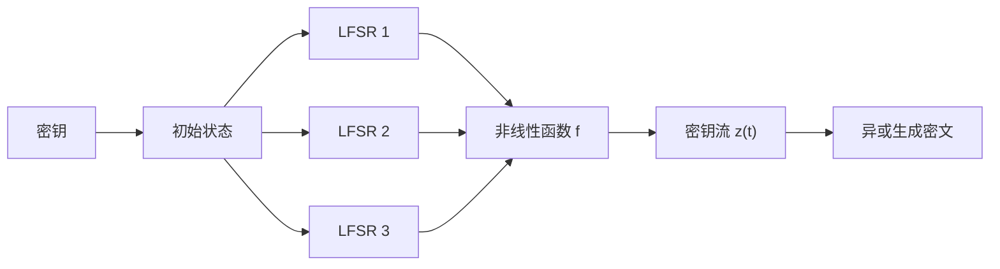

# 对一个或多个LFSR进行非线性组合产生伪随机序列的方法

## 为什么需要非线性组合

LFSR 结构简单、速度快，本原 LFSR 还能产生周期为 $2^n-1$ 的 m 序列，具有良好的随机性。但 ==LFSR 的递推关系是线性的，已知足够多的密钥流比特，就可能恢复其反馈多项式和状态==，因此不能直接把单个 LFSR 的输出当作安全密钥流。

解决办法是：保留 LFSR 便于硬件实现、周期较长的优点，再用**非线性函数**组合其输出，提高密钥流的线性复杂度和不可预测性。

## 基本结构与工作过程

设 $r$ 个 LFSR 在时刻 $t$ 的输出分别为
$$
x_1(t),x_2(t),\ldots,x_r(t),
$$
非线性组合函数为布尔函数 $f$，则密钥流为
$$
z(t)=f\bigl(x_1(t),x_2(t),\ldots,x_r(t)\bigr).
$$

每拍通常先由各 LFSR 提供当前输出，经 $f$ 得到一个密钥流比特，再按各自反馈关系移位。加密仍为
$$
c(t)=m(t)\oplus z(t),
$$
解密用相同初始状态同步生成 $z(t)$，计算 $m(t)=c(t)\oplus z(t)$。

> [!IMPORTANT]
> 非线性组合系统的目的不是简单“把周期相乘”，而是 ==在保持较长周期的同时，提高线性复杂度并破坏单一线性递推关系==。

## 一个算对的例子

取两个 LFSR，某时刻输出为 $x_1=1,x_2=0$，非线性函数为
$$
f(x_1,x_2)=x_1\oplus x_2\oplus x_1x_2.
$$
则
$$
z=f(1,0)=1\oplus0\oplus(1\cdot0)=1.
$$
若明文比特 $m=1$，密文比特就是
$$
c=m\oplus z=1\oplus1=0.
$$
这里乘积项 $x_1x_2$ 是二次项，所以 $f$ 不是线性函数；若只有 $x_1\oplus x_2$，整体仍是线性组合，达不到引入非线性的目的。

## 相近概念与常见误区

| 方法 | 密钥流来源 | 主要特点 |
|---|---|---|
| 单个 LFSR | 一个线性递推序列 | 简单快速，但线性关系易分析 |
| 非线性组合 | 多个 LFSR 输出经 $f$ 组合 | 提高复杂度，需分析相关攻击 |
| 非线性滤波 | 一个 LFSR 的多个状态位经 $f$ 输出 | 非线性作用于同一寄存器内部 |
| 钟控生成器 | 一些 LFSR 控制另一些移位节奏 | 通过不规则钟控破坏线性规律 |

> [!WARNING]
> 多个 LFSR 输出直接异或，仍是线性系统；寄存器数量多、周期长，也不自动等于安全。

> [!CAUTION]
> 若 $f$ 过度依赖某一个输入，例如 $z$ 经常等于 $x_1$，攻击者可猜测该 LFSR 状态并检验相关性，这就是相关攻击利用的弱点。函数选择还要综合考虑平衡性、相关免疫性和代数次数，不能只看“有没有乘积项”。

> [!TIP]
> 答题抓住一条主线：**LFSR 负责提供长周期序列，非线性组合负责提高复杂度，最终输出与明文异或形成密钥流加密。**
