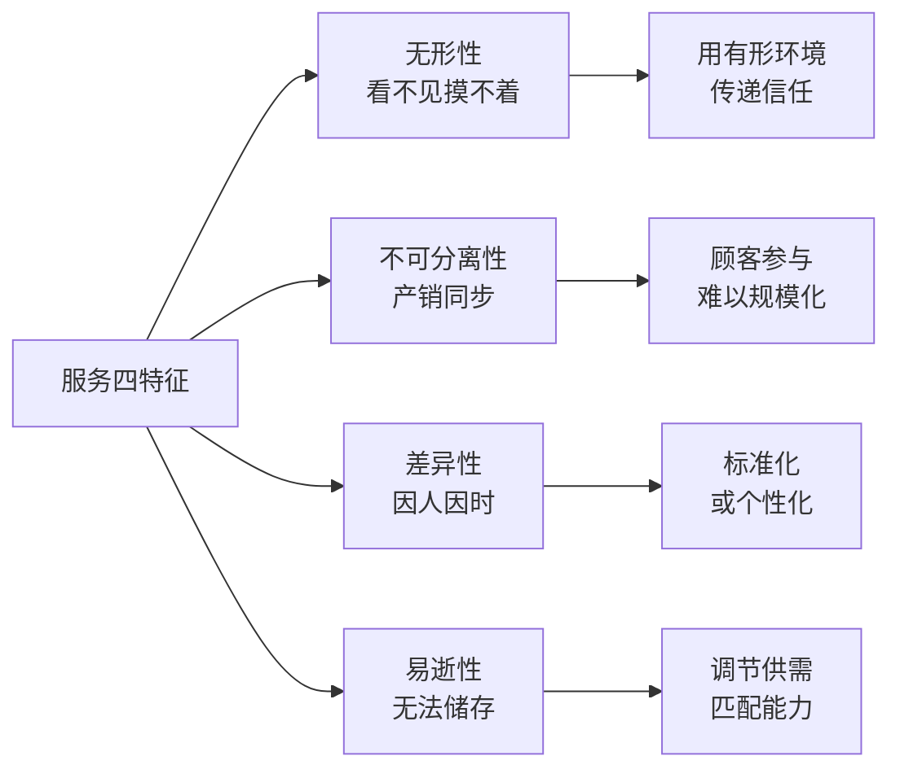

# 服务的特征（无形性、不可分离性、差异性、易逝性）

## 服务的特征

先想一个问题：你去营业厅办一张电话卡，和你去超市买一瓶矿泉水，这两个“买”的过程有什么本质不同？矿泉水可以先生产、入库、上架，你付款后拿走，整个过程和生产者本人没有直接接触。而办电话卡时，营业员必须当场为你录入信息、开通套餐——服务在生产的同时就被你消费掉了。这一区别引出了服务的四个核心特征。

### 无形性（Intangibility）

服务不是一件可以摸到、称重、提前试用的实物。你无法在购买前“看看”一次理发服务长什么样，也无法把一次咨询装进购物车。

> [!IMPORTANT]
> ==无形性==是服务最基本的特征：服务是一种行为或过程，而非有形物品。消费者购买前无法通过感官直接评估服务质量。

这带来一个管理难题：如何让顾客信任一个看不见的东西？企业的做法通常是**把无形变有形**——用实体环境、设备、人员形象等作为“证据”。比如银行装修得稳重气派，理发师穿着整洁、展示发型作品集，都是在传递“我值得信赖”的信号。

### 不可分离性（Inseparability）

实物产品的生产与消费在时间和空间上可以完全分开：手机在深圳生产，你在南京使用，中间隔了几个月。但服务不同。

> [!NOTE]
> 服务的生产过程与消费过程同时发生，顾客必须参与到服务过程中来，服务的提供者与消费者==不可分离==。

医生看病时，你必须在场；老师上课时，学生必须在教室。这意味着：

1. **顾客参与了生产过程**——你的配合程度直接影响服务结果。你说不清病情，医生诊断就困难。
2. **服务难以大规模集中生产**——一个理发师一天能服务的顾客数量天然受限，不像工厂可以开足马力造十万台手机。
3. **一线员工就是“产品”本身**——营业员的态度差，顾客感知到的服务就差，二者无法拆分。

### 差异性（Variability / Heterogeneity）

同一台机器生产的瓶装水，每一瓶几乎完全相同。但同一个老师给两个班教同样的内容，每堂课的体验和效果都不一样。

> [!IMPORTANT]
> ==差异性==指服务质量取决于**谁**来提供、在**何时何地**提供、由**谁**来接受，因而难以标准化。

原因有三层：服务人员的状态会波动（今天累了、情绪不好）；不同顾客的需求和配合度不同；同一顾客在不同时间的感受也不同。

企业的应对思路通常有两条：一是**尽量标准化**，比如麦当劳把制餐流程拆解成精确到秒的操作规范，努力把差异性压到最小；二是**利用差异性**，比如高端服务强调“个性化定制”，反而把因人而异的服务当作卖点。

### 易逝性（Perishability）

实物可以存——今天没卖完的矿泉水明天接着卖。但服务不能。

> [!IMPORTANT]
> ==易逝性==指服务能力无法储存：航班起飞后的空座、酒店今晚没订出的房间、老师没排满的课时，过了那个时间点就永久损失了，无法留到明天再“卖”。

这造成了供给与需求的匹配难题。旺季时服务能力不够用，淡季时大量资源闲置。常见应对策略包括：

| 策略方向 | 具体做法举例 |
|---|---|
| 调节需求 | 淡季折扣（旅游淡季降价）、预约制（医院挂号） |
| 调节供给 | 临时增派人手（高峰期加开结账通道）、兼职员工 |

### 四个特征如何区分

考试中最容易混淆的是**不可分离性**和**易逝性**。

> [!WARNING]
> 不可分离性说的是“生产与消费同时发生，顾客必须在场”；易逝性说的是“结束后无法储存，闲置能力不可回收”。一个是**过程属性**，一个是**结果属性**。

举个例子：一场演唱会的门票卖不完，票卖不出去是易逝性；但买了票的观众必须在演出现场“参与”才能完成服务消费，这是不可分离性。再比如网课录像：录制好的网课可以随时播放，已经部分克服了不可分离性；但如果直播课的实时互动环节你没参加，那个互动机会就永远消失了，这是易逝性。

### 算对了的例子

> [!TIP]
> 案例分析题中判断属于哪个特征，先问：**“这件事是在讲‘看不见’，还是在讲‘同时发生’，还是在讲‘不稳定’，还是在讲‘存不住’？”**

> **例题**：某航空公司每个航班起飞后，未售出的座位就永远无法再产生收入；同时，该航班上每位乘客感受到的服务质量因乘务员当天的状态而异。请指出材料涉及服务的哪些特征，并分别说明含义。
>
> **答**：①未售出座位起飞后永久损失——体现了服务的==易逝性==，即服务能力无法储存，过了服务提供的时间点，未利用的能力即刻消失。②乘客感受到的服务质量因乘务员状态而异——体现了服务的==差异性==，即服务质量受服务人员、时间、顾客等多因素影响，难以保持统一标准。
