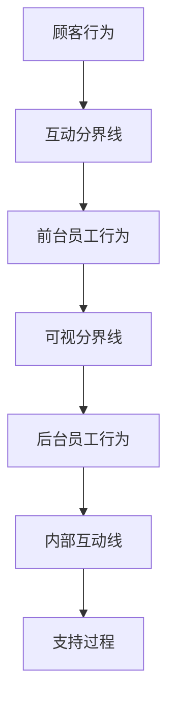

# 服务蓝图的设计与应用（前台、后台与支持过程）

## 服务蓝图是什么与为什么需要

当你去银行办业务时，只看到柜员微笑服务，但背后的授权、系统核验、现金调拨是如何协同的？==服务蓝图就是一张将“顾客体验”与“内部运营”可视化的流程图==。它不同于传统制造流程图，核心在于揭示了服务过程中 ==前台、后台与支持过程的交互界面==。

> [!IMPORTANT]
> 服务蓝图的本质是==识别并管理服务接触点==，通过可视化消除前后台信息不对称，从而提升服务质量与运营效率。

## 三层结构与四条分界线怎么做

设计服务蓝图时，不妨先问自己：哪些环节顾客能直接感知？哪些是员工在幕后完成？据此可将服务系统划分为三个层次，并用四条关键分界线隔开：

-   **互动分界线**：区分顾客行为与前台员工行为，是==服务接触的核心界面==。
-   **可视分界线**：区分前台（可见）与后台（不可见），决定了顾客的感知范围。
-   **内部互动线**：区分后台员工与支持系统/部门，体现内部协作关系。

> [!TIP]
> 记忆口诀：“==三行四线==”。三行指顾客、前台、后台/支持；四线即上述三条分界线加一条“物理证据线”（位于最顶端，标识环境设施等 tangible cues）。

## 与相近概念的区别及常见误区

| 对比维度 | 服务蓝图 | 传统业务流程图 |
| :--- | :--- | :--- |
| 视角起点 | 以==顾客体验==为主线 | 以内部作业效率为主线 |
| 核心要素 | 包含物理证据、前后台界面 | 仅关注工序流转与决策 |
| 应用目的 | 优化服务接触、发现失败点 | 消除浪费、标准化作业 |

> [!WARNING]
> 常见坑：==混淆“后台”与“支持过程”==。后台仍是服务人员的行为（如厨师炒菜），而支持过程是系统或职能部门的活动（如采购食材、pos机结算），二者被“内部互动线”严格区分。

## 正确绘制示例：高校食堂就餐

以南邮学生熟悉的食堂场景为例，正确识别各层归属是关键：

1.  **物理证据**：餐桌椅、菜单牌、取餐窗口。
2.  **顾客行为**：排队→选餐→刷卡→就座用餐。
3.  **前台行为**：打菜阿姨盛饭、收银员刷卡确认（互动线以上）。
4.  **后台行为**：后厨备菜、餐具清洗消毒（可视线以下、内部互动线以上）。
5.  **支持过程**：食材供应链配送、校园卡系统扣款（内部互动线以下）。

> [!CAUTION]
> 易错点：将“校园卡系统扣款”误画为前台行为。实际上它是==支持过程==，由信息系统自动完成，不直接面向顾客交互，必须置于内部互动线之下。

通过服务蓝图，管理者可精准定位“刷卡失败”究竟是前台操作失误、后台准备不足，还是支持系统故障，从而实现针对性改进。
