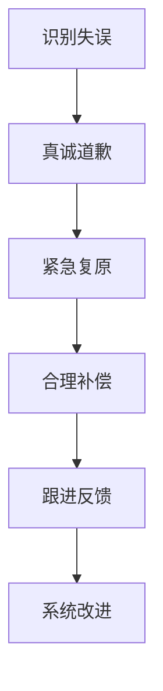

# 服务失误与服务补救策略
当顾客感知到的服务水平低于期望时，就发生了==服务失误==。但失误本身并不直接导致客户流失，真正决定去留的是企业随后的反应。为什么同样的失误，有的顾客愤而离开，有的却反而成为忠实粉丝？关键在于是否实施了有效的==服务补救==。

> [!IMPORTANT]
> 核心定义：服务补救是企业针对服务失误所采取的==即时性、主动性==纠正措施，旨在挽回顾客满意并修复关系。它不同于事后投诉处理，强调“现场”与“主动”。

### 补救策略的实施框架

面对失误，管理者应如何系统化应对？可遵循以下四步闭环流程：

- **识别与倾听**：不辩解，让顾客充分表达不满，确认问题本质。
- **真诚道歉**：承认责任，表达对顾客感受的理解，而非机械套话。
- **紧急复原**：在最短时间内解决核心问题，恢复服务基本功能。
- **适度补偿**：根据失误严重度提供物质或精神补偿，注意公平感。
- **跟进与改进**：事后回访确认满意度，并将案例纳入组织学习，防止重演。

> [!TIP]
> 答题口诀：“识歉复补跟改”六字诀，案例分析题按此框架逐条匹配材料，避免遗漏得分点。

### 与相近概念的辨析

| 维度 | 服务补救 | 投诉处理 | 服务质量管理 |
| :--- | :--- | :--- | :--- |
| 触发时机 | 失误发生后==即时==响应 | 顾客主动投诉后被动响应 | 事前预防+事后持续改进 |
| 核心目标 | 挽回当次体验与关系 | 解决具体诉求、平息情绪 | 提升整体服务水平 |
| 主动性 | ==主动发现、主动介入== | 被动等待顾客发声 | 系统性、制度化 |
| 时间窗口 | 黄金时段（通常≤24h） | 无严格时限，但越久越难 | 长期持续过程 |

> [!WARNING]
> 常见误区：将“服务补救”等同于“赔偿”。补偿只是手段之一，==情感修复与信任重建==才是根本目的。仅给优惠券而不道歉、不解释原因，往往适得其反。

### 案例分析示范

某快递包裹延误3天且外包装破损，客户致电怒斥。客服立即致歉并核实情况（识别+道歉），2小时内安排重新包装并加急派送（紧急复原），同时赠送10元运费券及手写致歉卡（补偿），次日回访确认收货满意（跟进），并将该中转站列入整改名单（系统改进）。

> [!NOTE]
> 此例中，若仅提供运费券而未重包加急，则属“有补偿无复原”，客户仍会差评；若仅重包而无任何补偿，则公平感缺失。==有效补救=复原+补偿+情感回应==三者缺一不可。

> [!CAUTION]
> 考试高频陷阱：题干描述“企业事后给予高额赔偿但客户仍流失”，错误归因常为“补偿不足”。实则多因==缺乏即时性与真诚沟通==，违背了补救的“主动、及时、共情”三原则。
