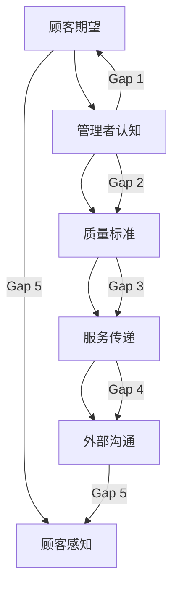

# 服务质量差距模型（SERVQUAL模型及五个差距分析）

> [!IMPORTANT]
> 服务质量差距模型（SERVQUAL）是衡量顾客期望与实际感知服务之间落差的工具，核心思想为：==服务质量取决于顾客期望与感知的差距==。

为什么企业自认为服务很好，顾客却依然流失？问题往往出在“内部认知”与“外部体验”的断层上。该模型正是为了定位这种断层而生。

## 五个差距是什么

模型将服务质量问题拆解为 5 个差距（Gap），前 4 个发生在企业内部，第 5 个是最终结果。

- **差距 1（认知差距）**：管理者不了解顾客真正期望什么。
- **差距 2（标准差距）**：了解了期望，但没转化为明确的服务质量标准。
- **差距 3（交付差距）**：有标准，但员工在实际传递中未执行到位。
- **差距 4（沟通差距）**：对外宣传承诺过高，实际交付达不到。
- **差距 5（服务差距）**：==顾客期望与感知之差==，由前 4 个差距共同决定。

$$Gap_5 = \text{顾客感知} - \text{顾客期望}$$

当 $Gap_5 < 0$ 时，服务质量不达标；$Gap_5 > 0$ 时，超出期望。

## SERVQUAL 怎么做

SERVQUAL 通过问卷让顾客对 5 个维度打分，计算期望分 $E$ 与感知分 $P$ 的差值：

$$SQ = \sum_{i=1}^{n}(P_i - E_i)$$

| 维度 | 含义 | 举例（以运营商为例） |
| :--- | :--- | :--- |
| 有形性 | 设施、设备外观 | 营业厅环境整洁 |
| 可靠性 | 准确履行承诺 | 宽带按时开通 |
| 响应性 | 帮助顾客的意愿 | 客服接通速度 |
| 保证性 | 员工专业与信任感 | 业务员解答准确 |
| 移情性 | 给予个性化关怀 | 针对老人专属指导 |

## 相近概念辨析

| 对比项 | 服务质量差距模型 | 4P 营销组合 |
| :--- | :--- | :--- |
| 关注点 | 服务过程与体验落差 | 产品、价格、渠道、促销策略 |
| 适用对象 | 无形服务为主 | 有形产品与无形服务皆可 |
| 核心目的 | 找内部管理漏洞 | 制定市场进入策略 |

> [!NOTE]
> 4P 属于第 9 章市场营销策略，而 SERVQUAL 侧重第 1 章企业管理中对“服务质量控制”的理解，两者视角不同。

## 常见坑与例题

> [!WARNING]
> 连线题中最易混淆的是 ==差距 2 与差距 3==：差距 2 是“没定好标准”，差距 3 是“定了标准没做到”。

**【综合选择题模拟】** 请将左侧现象与右侧差距匹配：
① 广告宣称“千兆网速”，实际只有百兆
② 经理以为学生需要低价，其实学生更看重稳定
③ 规定了 3 分钟响应，客服却经常超时

**正确匹配**：
- ① → 差距 4（外部沟通夸大）
- ② → 差距 1（管理者认知错误）
- ③ → 差距 3（服务交付未达标）

> [!TIP]
> 记忆口诀：“一认二标三交四宣五总”。做题时先判断问题出在“谁和谁之间”，再对应到具体 Gap。
