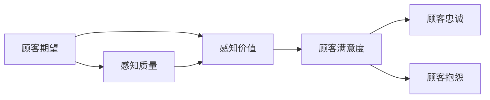

# 顾客满意度（CS）测评指标体系与测评方法

顾客满意度（Customer Satisfaction，简称 CS）测评，是企业通过科学方法量化顾客对产品或服务的满意程度，进而改进经营管理、提升竞争力的重要工具。它不仅是“顾客满意战略”的核心环节，也是现代企业管理中“以顾客为中心”理念的具体体现。

## 为什么需要 CS 测评

在激烈的市场竞争中，企业越来越认识到：==顾客满意是企业生存和发展的基础==。满意的顾客更可能重复购买、口碑推荐，形成品牌忠诚；而不满意的顾客则可能流失，甚至带来负面传播。因此，企业需要建立一套科学的 CS 测评体系，持续监测顾客满意水平，发现问题、改进服务、提升价值。

## CS 测评指标体系的构建

CS 测评指标体系通常包括三个层次：

| 层级 | 内容 | 举例 |
|------|------|------|
| 一级指标 | 顾客满意度总体指数 | CSI（Customer Satisfaction Index） |
| 二级指标 | 顾客期望、感知质量、感知价值、顾客抱怨、顾客忠诚等 | 感知质量、感知价值 |
| 三级指标 | 具体可测的项目 | 产品性能、服务态度、响应速度、价格合理性等 |

这些指标之间具有逻辑关系，常用结构方程模型（SEM）或因果路径图表示：

> [!IMPORTANT]
> ==感知质量与感知价值是影响顾客满意度的核心变量==，顾客忠诚是满意度的结果体现。

## CS 测评方法

常用的 CS 测评方法包括：

- **问卷调查法**：设计结构化问卷，采用李克特量表（如 1～5 分）收集顾客评价；
- **模糊综合评价法**：适用于评价因素多、边界模糊的情形；
- **主成分分析法**：用于降维，提取主要影响因子；
- **结构方程模型（SEM）**：用于验证指标间的因果关系，适合复杂模型；
- **顾客满意度指数法（CSI）**：将多个指标加权合成为一个综合指数，便于横向比较。

> [!TIP]
> 记忆口诀：**“期望—感知—满意—忠诚”**，是 CS 测评模型的主线。

## 一个算对了的例子

某企业对 100 名顾客进行满意度调查，采用 5 级李克特量表，结果如下：

| 满意程度 | 非常满意 | 满意 | 一般 | 不满意 | 非常不满意 |
|----------|------------|------|------|--------|--------------|
| 人数     | 40         | 35   | 15   | 7      | 3            |

则顾客满意度为：

$$
CS = \frac{40 \times 5 + 35 \times 4 + 15 \times 3 + 7 \times 2 + 3 \times 1}{100 \times 5} = \frac{402}{500} = 0.804 = 80.4\%
$$

> [!NOTE]
> 该结果表示顾客总体满意度为 80.4%，企业可据此设定改进目标。

## 与相近概念的区别

| 概念 | 含义 | 与 CS 的关系 |
|------|------|----------------|
| 顾客忠诚 | 顾客持续购买、推荐他人 | 是 CS 的结果变量 |
| 顾客价值 | 顾客感知收益与成本之比 | 是 CS 的前因变量 |
| 服务质量 | 服务满足顾客期望的程度 | 是感知质量的重要组成部分 |

> [!WARNING]
> 常见误区：将“顾客满意”等同于“顾客忠诚”。实际上，满意是忠诚的必要条件，但不是充分条件。

## 常见考点与易错点

- **连线题高频**：如“感知质量”对应“顾客对产品实际性能的感受”，“顾客忠诚”对应“重复购买与推荐行为”；
- **不要混淆“顾客期望”与“感知价值”**：前者是购买前的预期，后者是购买后的性价比判断；
- **CSI 不是简单平均**，而是加权综合指数，权重可通过专家打分或统计方法确定。

> [!CAUTION]
> 不要忽视“顾客抱怨”指标，它是发现服务短板、改进管理的重要信号。

通过建立科学的 CS 测评体系，企业可以实现从“产品导向”向“顾客导向”的转变，真正做到以顾客为中心，持续提升管理水平与市场竞争力。
