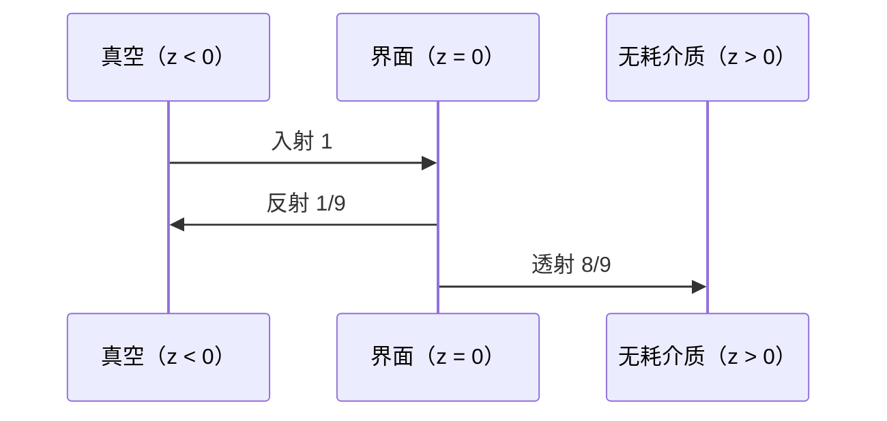

# 无耗介质界面的正入射

一束平面波打到不吸收能量的介质上，不等于能量全部通过。波的电场和磁场必须同时满足界面条件；如果材料换了，传播波中两种场的比例也可能换掉。假定根本没有反射，这两条条件还能同时成立吗？

设平界面位于 $z=0$，两边是均匀、线性、各向同性、无耗的半无限介质，无自由面电流。入射波沿 $+z$ 传播，电场沿 $x$，用 $E_i,E_r,E_t$ 表示在界面处同一 $x$ 方向上的电场复振幅。介质 $m$ 的波阻抗 $\eta_m=\sqrt{\mu_m/\varepsilon_m}$。同向传播的入射波与透射波的磁场沿 $y$；反射波沿 $-z$ 传播，磁场相对其电场的取向反转，所以磁场 $y$ 分量写成 $-E_r/\eta_1$，这里负号来自传播方向，而非预先假定 $E_r$ 的相位。

切向电场和磁场的连续分别给出

$$
E_i+E_r=E_t,\qquad
\frac{E_i-E_r}{\eta_1}=\frac{E_t}{\eta_2}.
$$

如果 $E_r=0$，两式要求 $E_t=E_i$ 并且 $E_i/\eta_1=E_i/\eta_2$。非零入射时，两个条件只有在 $\eta_1=\eta_2$ 才同时成立。这就解释了为什么阻抗不同的无耗介质仍会反射。联立两式可得电场振幅系数：

$$
\Gamma=\frac{E_r}{E_i}=\frac{\eta_2-\eta_1}{\eta_2+\eta_1},\qquad
\tau=\frac{E_t}{E_i}=\frac{2\eta_2}{\eta_2+\eta_1}.
$$

“从真空正入射到非磁性介质，$\varepsilon_2=4\varepsilon_0$”给出的关键信息是 $\eta_2=\eta_1/2$，不是 $\eta_2=\eta_1/4$。代入得 $\Gamma=-1/3$、$\tau=2/3$；负的反射振幅表示界面处反射电场比入射电场反相，而不是反射功率为负。以 $E_i=1$ 直接回代：电场两侧都是 $2/3$，磁场两侧都是 $4/(3\eta_1)$。再用各行波的平均功率通量大小与 $|E|^2/\eta$ 成正比核算，反射比例是 $1/9$，透射比例是 $(\eta_1/\eta_2)|\tau|^2=8/9$，相加为 $1$。

以下把入射功率通量的大小归一化为 1。箭头指能量传播方向，标注是通量大小的比例；分行只是为了读图，不表示先后。

> [!TIP]
> ==功率比例用通量的大小，守恒则要带方向。== 反射沿 $-z$，所以介质 1 沿 $+z$ 的净通量为 $1-1/9=8/9$，恰等于介质 2 的透射通量。把 $|\tau|^2=4/9$ 直接当成功率透射比，会漏掉阻抗差，也过不了这道守恒检验。

看到**正入射、平界面、半无限、无耗**，先求两侧波阻抗，再写两条切向条件；有镀层，波还会在下一界面返回；有斜入射，需要区分极化；有损耗时，不能直接照搬这里基于实波阻抗的功率比。可迁移的不是那条分式，而是先判定每个方向的场关系，再让界面两边同时满足约束。

参考：[MIT 电磁场讲义 §7-6：平面波正入射无耗介质](https://ocw.mit.edu/courses/res-6-002-electromagnetic-field-theory-a-problem-solving-approach-spring-2008/a351c693a668be056fefd2ffff0dc068_MITRES_6_002S08_chp07_text.pdf)。
