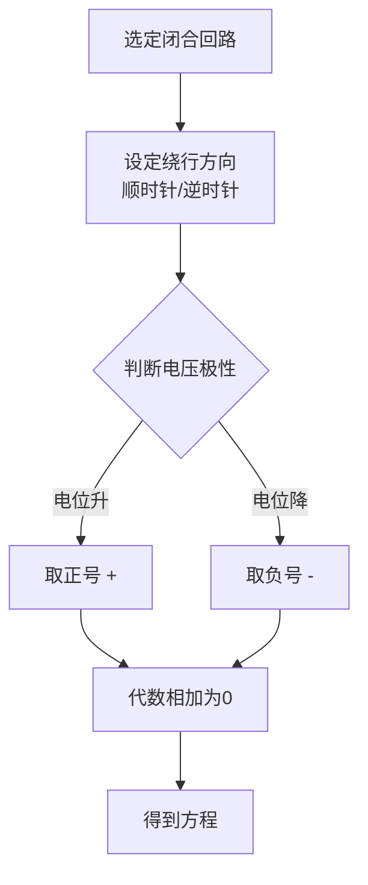

# 基尔霍夫电压定律（KVL）及其应用

## 基尔霍夫电压定律（KVL）

在电路分析中，如果 KCL 解决了“电流去哪了”的问题，那么 **KVL** 解决的就是“电压怎么分”的问题。它基于能量守恒定律：**沿任意闭合回路绕行一周，各段电压的代数和恒为零**。

$$
\sum_{k=1}^{m} U_k = 0
$$

> [!IMPORTANT]
> ==核心结论==：KVL 不仅适用于电阻网络，也适用于包含电容、电感甚至非线性元件（如二极管）的任意集总参数电路。它是列写回路方程、网孔分析法及戴维南等效的基础。

### 为什么需要 KVL？

单纯依靠欧姆定律（VCR）只能处理简单串并联。面对复杂网络（如桥式电路或含多个电源的回路），我们需要一种系统化的方法来建立电压之间的约束关系。KVL 提供了这种**拓扑约束**，与元件的 VCR 特性结合，即可求解所有未知量。

### 怎么做：三步走策略

1.  **标定参考方向**：明确各元件电压的 $+/-$ 极性或电流参考方向。
2.  **选定绕行方向**：通常选顺时针，保持一致即可。
3.  **列写方程**：
    *   若从 $-$ 到 $+$（电位升高），记为 $+U$；
    *   若从 $+$ 到 $-$（电位降低），记为 $-U$。
    *   对于电阻，若电流方向与绕行方向一致，电压降为 $-IR$；反之则为 $+IR$。

> [!TIP]
> **记忆口诀**：遇降取负，遇升取正；或者统一视为“电压降之和等于电压升之和”。

### 常见坑与辨析

| 概念 | 关键点 | 易错警示 |
| :--- | :--- | :--- |
| **参考方向** | 人为假设，与实际无关 | ==切勿混淆实际极性与参考方向==，计算结果为负仅代表实际方向与参考相反。 |
| **开口电压** | KVL 可推广至开口电路 | 求两点间电压 $U_{ab}$ 时，可虚构一条路径构成闭合回路，令 $\sum U = 0$ 求解。 |
| **独立回路** | $b-(n-1)$ 个 | 网孔是特殊的独立回路，但独立回路不一定是网孔。 |

> [!WARNING]
> **含源支路处理**：计算电流源两端电压时，必须列 KVL 方程求解，因为电流源电压由外电路决定，不能直接用欧姆定律。

### 典型例题解析

以课件中**计算 4** 为例，已知 $U_2 = 10\text{V}$，求 $U_s$。

1.  **局部求解**：由欧姆定律，$I_2 = \frac{U_2}{20} = 0.5\text{A}$。
2.  **应用 KVL/KCL**：
    *   $30\Omega$ 电阻两端电压 $U_3 = I_2(10+20) = 15\text{V}$（此处隐含了对右侧回路的 KVL 应用）。
    *   进而求得中间节点电压 $U_4$。注意这里利用了 KCL 求出流经 $10\Omega$ 电阻的总电流，再结合 KVL：
        $$ U_4 = \left(\frac{U_3}{30} + I_2\right) \times 10 + U_3 = 25\text{V} $$
3.  **最终回路**：对最左侧大回路或节点应用 KVL/KCL：
    $$ I_1 = \frac{U_4}{25} + \frac{U_3}{30} + I_2 = 2\text{A} $$
    $$ U_s = I_1 \times 10 + U_4 = 45\text{V} $$

此题展示了如何混合使用 KCL、KVL 和 VCR，从已知局部变量逐步推导至全局电源电压。
