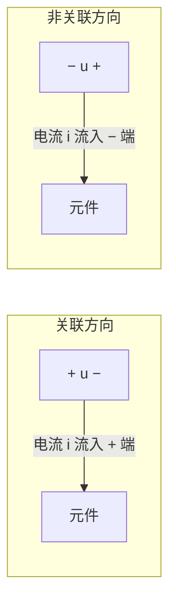

# 元件吸收与产生功率的计算与判断

## 它是什么

元件在电路中不是“产生能量”就是“消耗能量”。我们用一个代数量 $p$ 来表示**功率**：

$$
p = u\,i
$$

单位是瓦特（W）。判断是吸收还是发出功率，核心只靠一件事：==看电压和电流的参考方向是否关联==。

## 为什么需要

电源、电阻、电容、电感在电路中的角色不同，但仅凭元件外观无法判断它是在供电还是在耗电。例如一个电池可能正在放电，也可能正在被充电。只有正确判断功率流向，才能分析能量守恒、计算效率、排除故障。

## 怎么做：关联参考方向是关键

### 第一步：判断参考方向是否关联

> **关联参考方向**：电流从电压的“+”端流入，“−”端流出。

| 参考方向 | 功率计算 | 结果判断 |
|---|---|---|
| 关联 | $p = ui$ | $p > 0$：吸收；$p < 0$：发出 |
| 非关联 | $p = ui$ | $p > 0$：发出；$p < 0$：吸收 |

### 第二步：算 $p = ui$ 并判断

> [!IMPORTANT]
> 关联方向下：$p>0$ 表示**吸收功率**，$p<0$ 表示**发出功率**。非关联方向下结论完全相反。

## 常见坑

> [!WARNING]
> 最常见的错误是：**不先判断方向是否关联，直接套结论**。看到一个负号就匆忙说“发出功率”，这很容易翻车。

正确顺序永远是：**先看方向 → 再算 $p$ → 最后按规则下结论**。

## 一个算对的例子

题图 1 所示电路中，求电流源发出的功率。

设电流源两端电压为 $u$，其上正下负。电路中电流源电流为 $1\text{A}$，方向向上；另有 $2\Omega$ 电阻与 $10\text{V}$ 电压源串联支路并联在其两端。

由 KVL，沿右侧支路列方程：

$$
u = 10 + 2 \times 1 = 12\text{V}
$$

电流源上，电流从**上端流出**、从**下端流入**，即电流从电压的 $-$ 端流入、$+$ 端流出——这是**非关联参考方向**。

所以：

$$
p = ui = 12 \times 1 = 12\text{W}
$$

非关联方向下 $p>0$，说明电流源**发出 12W 功率**。

> [!TIP]
> 判断口诀：**“关联吸，非联发；正吸负发记心间。”** 先把方向定准，再算 $p$，最后按规则翻译成吸收或发出。
