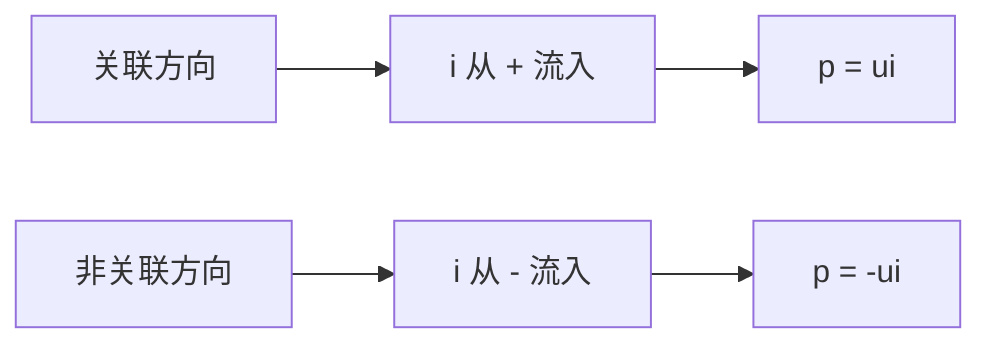

# 电流、电压的参考方向及关联参考方向

## 为什么需要参考方向

在分析复杂电路时，我们往往无法预先判断某条支路中电流的真实流向或元件两端电压的真实极性。如果必须等到算出结果才能列方程，电路分析将无从下手。因此，我们需要人为指定一个“正方向”作为列写方程和判断符号的基准，这就是==参考方向==。它不是物理真实方向，而是数学计算的“坐标系”。

> [!IMPORTANT]
> 参考方向是电路分析的“语法基础”。所有KCL、KVL及元件伏安关系（VCR）的公式，都必须在选定参考方向后才成立。未标参考方向的电路图是不完整的。

## 关联与非关联参考方向

对于任意二端元件，电流和电压的参考方向可以独立任意指定，但为了简化功率计算和统一元件模型，通常采用以下两种约定：

| 类型 | 定义 | 功率公式 | 物理含义 |
| :--- | :--- | :--- | :--- |
| **关联参考方向** | 电流从电压“+”极流入，“-”极流出 | $p = ui$ | $p>0$ 吸收功率；$p<0$ 发出功率 |
| **非关联参考方向** | 电流从电压“-”极流入，“+”极流出 | $p = -ui$ | $p>0$ 发出功率；$p<0$ 吸收功率 |

> [!TIP]
> 南邮教材及考试中，若无特殊说明，==默认采用关联参考方向==。此时欧姆定律直接写作 $u=Ri$；若为非关联，则必须加负号 $u=-Ri$。这是初学者最容易丢分的地方。

## 常见误区与避坑指南

> [!WARNING]
> **参考方向 ≠ 实际方向**。计算结果 $i>0$ 表示实际方向与参考方向一致；$i<0$ 则表示相反。切勿因为算出负值就认为“错了”而强行改号，负号本身携带了重要的方向信息。

> [!CAUTION]
> 在列写KVL或元件VCR时，必须先看图中标注的参考方向再决定正负号，绝不能凭“感觉”或“电源正极”来代入数值。例如在动态电路初始值计算中，若电容电压 $u_C(0^+)$ 的参考方向与实际极性相反，代入三要素公式时必须带负号，否则后续响应表达式全错。

## 算例验证：参考方向在初始值计算中的应用

以课件中“图6-12”一阶电路为例，求换路后 $i_C(0^+)$。已知 $t<0$ 时电路稳定，求得 $u_C(0^-) = -12\text{V}$（注意此处负号源于参考方向设定）。

换路瞬间由换路定律得 $u_C(0^+) = u_C(0^-) = -12\text{V}$。在 $t=0^+$ 等效电路中，对含电容支路列KCL时，必须严格依据 $u_C$ 和 $i_C$ 的==关联参考方向==列式：
$$
i_C(0^+) = -\frac{u_1(0^+)}{1} - i_L(0^+)
$$
其中 $u_1(0^+)$ 由分压得出为 $-3\text{V}$，$i_L(0^+)=6\text{A}$。代入得：
$$
i_C(0^+) = -(-3) - 6 = -3\text{A}
$$
最终结果为负，仅说明 $t=0^+$ 时刻电容电流的实际方向与图中所标参考方向相反。若忽略 $u_C$ 的负号或非关联时的符号规则，必将导致 $du_C/dt$ 及后续全响应计算错误。此例充分体现了==参考方向贯穿电路分析始终==的核心地位。
