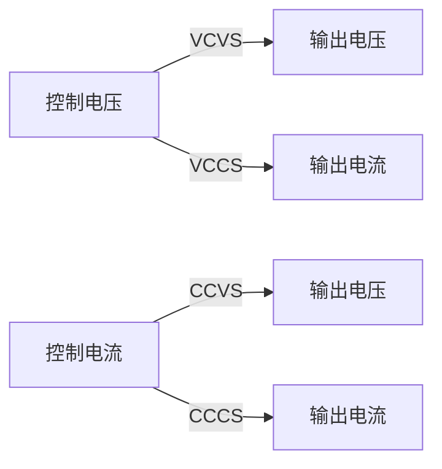

# 四种受控电源（VCVS、VCCS、CCVS、CCCS）的特性

## 什么是受控源

受控源是“输出由另一个电路变量控制”的二端元件，输出与输入之间呈线性关系。四个基本控制量分别为电压 $u$ 和电流 $i$：

| 类型 | 名称 | 控制量 | 输出量 | 约束关系 |
|---|---|---|---|---|
| VCVS | 电压控制电压源 | 电压 | 电压 | $u_o=\mu u_c$ |
| VCCS | 电压控制电流源 | 电压 | 电流 | $i_o=g u_c$ |
| CCVS | 电流控制电压源 | 电流 | 电压 | $u_o=r_m i_c$ |
| CCCS | 电流控制电流源 | 电流 | 电流 | $i_o=\beta i_c$ |

其中，VCVS 常用于描述晶体管的电压放大作用；VCCS 可表示电压输入转换为电流输出；CCVS 表现为受控电压；CCCS 常用于描述晶体管的电流放大作用。

> [!IMPORTANT]
> ==“控制量”和“输出量”必须分开看==：VCVS、CCVS 输出的是电压；VCCS、CCCS 输出的是电流。

## 为什么要使用受控源

普通独立电源能自行建立电压或电流；受控源则必须先有控制量，才能确定输出。例如，晶体管基极电流变化时，集电极电流随之变化，这类“放大”关系可以等效为 CCCS。

受控源让电路模型能够描述放大、反馈、电子器件等复杂现象，也是含有受控源电路进行戴维南、诺顿等效和节点分析的基本工具。

> [!NOTE]
> 受控源不是独立电源。独立源可独立取值；受控源的输出不能脱离控制量而任意指定。分析含受控源电路时，独立源置零后，==受控源一般不能置零==。

## 四种受控源的控制关系

### VCVS：电压控制电压源

输出电压与控制电压成比例：

$$
u_o=\mu u_c
$$

$\mu$ 为电压放大系数，无量纲。若菱形符号内标有“$\pm\mu U$”，则还要结合图中正负号确定实际极性。

### VCCS：电压控制电流源

输出电流与控制电压成比例：

$$
i_o=g u_c
$$

$g$ 为跨导，单位为 $\mathrm{S}$。箭头表示输出电流的参考方向。

### CCVS：电流控制电压源

输出电压与控制电流成比例：

$$
u_o=r_m i_c
$$

$r_m$ 为转移电阻，单位为 $\Omega$。

### CCCS：电流控制电流源

输出电流与控制电流成比例：

$$
i_o=\beta i_c
$$

$\beta$ 为电流放大系数，无量纲。$\beta>1$ 时体现电流放大，但不能因此认为实际输出一定大于控制电流，因为还取决于电路其他参数。

> [!TIP]
> 记忆口诀：==第一项看控制，第二项看输出==。例如 CCVS 是“电流控制、输出电压”。

## 与相近概念的区别

| 比较对象 | 区别 |
|---|---|
| 独立源与受控源 | 独立源自行确定输出；受控源由 $u_c$ 或 $i_c$ 决定 |
| 无源元件与受控源 | 电阻、电容等不能用普通代数式直接表示输入输出关系；受控源有明确控制方程 |
| VCVS 与 CCVS | 两者都输出电压，但控制量分别是电压、电流 |
| VCCS 与 CCCS | 两者都输出电流，但控制量分别是电压、电流 |

此外，受控源是一种有源模型，受控源电路整体不一定真的含有实际电源。

## 做题时怎么做

1. **认清控制量**：找到控制电压 $u_c$ 或控制电流 $i_c$ 所在支路。
2. **写出约束关系**：明确比例系数及正负方向。
3. **补充约束方程**：按需要列 KCL、KVL 或端口伏安关系。
4. **联立求解**：若求端口等效参数，可先求开路电压，再求等效电阻；也可采用加压求流法。

> [!WARNING]
> ==端口等效电阻不一定为正==。含受控源网络的等效电阻可能是负值。

## 算对的例子

以含 VCVS 的二端网络为例，设端口电压为 $u$、电流为 $i$。由电路关系得到：

$$
u=2(3u+i)+\frac{1\times2}{1+2}i
$$

即

$$
u=6u+2i+\frac23i
$$

整理得：

$$
u=-\frac{8}{15}i
$$

因此端口等效电阻为

$$
R_{\mathrm{eq}}=\frac{u}{i}=-\frac{8}{15}\Omega
$$

负号表示该网络向外提供电流，等效电阻为负。

> [!CAUTION]
> 求含受控源网络的等效电阻时，不能像纯电阻网络那样直接把独立源置零后，将端口电压除以电流；通常应在端口加测试电压 $u$，求测试电流 $i$，再由 $R_{\mathrm{eq}}=u/i$ 得到结果。
