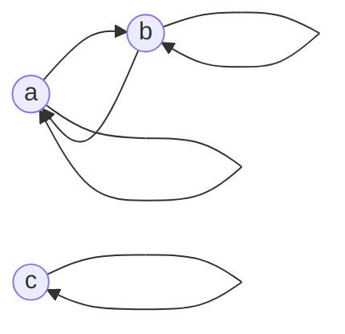

# 二元关系的定义、关系矩阵与关系图的画法

## 二元关系的矩阵与图表示

### 为什么需要矩阵和图

二元关系本质上是笛卡尔积 $X \times Y$ 的子集。当 $X$、$Y$ 是有限集时，直接写序偶集合既不直观，也不便于判断性质和做运算。于是引入两种工具：

- **关系矩阵**：适合代数运算（复合、闭包）。
- **关系图**：适合直观判断五种性质（自反、反自反、对称、反对称、传递）。

两者与有序对集合一一对应，是同一关系的三种记法。

> [!IMPORTANT]
> 关系矩阵和关系图只适用于**有限集**上的二元关系。无限集上的关系只能用集合表达式描述。

---

### 关系矩阵怎么画

设 $X = \{x_1, x_2, \ldots, x_m\}$，$Y = \{y_1, y_2, \ldots, y_n\}$，$R \subseteq X \times Y$。

关系矩阵 $M_R$ 是一个 $m \times n$ 的 $(0,1)$ 矩阵，其中

$$
M_R[i][j] =
\begin{cases}
1, & \langle x_i, y_j \rangle \in R, \\[4pt]
0, & \langle x_i, y_j \rangle \notin R.
\end{cases}
$$

**行对应 $X$ 的元素，列对应 $Y$ 的元素。**

若 $R$ 是 $A$ 上的二元关系（即 $R \subseteq A \times A$），则 $M_R$ 是 $n \times n$ **方阵**。

**例**：设 $A=\{-1,0,1\}$，$R=\{\langle-1,0\rangle,\langle1,0\rangle\}$。

按行序 $-1,0,1$、列序 $-1,0,1$ 排列，逐一检查 $A \times A$ 的九个有序对：

|   | $-1$ | $0$ | $1$ |
|---|:---:|:---:|:---:|
| $-1$ | 0 | **1** | 0 |
| $0$  | 0 | 0 | 0 |
| $1$  | 0 | **1** | 0 |

$$
M_R =
\begin{bmatrix}
0 & 1 & 0 \\
0 & 0 & 0 \\
0 & 1 & 0
\end{bmatrix}
$$

> [!WARNING]
> 写关系矩阵前必须先**固定元素的排列顺序**。顺序改变，矩阵也随之改变。考试时若题目未指定顺序，按字母序或数字序写出并在旁边标注。

---

### 关系图怎么画

关系图只画**方阵情形**（$R \subseteq A \times A$）：

1. 把 $A$ 中每个元素画成一个**结点**（写成小圆圈或点）。
2. 若 $\langle x, y \rangle \in R$，则从结点 $x$ 画一条**有向弧**指向结点 $y$。
3. 若 $\langle x, x \rangle \in R$，则在结点 $x$ 处画一条**自回路**（自环）。

```mermaid
flowchart LR
    a((-1)) -->|R| b((0))
    c((1)) -->|R| b
    a ---|"R: <-1,-1>"| a
    c ---|"R: <1,1>"| c
```

上图中，$a$ 到 $b$、$c$ 到 $b$ 的有向弧来自 $\langle -1,0\rangle$ 与 $\langle 1,0\rangle$；自回路表示 $\langle -1,-1\rangle$ 和 $\langle 1,1\rangle$。

---

### 从矩阵和图判五种性质

| 性质 | 关系矩阵 | 关系图 |
|---|---|---|
| **自反** | 对角线全为 $1$ | 每个结点都有自回路 |
| **反自反** | 对角线全为 $0$ | 每个结点都无自回路 |
| **对称** | 矩阵为对称矩阵（$M = M^{T}$） | 任意两结点间有向弧必成对出现 |
| **反对称** | 以对角线为对称轴的两个元素不同时为 $1$（但可同时为 $0$） | 任意两结点间有向弧不能成对出现 |
| **传递** | 若 $M[i][j]=1$ 且 $M[j][k]=1$，则 $M[i][k]=1$ | 若 $x \to y$ 且 $y \to z$，则必有 $x \to z$ |

> [!TIP]
> 自反看对角线，对称看矩阵是否转置相等，反对称只看**非对角线**的对称位置。

---

### 算对了的例子

**例**：设 $A = \{a, b, c\}$，$R = \{\langle a,a\rangle, \langle a,b\rangle, \langle b,a\rangle, \langle b,b\rangle, \langle c,c\rangle\}$。写出关系矩阵、画关系图，并判断性质。

**解**：

按 $a,b,c$ 顺序：

$$
M_R =
\begin{bmatrix}
1 & 1 & 0 \\
1 & 1 & 0 \\
0 & 0 & 1
\end{bmatrix}
$$



判定：

- **自反**：对角线全为 $1$，是。
- **反自反**：否（有 $1$）。
- **对称**：$M_R = M_R^{T}$，是。
- **反对称**：$M_R[1][2] = M_R[2][1] = 1$，不同时为 $0$，否。
- **传递**：逐一检查 $a \to b$ 且 $b \to a \Rightarrow a \to a$ 等均成立，是。

> [!CAUTION]
> 反对称的定义是“若 $x \neq y$ 且 $\langle x,y\rangle \in R$，则 $\langle y,x\rangle \notin R$”。因此**只有对角线元素允许同时为 $1$**，非对角线的对称位置不能同时为 $1$。本题中 $M_R[1][2]$ 与 $M_R[2][1]$ 同时为 $1$，直接否定反对称。

---

### 常见坑与辨析

- **混淆“反对称”与“非对称”**：反对称允许 $\langle x, x \rangle$ 存在；非对称要求任何 $\langle x, y\rangle \in R$ 都有 $\langle y, x\rangle \notin R$，更强。
- **关系图漏画自回路**：自反性判断完全依赖自回路，漏画直接判错。
- **矩阵行、列顺序不标注**：做题时不标顺序，答案没法复现。
- **$X \neq Y$ 时不能画关系图**：关系图以结点表示集合元素，但 $X$ 与 $Y$ 不同无法用同一组结点表达，只能写矩阵。
