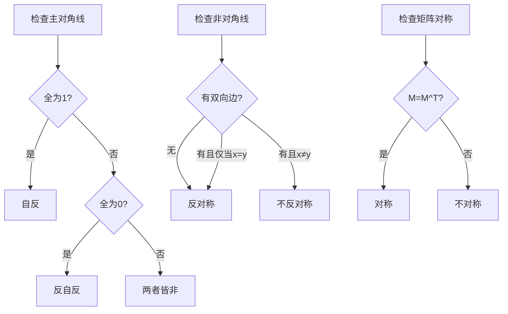

# 关系的自反性、反自反性、对称性、反对称性与传递性的判定

> [!IMPORTANT]
> 关系的五种基本性质是判定等价关系与偏序关系的基石，也是期末大题（如哈斯图、闭包）的前置条件。

设 $R$ 为集合 $X$ 上的二元关系。面对一个具体的关系矩阵或关系图，我们如何快速判断它具备哪些性质？不妨先问自己两个问题：这个关系里，每个元素“指向自己”了吗？如果 $x$ 能到 $y$，$y$ 一定能回 $x$ 吗？顺着这两个问题，五种性质便自然浮现。

## 定义与直观理解

- **自反性**：$\forall x \in X, \langle x,x \rangle \in R$。==关系矩阵主对角线全为 1==，关系图中每个节点都有自环。
- **反自反性**：$\forall x \in X, \langle x,x \rangle \notin R$。主对角线全为 0，无任何自环。
- **对称性**：$\langle x,y \rangle \in R \Rightarrow \langle y,x \rangle \in R$。课件特别指出：若根本没有 $\langle x,y \rangle \in R$，也视为满足对称性。矩阵关于主对角线对称，图中箭头必成对出现。
- **反对称性**：$\langle x,y \rangle \in R \land \langle y,x \rangle \in R \Rightarrow x = y$。即若 $x \neq y$，则双向箭头不能同时存在。其等价判定条件为 $R \cap R^c \subseteq I_X$（其中 $R^c$ 为逆关系，$I_X$ 为恒等关系）。
- **传递性**：$\langle x,y \rangle \in R \land \langle y,z \rangle \in R \Rightarrow \langle x,z \rangle \in R$。图中若有路径 $x \to y \to z$，则必须有直达边 $x \to z$。

## 易混淆概念辨析

> [!WARNING]
> ==“反对称”绝不是“不对称”，“反自反”也不是“不自反”！==

| 对比项 | 含义区别 | 能否共存 |
| :--- | :--- | :--- |
| 自反 vs 反自反 | 主对角线全1 vs 全0 | 互斥（除非 $X=\varnothing$） |
| 对称 vs 反对称 | 有去必有回 vs 有去有回则必同一点 | 可共存（如恒等关系 $I_X$） |

课件中给出的判定表印证了这一点：某关系 $R_1$ 既不是自反的，也不是反自反的，但它同时满足对称性与反对称性。这说明这两种性质并不矛盾——当关系中根本不存在 $x \neq y$ 的双向有序对时，对称和反对称的条件都被“空真”地满足了。

## 证明技巧与实例

在证明题中，常需利用关系运算来判定性质。例如课件中证明“若 $R, S$ 均对称，则 $R \cap S$ 也对称”的逻辑链非常经典：

$$
\forall \langle x,y \rangle \in R \cap S \Rightarrow \langle x,y \rangle \in R \land \langle x,y \rangle \in S
$$
由 $R, S$ 对称知 $\langle y,x \rangle \in R \land \langle y,x \rangle \in S$，故 $\langle y,x \rangle \in R \cap S$。

再看反对称性的代数证明思路：要证 $R$ 反对称，只需证明 $R \cap R^c \subseteq I_X$。因为 $\langle x,y \rangle \in R \cap R^c \Leftrightarrow \langle x,y \rangle \in R \land \langle y,x \rangle \in R$，若该交集被包含于恒等关系 $I_X$ 中，则必然推出 $x=y$。

> [!TIP]
> 实战做题口诀：**看对角线定自反/反自反，看对称性定对称/反对称，找三角路径查传递**。后续求等价类需要“自反+对称+传递”，画哈斯图的前提则是“自反+反对称+传递”（即偏序集），切勿将性质张冠李戴。
