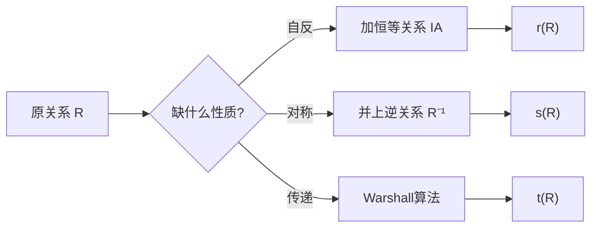

# 自反闭包r(R)、对称闭包s(R)与传递闭包t(R)的求法

## 为什么需要闭包运算

给定集合 $A$ 上的关系 $R$，它未必具备自反、对称或传递性。但在等价关系与偏序关系的判定中，这些性质缺一不可。如果 $R$ 缺少某种性质，我们能否以“最小代价”添加最少的有序对，使其满足该性质？这就是==闭包运算==的核心思想：在包含 $R$ 的前提下，构造满足特定性质的最小关系。

## 三种闭包的定义与求法

设 $R$ 是集合 $A$ 上的二元关系，三种闭包的构造方法如下表所示：

| 闭包类型 | 记号 | 集合运算公式 | 矩阵运算公式 | 关系图操作 |
| :--- | :--- | :--- | :--- | :--- |
| 自反闭包 | $r(R)$ | $R \cup I_A$ | $M_R \lor I$ | 每个节点加自环 |
| 对称闭包 | $s(R)$ | $R \cup R^{-1}$ | $M_R \lor M_R^T$ | 单向边变双向边 |
| 传递闭包 | $t(R)$ | $\bigcup_{i=1}^{n} R^i$ | $\bigvee_{i=1}^{n} M_R^i$ | 补全所有可达路径 |

> [!IMPORTANT]
> 传递闭包的计算是考试重难点。当 $|A|=n$ 时，只需计算到 $R^n$ 即可停止，即 $t(R) = R \cup R^2 \cup \dots \cup R^n$。实际解题推荐使用 ==Warshall 算法==，避免反复做矩阵乘法。

## 典型例题演算

设 $A=\{-1, 0, 1\}$，$R=\{\langle-1,0\rangle, \langle1,0\rangle\}$，求三种闭包。

**自反闭包**：补上 $A$ 中所有元素的自环，得 $r(R)=R \cup \{\langle-1,-1\rangle, \langle0,0\rangle, \langle1,1\rangle\}$。

**对称闭包**：将 $R$ 中每个有序对逆转后并入，得 $s(R)=R \cup \{\langle0,-1\rangle, \langle0,1\rangle\}$。

**传递闭包**：检查是否存在 $\langle a,b\rangle \in R$ 且 $\langle b,c\rangle \in R$ 但 $\langle a,c\rangle \notin R$ 的情况。本例中 $R$ 的两个有序对第二个分量均为 $0$，而 $0$ 不是任何有序对的第一个分量，无法构成传递链，故 ==$t(R)=R$==。

> [!TIP]
> 若用矩阵法验证：写出 $M_R$，计算 $M_R^2$。若 $M_R^2$ 中无非零新元素出现，则 $t(R)=R$，无需继续算更高次幂。

## 易错点辨析

> [!WARNING]
> 求 $t(R)$ 时最常见的错误是==漏掉间接路径==。例如 $R=\{\langle1,2\rangle,\langle2,3\rangle\}$，必须补上 $\langle1,3\rangle$；若还有 $\langle3,4\rangle$，则还需补 $\langle1,4\rangle$ 和 $\langle2,4\rangle$。务必逐层检查或使用 Warshall 算法系统求解。

> [!CAUTION]
> 闭包运算的顺序不可随意交换！一般地 $tsr(R) \neq str(R)$。只有先做自反、再做对称、最后做传递，才能保证结果同时具备三种性质（即等价闭包）。单独求某一种闭包时不受此限制。

> [!NOTE]
> 自反闭包与对称闭包具有封闭性：$r(r(R))=r(R)$，$s(s(R))=s(R)$。但传递闭包不一定保持自反性或对称性，需根据题目要求判断是否需要复合运算。
