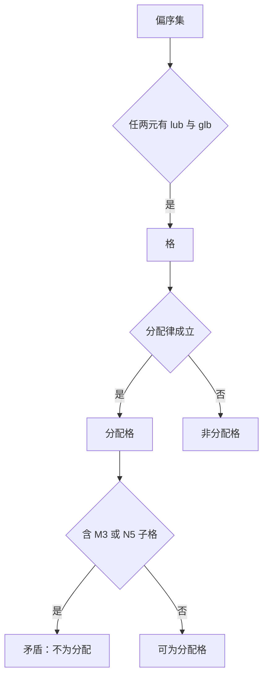

# 分配格的定义、判定条件及非分配格的典型特征

分配格（distributive lattice）是格结构中对"分配律"做出要求的子类。回忆普通格的定义：偏序集 $\langle A, \leq \rangle$ 中任两元都有最小上界 $\vee$ 与最大下界 $\wedge$。分配格进一步要求 $\vee$ 对 $\wedge$ 可分配（反之亦然），即

$$
a \vee (b \wedge c) = (a \vee b) \wedge (a \vee c),\quad
a \wedge (b \vee c) = (a \wedge b) \vee (a \wedge c)
$$

对任意 $a,b,c\in A$ 成立。==只要其中一条成立，另一条由对偶原理自动成立==，故只需证一条。分配律刻画的是"并可穿过交"的代数规律，它为后面布尔代数（分配 + 有补 + 有界）提供前提。

## 判定思路与子格继承

判定时常见两条路：

- **逐元素验证**：直接对三元组枚举，验证分配等式，如证明 $\langle \mathbb Z, \max, \min\rangle$ 是分配格。
- **利用结构**：分配格的==任意子格仍为分配格==（运算继承自母格）；判定 $n\ge 5$ 的格时，看它是否"含有同构于钻石格 $M_3$ 或五角格 $N_5$ 的子格"，若含则必非分配。

## 非分配格的典型特征

$M_3$（钻石格）与 $N_5$（五角格）是判非分配的关键反例：

| 格 | 元数 | 直观结构 | 典型反例情形 |
| --- | --- | --- | --- |
| $M_3$ | 5 | 底 $0$、顶 $1$、三个中间元两两不可比 | $a \wedge (b \vee c)=0$，但 $(a\wedge b)\vee(a\wedge c)=0$，破坏吸收之外的分配 |
| $N_5$ | 5 | 底 $0$、顶 $1$，三条腿有"长链+短腿"不对称 | 取链 $a<b<c$ 与旁支 $d$，构造反例 |

> [!WARNING]
> ==五元及以上格的分配性判定=查 $M_3$/$N_5$==。若同构于其中任一（或含其子格），立即判非分配。

> [!TIP]
> 记忆口诀："钻石三个中间并排，五角一长两短斜挂"。$M_3$、$N_5$ 的非分配性可用一张 Hasse 图对照记住。

## 一个算对的例子

证明 $\langle \mathbb Z, \vee, \wedge\rangle$ 是分配格，其中 $a\vee b=\max(a,b)$，$a\wedge b=\min(a,b)$。

**步骤：** 先证是格（封闭、交换、结合、吸收），再证分配。设 $a>b>c$：

- 左：$a \vee (b \wedge c) = a \vee c = a$
- 右：$(a \vee b) \wedge (a \vee c) = a \wedge a = a$

两边相等。对 $a,b,c$ 的全序共 6 种相对大小（$a=b=c$、$a>b>c$ 等），逐一验证同理。再由对偶原理得 $a \wedge (b \vee c) = (a\wedge b) \vee (a\wedge c)$。故 $\langle \mathbb Z, \max, \min\rangle$ ==是分配格==。

> [!NOTE]
> 与"布尔格"的区别：分配格不必然有界、有补；==分配格+有界+有补才构成布尔格==。如 $\langle \mathbb Z,\max,\min\rangle$ 无 $0/1$，因而不是布尔格。
