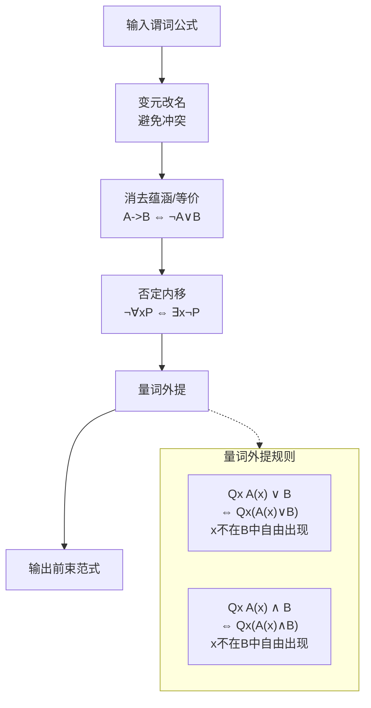

# 前束范式的定义及谓词公式化为前束范式的方法

# 前束范式及其求法

## 什么是前束范式？

在谓词逻辑中，如果一个公式的所有量词（$\forall, \exists$）都非否定地出现在公式的最左边，且其辖域延伸至公式末尾，其余部分不含量词，则称该公式为==前束范式==。

形式化定义为：
$$ Q_1 x_1 Q_2 x_2 \dots Q_n x_n M $$
其中 $Q_i$ 为量词，$M$ 为**不含量词**的母式。

> [!IMPORTANT]
> 核心目标：将量词“提取”到最前端，使母式 $M$ 成为命题逻辑公式。这是进行自动化推理和判定可满足性的基础步骤。

## 为什么要化为前束范式？

1.  **标准化**：消除量词位置的随意性，统一公式结构。
2.  **后续处理前提**：它是求解==前束合取范式==或==前束析取范式==，以及进一步化为==Skolem标准形==（消去存在量词）的必要前置步骤。

## 转化步骤与规则

化为前束范式通常遵循以下流程，可概括为“改名、去蕴涵、内移否定、外提量词”。

> [!TIP]
> **量词外提口诀**：
> 1. 若变量 $x$ 不在 $B$ 中自由出现，量词可直接提出。
> 2. **注意蕴涵式**：$(\forall x)A(x) \to B \Leftrightarrow (\exists x)(A(x) \to B)$；$(\exists x)A(x) \to B \Leftrightarrow (\forall x)(A(x) \to B)$。**前件量词提出时，全称变存在，存在变全称。**

## 常见陷阱与辨析

| 易错点 | 正确做法 | 错误示例 |
| :--- | :--- | :--- |
| **变元冲突** | 不同辖域的同名变元必须==改名== | 直接合并导致约束混乱 |
| **蕴涵前件** | $\forall$ 提至前件时变为 $\exists$ | $(\forall x)A \to B$ 误写为 $\forall x(A \to B)$ |
| **自由变元** | 确认 $x$ 是否在另一子句中自由出现 | 忽略依赖关系强行提取 |

> [!WARNING]
> 在处理 $\neg (\forall x) P(x)$ 时，务必先将否定符号深入内部，转化为 $(\exists x) \neg P(x)$，切勿直接将 $\forall x$ 提到最外层而保留外部否定。

## 典型例题解析

**题目**：求 $(\forall x)(\forall y)((\exists z)(A(x, z) \land B(x, z)) \rightarrow (\exists u)R(x, y, u))$ 的前束范式。

**解析过程**：

1.  **观察结构**：公式主体为蕴涵式 $A \to B$。前件含 $\exists z$，后件含 $\exists u$。
2.  **处理前件量词**：根据规则，前件中的存在量词 $\exists z$ 提出到蕴涵式外侧时，需变为全称量词 $\forall z$。
    $$ (\exists z)\Phi(z) \to \Psi \Leftrightarrow (\forall z)(\Phi(z) \to \Psi) $$
    此时公式变为：
    $$ (\forall x)(\forall y)(\forall z)((A(x, z) \land B(x, z)) \rightarrow (\exists u)R(x, y, u)) $$
3.  **处理后件量词**：后件中的存在量词 $\exists u$ 处于后件，提出时保持符号不变（仍为 $\exists u$），且 $u$ 不在前件中出现。
    $$ \Phi \to (\exists u)\Psi(u) \Leftrightarrow (\exists u)(\Phi \to \Psi(u)) $$
4.  **最终结果**：
    $$ (\forall x)(\forall y)(\forall z)(\exists u)((A(x, z) \land B(x, z)) \rightarrow R(x, y, u)) $$

> [!NOTE]
> 此题无需改名，因为 $z$ 和 $u$ 作用域原本就不重叠，且与 $x,y$ 无冲突。若遇同名冲突（如计算3），务必先执行==换名规则==。
