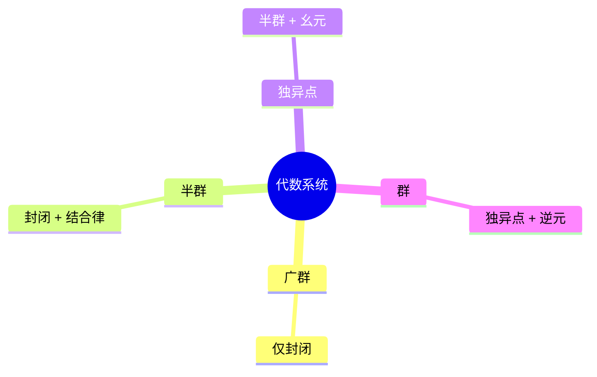

# 半群、子半群、独异点（含幺半群）及子独异点的定义与判定

## 代数结构的基石：从半群到独异点

在离散数学的代数系统中，我们常通过运算的性质来对集合进行分类。**半群**与**独异点**是构建更复杂结构（如群、环）的基础。理解它们的关键在于把握两个核心属性：**结合律**与**幺元**。

> [!IMPORTANT]
> **定义判定核心**
> - **半群 (Semigroup)**：代数系统 $<S, *>$ 满足 ==封闭性== 和 ==结合律==。
> - **独异点 (Monoid)**：在半群的基础上，存在 ==幺元 (Identity Element)== $e$，使得 $\forall a \in S, a*e = e*a = a$。

### 为什么需要区分？

想象一下矩阵乘法或函数复合，它们天然满足结合律但不一定可交换。半群捕捉了这种“顺序执行但结果确定”的特性。而引入幺元（独异点），相当于引入了“空操作”或“单位1”，这是定义逆元的前提。没有幺元，就无法谈论“撤销”一个操作。

### 子结构的判定陷阱

对于子半群和子独异点，判定条件有细微差别，这是考试的高频坑点。

| 概念 | 判定条件 | 关键点 |
| :--- | :--- | :--- |
| **子半群** | $B \subseteq A$，且 $*$ 在 $B$ 上封闭 | 只要封闭，结合律自动继承 |
| **子独异点** | $B \subseteq A$，封闭，且 **$e_B = e_A$** | 幺元必须与原系统一致 |

> [!WARNING]
> **常见误区**：子独异点的幺元必须是原独异点的幺元。
> 例如：$<\mathbb{Z}, \cdot>$ 是独异点，幺元为 1。考虑子集 $2\mathbb{Z}$（偶数集），虽然它在乘法下封闭构成子半群，但它没有幺元（或者说其局部幺元不存在于集合中或不等于1），因此不是子独异点。

### 典型例题解析

**题目**：在整数集 $\mathbb{Z}$ 上定义运算 $a * b = a + b + ab$。证明 $<\mathbb{Z}, *>$ 是独异点，并求幺元。

**解题思路**：
1.  **封闭性**：整数加法、乘法封闭，故 $a+b+ab$ 仍为整数。
2.  **结合律**：需验证 $(a*b)*c = a*(b*c)$。
    $$
    \begin{aligned}
    (a*b)*c &= (a+b+ab)*c = a+b+ab+c+(a+b+ab)c \\
    &= a+b+c+ab+ac+bc+abc
    \end{aligned}
    $$
    同理展开 $a*(b*c)$ 可得相同结果，故满足结合律，它是半群。
3.  **找幺元**：设幺元为 $e$，则 $a*e=a$。
    $$ a + e + ae = a \implies e(1+a) = 0 $$
    由于对任意 $a$ 成立，取 $a=0$ 得 $e=0$。验证 $0*a = 0+a+0=a$，成立。

> [!TIP]
> **快速判定技巧**
> 若运算表给出，检查**对称性**看交换律，检查**主对角线**看幂等元。找幺元时，寻找某一行/列与表头完全一致的行列。

==核心结论==：证明独异点只需三步走：一证封闭，二证结合，三找幺元。子结构判定务必确认幺元是否“传承”。
