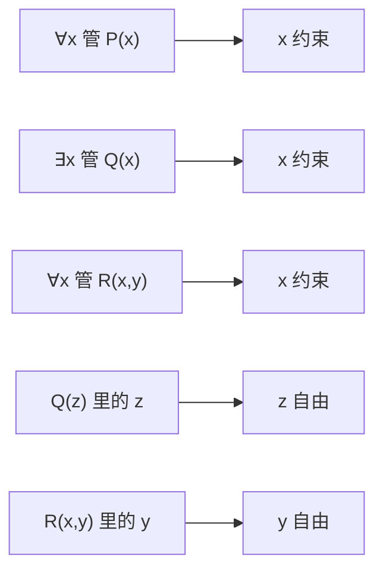

# 自由变元与约束变元的区分、作用域及换名代入规则

## 它是什么

在谓词逻辑里，量词只管住它后面的一段公式，这段公式叫**量词的作用域**。被量词管住、跟着指导变元走的变元叫**约束变元**；没被任何量词管住、能在作用域里“自己说话”的变元叫**自由变元**，也叫**参数**。同一个字母可以在一个大作用域里是约束变元，在另一个小作用域里却是自由变元。

先想一个小问题：在 $(\forall x)(P(x)\land Q(x,y))\lor R(x,z)$ 里，$x$ 到底被谁约束？你会发现：前面的 $x$ 被 $(\forall x)$ 约束，后面的 $R(x,z)$ 里的 $x$ 没人管，成了自由变元。

## 为什么需要区分

区分自由变元和约束变元，是为了看清公式到底还剩几个“未定量”。如果 $n$ 元谓词里有 $k$ 个变元被约束，就变成 $n-k$ 元谓词；全约束完，就变成**命题**。

> [!IMPORTANT]
> ==核心结论==：约束变元不自由、随量词走；自由变元虽可出现在量词作用域里，却不受该量词指导变元约束。

## 怎么做：作用域、换名与代入

换名规则和代入规则是两套操作：

- **约束变元换名**：只换某个量词及其作用域里的指导变元，不影响别的同名约束区，也不动自由变元。
- **自由变元代入**：要把公式里该自由变元出现的**每一处**都换掉。

来看课件里的例子 $(\exists x)(\forall y)(P(x,z)\to Q(x,y))\land R(x,y)$。这里 $x,y$ 既有约束出现，也有自由出现。换约束变元时，把前面的 $x$ 换成 $u$：

$$(\exists u)(\forall y)(P(u,z)\to Q(u,y))\land R(x,y)$$

而自由变元代入（如题 3(1) 把自由 $z$ 换成 $u$）要全文替换：

$$((\exists y)Q(u,y)\to(\forall x)R(x,y))\lor(\exists x)S(x,y,u)$$

| 操作 | 换谁 | 范围 | 例子片段 |
|---|---|---|---|
| 约束变元换名 | 某个量词指导变元 | 仅该量词作用域 | $(\forall x)P(x)\to(\forall u)P(u)$ |
| 自由变元代入 | 自由出现的字母 | 全文每一处 | 自由 $y\to v$，所有 $y$ 都变 |

## 常见的坑

> [!WARNING]
> 别把“$(\forall x)$ 后面所有同名 $x$”都当成约束。若公式写成 $(\forall x)P(x)\lor Q(x)$，后一个 $x$ 在析取支外面，仍是自由变元。

> [!CAUTION]
> 自由变元代入不能只换一半。漏一处，公式意思就变了，考试直接扣分。

## 算对了的例子

看习题：指出 $(\forall x)(P(x)\land(\exists x)Q(x))\lor((\forall x)R(x,y)\land Q(z))$ 的约束变元和自由变元。

答案是：==约束变元为 $x$，自由变元为 $y,z$==。因为三个量词各自的作用域都只把 $x$ 收编了，$y$ 和 $z$ 始终没人用全称或存在量词去约束，所以它们保持自由。
