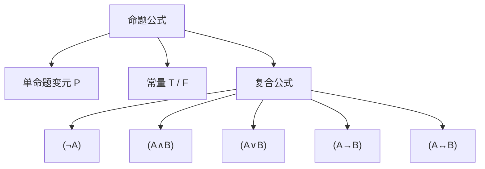

# 命题公式的递归定义与自然语言符号化翻译

## 命题公式的递归定义

在离散数学中，**命题公式**是由命题变元、联结词和括号按一定规则构成的符号串。它的定义是递归的：

1. **基础**：单个命题变元（如 $P$、$Q$、$R$）是命题公式；命题常量 $T$（真）、$F$（假）也是命题公式。
2. **归纳**：若 $A$ 和 $B$ 是命题公式，则 $(\neg A)$、$(A \land B)$、$(A \lor B)$、$(A \to B)$、$(A \leftrightarrow B)$ 也是命题公式。
3. **极小性**：仅由以上两条规则生成的符号串才是命题公式。

> [!IMPORTANT]
> 递归定义保证了每个命题公式都有唯一的结构树，==括号的省略必须遵循联结词优先级==：$\neg > \land > \lor > \to > \leftrightarrow$。例如 $P \to Q \lor R$ 应理解为 $P \to (Q \lor R)$。

## 自然语言符号化翻译

将自然语言翻译为命题公式，关键在于识别语境中联结词的逻辑含义。

| 自然语言 | 逻辑联结词 | 符号 |
|:---:|:---:|:---:|
| 不、非、没有 | 否定 | $\neg$ |
| 且、和、同时 | 合取 | $\land$ |
| 或、至少一个 | 析取 | $\lor$ |
| 如果……那么……、只要……就…… | 蕴含 | $\to$ |
| 仅当、只有……才…… | 蕴含（反向） | $\to$ |
| 当且仅当、等价于 | 双条件 | $\leftrightarrow$ |

> [!TIP]
> 翻译口诀：==“当”在前是充分，“仅当”在后是必要==。  
> - “$P$ 当 $Q$”：$Q \to P$（$Q$ 是充分条件）  
> - “$P$ 仅当 $Q$”：$P \to Q$（$Q$ 是必要条件）  
> - “$P$ 当且仅当 $Q$”：$P \leftrightarrow Q$

> [!WARNING]
> **“或”的歧义**：自然语言中“或”有时是**排斥或**（要么……要么……），但命题逻辑中的 $\lor$ 是**可兼或**。例如“他明天去北京或上海”若理解为不可同时去两地，则需要表达为：$(P \lor Q) \land \neg(P \land Q)$。

## 一个完整的例子

**题**：设 $P$ 表示“天下雪”，$Q$ 表示“我将去镇上”，$R$ 表示“我有时间”。请符号化：

a) 如果天不下雪和我有时间，那么我将去镇上。  
b) 我将去镇上，仅当我有时间。

**分析过程**：

- (a) 句子的结构是“如果（条件），那么（结论）”。条件部分包含两个并列事实：“天不下雪”（即 $\neg P$）和“我有时间”（$R$），用 $\land$ 连接。结论是“我将去镇上”（$Q$）。整个句子是蕴含式。

  答案：(a) ==$(\neg P \land R) \to Q$==

- (b) 句子中出现“仅当”，这是一个必要条件判断。被修饰的对象“我将去镇上”（$Q$）是蕴含式的前件，“我有时间”（$R$）是后件。记忆口诀：“$Q$ 仅当 $R$”就是 $Q \to R$。

  答案：(b) ==$Q \to R$==

> [!CAUTION]
> 初学者容易把“仅当”直接写成 $R \to Q$，这是受“当”字迷惑。注意区分：  
> - “$Q$ 当 $R$” = “如果 $R$ 则 $Q$” = $R \to Q$  
> - “$Q$ 仅当 $R$” = “如果 $Q$ 则必须有 $R$” = $Q \to R$

这两个命题虽然符号上只是前后件对调，但逻辑含义完全不同。在真值表中，$P \to Q$ 只有在 $P$ 真 $Q$ 假时为假，其余情况为真——这是蕴含的“善意推定”特性，也是学习者最初最不适应的一个点。
