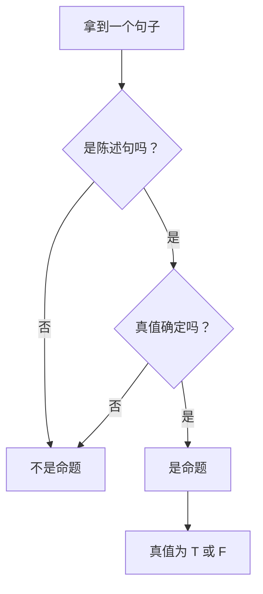

# 命题的概念与命题变元的表示法

> [!IMPORTANT]
> ==命题是能判断真假的陈述句==。一个句子要成为命题，必须同时满足两个条件：**是陈述句**、**有确定的真值（真或假）**。

## 什么是命题？

先看一句话：“$x+y>4$”。它是命题吗？

由于 $x, y$ 未赋值，这句话的真假无法确定，因此它不是命题。再看“计算机有空吗?”，这是疑问句，连陈述句都不是，当然也不是命题。

由此可以归纳出命题的判定流程：

> [!WARNING]
> “真值目前无法确定”不等于“没有确定真值”。例如“小李在宿舍里”，虽然你现在不知道真假，但客观上他要么在、要么不在，真值是确定的，所以它是命题。而含未赋值变量的谓词（如 $x>3$）真值根本不确定，不是命题。

不能分解为更简单命题的命题称为**原子命题**；由原子命题通过联结词组合而成的称为**复合命题**。

## 为什么需要命题变元？

自然语言太啰嗦且容易产生歧义。比如“如果天下大雨，他就乘班车上班”，每次推理都要写这么长一串文字，非常麻烦。我们需要一种像代数一样的符号系统来代替文字，这就是引入**命题变元**的原因。

用英文小写字母 $p, q, r, \dots$ 表示命题，称为命题变元。将自然语言翻译成命题公式的过程叫**符号化**。

## 怎么进行符号化？

符号化的核心步骤只有两步：
1. **拆解**：找出句子中的所有原子命题，分别用字母表示。
2. **连接**：分析句子中的逻辑关系，用五种基本联结词（$\neg, \wedge, \vee, \rightarrow, \leftrightarrow$）将它们连起来。

以真题为例：“我既不看电视也不外出，我在睡觉。”

- 找原子命题：设 $p$: 我看电视；$q$: 我外出；$r$: 我睡觉。
- 找逻辑关系：“既不…也不…”对应 $\neg p \wedge \neg q$；逗号前后是并列的“并且”关系，对应合取 $\wedge$。
- 最终符号化为：$(\neg p \wedge \neg q) \wedge r$。

> [!TIP]
> 看到“一面…一面…”、“既…又…”、“与…都…”等词，直接反应为合取 $\wedge$；看到“除非…否则…”要注意转化为条件式。

## 相近概念与自然语言的坑

自然语言中的同一个词，在不同语境下对应的联结词可能完全不同。最典型的坑就是“与”和“或”。

| 自然语言 | 实际逻辑含义 | 正确符号化 | 易错点 |
| :--- | :--- | :--- | :--- |
| 刘英与李进上山 | 两人各自上山（可拆分） | $p \wedge q$ | 误当成原子命题 |
| 李辛与李末是兄弟 | 描述两人关系的整体（不可拆） | $p$（原子命题） | 误拆成 $p \wedge q$ |
| 停机的原因在于语法错误或程序错误 | 原因导致结果（蕴含） | $(q \vee r) \rightarrow p$ | 弄反因果方向 |

> [!CAUTION]
> 判断“与/和”能不能拆，标准是：拆开后的两句话是否依然独立成立且意思不变。“刘英上山”和“李进上山”各自成立，可拆；但“李辛是兄弟”不成立，不可拆，只能整体作为原子命题。

再练一道条件命题的翻译：
设 $p$: 天下雪；$q$: 我将进城；$r$: 我有时间。
将“如果天不下雪而我又有时间的话，我将进城”符号化。

先处理前件：“天不下雪”是 $\neg p$，“我又有时间”是 $r$，“而”是合取 $\wedge$，故前件为 $\neg p \wedge r$。
后件是 $q$。
“如果…则…”是条件联结词 $\rightarrow$。
最终结果：$(\neg p \wedge r) \rightarrow q$。

> [!NOTE]
> 命题与命题变元是后续学习真值表、范式以及推理证明的基石。符号化一旦出错，后面的推导全盘皆输。务必多练自然语言到逻辑公式的翻译。
