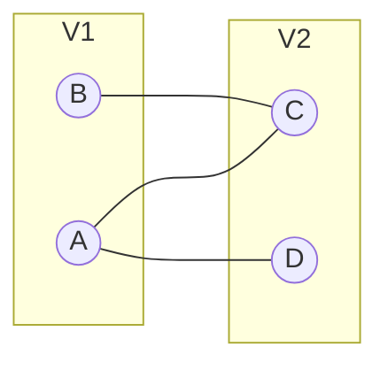

# 无向图与有向图、顶点的度数、握手定理、简单图、完全图、二部图与匹配

图论是离散数学中研究“关系”的利器。想象一下：如果把城市看作点，道路看作线，我们该如何用数学语言描述这张网？

## 无向图与有向图

**无向图**的每一条边都没有方向（如双向通行的桥）；**有向图**的每一条边都有明确方向（如单行道）。

| 概念 | 无向图 | 有向图 |
| :--- | :--- | :--- |
| **度数定义** | 关联该顶点的边数 | 入度 $d^-(v)$ + 出度 $d^+(v)$ |
| **完全图记号** | $K_n$ | 有向完全图 |
| **邻接矩阵** | 必为对称矩阵 | 不一定对称 |

> [!NOTE]
> 在有向图中，所有结点的入度之和恒等于所有结点的出度之和。

## 简单图与完全图

- **简单图**：==不含有平行边和环的图==。
- **完全图** $K_n$：每一对结点之间都有边关联的简单图。

$n$ 个结点的无向完全图 $K_n$ 的边数为 $\frac{n(n-1)}{2}$。为什么？因为每个结点的度数都是 $n-1$，共有 $n$ 个结点。

## 握手定理

既然每个结点度数是 $n-1$，那把所有结点的度数加起来会怎样？每条边被它的两个端点各算了一次！这就引出了图论最核心的定理：

> [!IMPORTANT]
> **握手定理**：任何无向图中，所有顶点的度数之和等于边数的两倍，即 $\sum_{v \in V} d(v) = 2|E|$。

由此可推出一个秒杀判断题的结论：==任何图中，奇数度结点的个数必为偶数==。

### 算对了的例子（真题重现）

**题目**：设无向图 $G$ 有 16 条边，有 3 个 4 度结点，4 个 3 度结点，其余结点的度数均小于 3，问：$G$ 中至少有几个结点？

**解题思路**：要让结点总数最少，就得让“其余结点”贡献的度数尽可能大，即全取最大允许值 2 度。设有 $x$ 个 2 度结点，由握手定理列方程：

$$3 \times 4 + 4 \times 3 + 2 \times x = 2 \times 16$$

解得 $x = 4$。因此 $G$ 至少有 $3 + 4 + 4 = 11$ 个结点。

> [!WARNING]
> 判断题常考陷阱：“若图含 4 个结点，度数分别为 1, 3, 5, 6”。错在哪？第一，度数之和 $1+3+5+6=15$ 为奇数，违反握手定理；第二，若是 4 阶简单图，最大度数不能超过 $n-1=3$。

## 二部图与匹配

如果图的顶点集能划分为两个不相交的子集 $V_1, V_2$，且每条边的两个端点分别属于这两个子集，这就是**二部图**。完全二部图记为 $K_{n,m}$。

**匹配**是指选出若干条没有公共端点的边。在复习提纲中，二部图常结合欧拉图、哈密尔顿图考查：

- $K_{n,m}$ 为欧拉图的条件：连通且所有顶点度数为偶数，即 ==$n, m$ 均为偶数==。
- $K_{n,m}$ 为哈密尔顿图的条件：存在经过每个顶点恰好一次的回路，要求 ==$n = m \ge 2$==。
