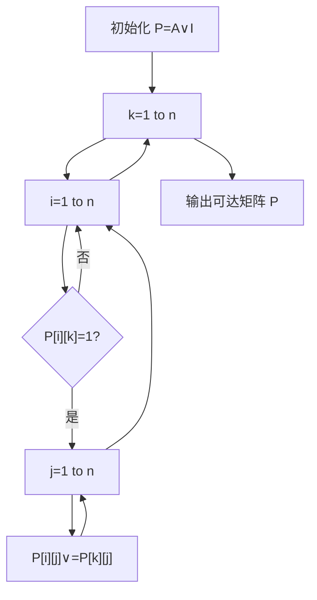

# 邻接矩阵、可达矩阵与关联矩阵的构造及在最短路与连通性中的应用

## 三种矩阵的本质区别

面对图论问题时，你是否困惑过：什么时候该用邻接矩阵，什么时候又该求可达矩阵？其实它们回答的是不同层面的问题。

> [!IMPORTANT]
> ==邻接矩阵 $A$ 描述“一步直达”关系，而可达矩阵 $P$ 描述“任意步可达”关系。==

- **邻接矩阵 $A(G)$**：$a_{ij}=1$ 表示 $v_i$ 到 $v_j$ 有边直接相连。它是图的“快照”。
- **可达矩阵 $P(G)$**：$p_{ij}=1$ 表示 $v_i$ 到 $v_j$ 存在至少一条路（长度 $\ge 0$）。它是图的“连通性全貌”。
- **关联矩阵 $M(G)$**：描述“点与边”的关系，而非点与点。行对应结点，列对应边。

| 矩阵类型 | 维度 | 核心用途 | 对称性（无向图） |
| :--- | :--- | :--- | :--- |
| 邻接矩阵 $A$ | $n \times n$ | 路径计数、度数计算 | 对称 |
| 可达矩阵 $P$ | $n \times n$ | 连通性判定、强/弱连通分类 | 对称 |
| 关联矩阵 $M$ | $n \times m$ | 圈空间分析、网络流 | 不要求 |

## 邻接矩阵的幂与路径计数

如何不画图就知道两点间有多少条特定长度的路？答案藏在矩阵乘法中。

> [!NOTE]
> 定理：$(A^l)_{ij}$ 的值等于从 $v_i$ 到 $v_j$ ==长度为 $l$ 的路的数目==。

例如计算 $v_1$ 到 $v_4$ 长度为2的路径数，只需算 $A^2$ 的第1行第4列元素。这本质是枚举所有中间结点 $v_k$，将 $v_i \to v_k$ 与 $v_k \to v_j$ 的路径数相乘再求和：$a_{ij}^{(2)} = \sum_{k=1}^{n} a_{ik} \cdot a_{kj}$。

[!TIP]
求各结点度数无需遍历图：有向图中，$A$ 第 $i$ 行之和为 $v_i$ 的出度 $\deg^+(v_i)$，第 $j$ 列之和为入度 $\deg^-(v_j)$。无向图中行列和相等即为度数。

## 可达矩阵构造与 Warshall 算法

判断连通性时，难道要手动计算 $A + A^2 + \cdots + A^n$ 吗？当 $n$ 较大时这不可行。

> [!WARNING]
> 直接用布尔和 $B_n = A \lor A^2 \lor \cdots \lor A^n$ 求可达矩阵复杂度高达 $O(n^4)$，==考试与工程均推荐 Warshall 算法==，复杂度仅 $O(n^3)$。

Warshall 算法的核心思想是动态规划：逐步引入中间结点 $v_k$，更新可达性。

注意初始时 $P = A \lor I$（加入单位阵），因为每个结点到自身默认可达（长度为0的路）。若题目问“是否存在非零长度的路”，则需另行处理对角线。

## 实战演练：从邻接矩阵到路径计数

以课件中的有向图为例，已知邻接矩阵：

$$
A = \begin{pmatrix} 0 & 1 & 0 & 0 \\ 0 & 0 & 1 & 1 \\ 1 & 1 & 0 & 1 \\ 1 & 1 & 0 & 0 \end{pmatrix}
$$

求 $v_1$ 到 $v_4$ 长度为2的路径数。计算 $A^2$：

$$
A^2 = \begin{pmatrix} 0 & 0 & 1 & 1 \\ 2 & 2 & 0 & 1 \\ 1 & 2 & 1 & 1 \\ 0 & 1 & 1 & 1 \end{pmatrix}
$$

查得 $(A^2)_{14} = 1$，故==恰有1条长度为2的路==（即 $v_1 \to v_2 \to v_4$）。同时可读出：$\deg^+(v_1)=1$（第1行和），$\deg^-(v_4)=2$（第4列和）。

> [!CAUTION]
> 关联矩阵中若有自回路，对应列在该结点行填2（无向）或特殊标记（有向），但==南邮考题通常假定无自回路==，按标准±1填写即可。
