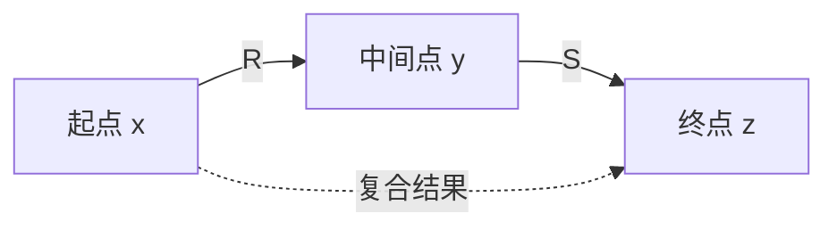

# 关系的复合运算（合成）与逆关系的定义及性质

## 定义与直观理解

设 $R\subseteq X\times Y$，$S\subseteq Y\times Z$。关系 $R$ 与 $S$ 的**复合关系（合成关系）**为
$$
R\circ S=\{\langle x,z\rangle\mid \exists y\in Y,\ \langle x,y\rangle\in R\land \langle y,z\rangle\in S\}.
$$
也就是：若 $x\xrightarrow{R}y$，$y\xrightarrow{S}z$，则 $x\xrightarrow{R\circ S}z$。==中间元素 $y$ 必须相同，而且只起“过桥”作用，不出现在结果中。==

关系 $R$ 的**逆关系**记作 $R^C$（也常记作 $R^{-1}$）：
$$
R^C=\{\langle y,x\rangle\mid \langle x,y\rangle\in R\}.
$$
求逆只需把每个有序对的前后分量交换；在关系图中，就是把所有箭头反向。

> [!IMPORTANT]
> 本课件采用 $R\circ S$ 表示“先走 $R$，再走 $S$”。做题时先确认教材和题目的记号约定，不要仅凭阅读习惯判断先后。

## 为什么需要这两种运算

复合可以描述“经过两步得到的联系”。例如，$R$ 表示“学生—所选课程”，$S$ 表示“课程—开课教师”，则 $R\circ S$ 表示“学生—其选课对应的教师”。逆关系则描述反方向联系，如把“$a$ 小于 $b$”反转为“$b$ 大于 $a$”。

复合还是关系幂与闭包计算的基础：
$$
R^2=R\circ R,\qquad R^3=R^2\circ R,
$$
而传递闭包可写为 $t(R)=R\cup R^2\cup R^3\cup\cdots$。

## 怎样求复合关系

推荐使用“**固定起点—寻找中间点—沿第二个关系到终点**”的方法：

1. 取 $\langle x,y\rangle\in R$；
2. 在 $S$ 中找所有以 $y$ 为第一分量的有序对 $\langle y,z\rangle$；
3. 把 $\langle x,z\rangle$ 加入结果，最后去重。

若用关系矩阵，设 $M_R=(r_{ij})$、$M_S=(s_{jk})$，则复合矩阵采用**布尔运算**：
$$
M_{R\circ S}=M_R\circ M_S,\qquad
(M_{R\circ S})_{ik}=\bigvee_j(r_{ij}\land s_{jk}).
$$
因此，普通矩阵乘法中只要某条路径存在，对应位置就记为 $1$，不能把多条路径算成 $2$。

## 一个完整算例

取课件中的关系：
$$
R=\{\langle x_1,y_1\rangle,\langle x_1,y_2\rangle,\langle x_2,y_2\rangle\},
$$
$$
S=\{\langle y_1,z_2\rangle,\langle y_2,z_3\rangle,\langle y_3,z_3\rangle\}.
$$
逐条接续：

| $R$ 中的路径 | $S$ 中可接的路径 | 复合结果 |
|---|---|---|
| $x_1\to y_1$ | $y_1\to z_2$ | $\langle x_1,z_2\rangle$ |
| $x_1\to y_2$ | $y_2\to z_3$ | $\langle x_1,z_3\rangle$ |
| $x_2\to y_2$ | $y_2\to z_3$ | $\langle x_2,z_3\rangle$ |

所以
$$
\boxed{R\circ S=\{\langle x_1,z_2\rangle,\langle x_1,z_3\rangle,\langle x_2,z_3\rangle\}}.
$$
$S$ 中的 $\langle y_3,z_3\rangle$ 没有使用，因为 $R$ 没有任何有序对能到达 $y_3$。

## 基本性质与相近概念

复合运算满足结合律：
$$
(R\circ S)\circ T=R\circ(S\circ T),
$$
因此 $R\circ S\circ T$ 不必加括号。它一般==不满足交换律==，即通常 $R\circ S\ne S\circ R$；有时其中一个甚至因首尾集合无法衔接而为空关系。

逆关系与复合联系的重要公式是
$$
\boxed{(R\circ S)^C=S^C\circ R^C}.
$$
注意逆运算会使复合次序反转。此外还有
$$
(R^C)^C=R,\qquad M_{R^C}=M_R^{T}.
$$

| 运算 | 操作 | 关系图表现 |
|---|---|---|
| 复合 $R\circ S$ | 拼接两段路径 | 两步箭头合成一步 |
| 逆 $R^C$ | 交换有序对分量 | 所有箭头反向 |
| 补 $\sim R$ | 在全集中取不在 $R$ 中的有序对 | 不是简单反向 |

> [!WARNING]
> 逆关系 $R^C$ 不是补关系 $\sim R$，也不是集合意义下的逆运算。复合时还要检查中间点：$R$ 的第二分量必须与 $S$ 的第一分量相同，不能只看两个关系“都非空”。

> [!TIP]
> 计算题可用三句话自检：复合看“中间点”，矩阵用“布尔或”，取逆后“顺序反”。若 $R\subseteq S$，还可由存在量词定义直接证明 $R\circ T\subseteq S\circ T$、$T\circ R\subseteq T\circ S$。
