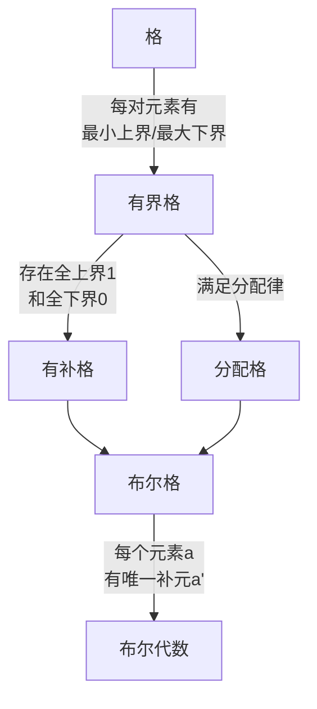

# 布尔代数的定义（有补分配格）及其基本定理与性质证明

> [!IMPORTANT]
> 布尔代数就是==有补分配格==（也称布尔格），记为 $\langle A, \vee, \wedge, ', 0, 1 \rangle$。它是将逻辑运算与集合运算统一起来的代数结构，也是数字电路设计的数学基础。

## 从格到布尔代数的进阶之路

在学习布尔代数前，不妨先问自己：一个普通的格，需要叠加哪些条件才能变成布尔代数？我们可以把格的“进化”过程画出来：

- **有界格**：格中存在全下界 $0$ 和全上界 $1$。
- **有补格**：在有界格中，$\forall a \in A$，都存在补元 $b$，使得 $a \vee b = 1$ 且 $a \wedge b = 0$。
- **分配格**：诱导的 $\vee, \wedge$ 运算满足分配律，即 $a \vee (b \wedge c) = (a \vee b) \wedge (a \vee c)$。

> [!WARNING]
> 普通有补格中，一个元素的补元可能不唯一；但一旦加上“分配”这个条件，补元就必然唯一了。因此布尔格中任一元素 $a$ 的唯一补元可以直接记为 $a'$。

## 相近概念辨析

考试中常要求根据定义判断各种格，下表帮你理清层级关系：

| 概念 | 核心条件 | 补元是否唯一 |
| :--- | :--- | :--- |
| 有界格 | 存在 $0, 1$ | 不涉及 |
| 有补格 | 有界 + 每个元素有补元 | 不一定唯一 |
| 分配格 | 满足分配等式 | 不涉及 |
| 布尔格 | ==有补格 + 分配格== | 必定唯一 |

## 基本定理与证明怎么做

布尔代数的证明题，核心套路是==利用 $0, 1$、补元定义以及分配律进行恒等变形==。我们来看两道南邮常考题型。

### 全下界与全上界的极端性质

**题目**：设 $\langle A, \preccurlyeq \rangle$ 是有界格，$x, y \in A$，若 $x \vee y = 0$，证明 $x = y = 0$。

**引导思考**：$x$ 和 $x \vee y$ 之间有什么偏序关系？

**证明**：
由最小上界的定义知 $x \preccurlyeq x \vee y$。
因为 $x \vee y = 0$，所以 $x \preccurlyeq 0$。
又因为 $0$ 是全下界，必有 $0 \preccurlyeq x$。
由偏序关系 $\preccurlyeq$ 的反对称性，得出 $x = 0$。
同理可证 $y = 0$。这就证明了 $x = y = 0$。

> [!TIP]
> 遇到类似 $x \wedge y = 1$ 的证明，思路完全对称：利用 $1 = x \wedge y \preccurlyeq x$ 和全上界 $x \preccurlyeq 1$，由反对称性得 $x = 1$。

### 偏序与补元的等价转换

**题目**：设 $\langle X, \preccurlyeq \rangle$ 是布尔格，$a, b \in X$，证明 $a' \vee b = 1 \Leftrightarrow a \preccurlyeq b$。

**证明**：
$(\Rightarrow)$ 设 $a' \vee b = 1$，下证 $a \preccurlyeq b$。
$$
a = a \wedge 1 = a \wedge (a' \vee b)
$$
利用分配律展开：
$$
= (a \wedge a') \vee (a \wedge b) = 0 \vee (a \wedge b) = a \wedge b
$$
由 $a = a \wedge b$ 可知 $a \preccurlyeq b$。

$(\Leftarrow)$ 设 $a \preccurlyeq b$，下证 $a' \vee b = 1$。
由 $a \preccurlyeq b$ 知 $a \vee b = b$，故：
$$
a' \vee b = a' \vee (a \vee b) = (a' \vee a) \vee b = 1 \vee b = 1
$$
证明完毕。

> [!CAUTION]
> 证明中的第一步 $a = a \wedge 1$ 极其关键！很多同学拿到题直接盯着 $a' \vee b$ 看，不知道怎么下手。记住技巧：==要凑出目标式，先给原式乘个 $1$（或加个 $0$）再代入展开==。
