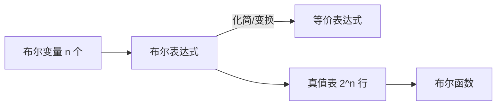

# 布尔表达式的构成、布尔函数的表示及化简

## 布尔表达式与布尔函数

### 它是什么

在格与布尔代数中，布尔表达式是由**布尔变量**、常量 $0$、$1$ 以及**布尔运算**（$\land$ 与、$\lor$ 或、$\neg$ 非）按规则构成的式子。例如：

$$
F(A,B,C) = A\,B + A' C
$$

其中“$+$”表示 $\lor$，“乘”表示 $\land$，“ $'$ ”表示 $\neg$。

而**布尔函数**是从 $\{0,1\}^n$ 到 $\{0,1\}$ 的映射。同一个布尔函数可以有无穷多个不同的布尔表达式，就像同一个真值表可以写出许多逻辑式。

> [!IMPORTANT]
> 布尔表达式是“写法”，布尔函数是“行为”。==两个表达式等价，当且仅当它们在所有赋值下取值相同==——既可以用真值表验证，也可以用布尔代数的基本定律化简验证。

### 为什么需要化简

同一个函数，表达式越简单，实现电路用的门就越少，成本越低、延迟越小。例如：

$$
F = A B + A B' \quad\Longleftrightarrow\quad F = A
$$

前者需要两个与门和一个或门，后者只需要一根导线。化简的依据是布尔代数中的定律，如**吸收律**、**德摩根律**、**分配律**等。

> [!TIP]
> 记忆常见化简套路：
> - $A + A'B = A + B$（消去冗余变量）
> - $AB + AB' = A$（合并互补项）
> - $A + AB = A$（吸收项）

### 怎么表示：真值表 → 标准形式

由真值表可以直接写出两种**标准形式**：

| 名称 | 又称 | 构造方法 | 例子（$F=1$ 的行为） |
|------|------|----------|----------------------|
| 主析取范式 | 极小项之和 | 对每个使 $F=1$ 的行，变量取 $1$ 写原变量、取 $0$ 写反变量，各项相乘后再相加 | $F = A'B'C + A'BC'$ |
| 主合取范式 | 极大项之积 | 对每个使 $F=0$ 的行，变量取 $0$ 写原变量、取 $1$ 写反变量，各项相加后再相乘 | $F = (A+B+C)(A+B'+C')$ |

> [!NOTE]
> 极小项（minterm）中每个变量恰好出现一次，以“与”连接 $n$ 个变量；极大项（maxterm）中每个变量恰好出现一次，以“或”连接 $n$ 个变量。两者互为**对偶**。

### 一个算对了的例子

**题目**：求三变量布尔函数 $F(A,B,C)$ 的主析取范式，已知其真值表如下：

| A | B | C | F |
|---|---|---|---|
| 0 | 0 | 0 | 0 |
| 0 | 0 | 1 | 1 |
| 0 | 1 | 0 | 0 |
| 0 | 1 | 1 | 1 |
| 1 | 0 | 0 | 0 |
| 1 | 0 | 1 | 1 |
| 1 | 1 | 0 | 0 |
| 1 | 1 | 1 | 1 |

**解**：

$F=1$ 的行是 $001$、$011$、$101$、$111$，对应极小项：

$$
\begin{aligned}
F &= \underbrace{A'B'C}_{001} + \underbrace{A'BC}_{011} + \underbrace{AB'C}_{101} + \underbrace{ABC}_{111} \\
&= A'C(B'+B) + AC(B'+B) \\
&= A'C + AC \\
&= C
\end{aligned}
$$

所以 $F(A,B,C)$ 的最简表达式就是 $F = C$。原来，这个看似复杂的函数**只与变量 $C$ 有关**。

> [!WARNING]
> 写极小项时，**别把变量顺序弄反**。比如真值表行 $011$，若变量顺序是 $A,B,C$，则极小项是 $A'BC$，而不是 $AB'C$。排序错一个，整个表达式就错了。

### 常见的坑

> [!CAUTION]
> **主析取范式 ≠ 最简表达式**。主析取范式是唯一的“标准写法”，但往往不是最简的；先写标准形式，再用定律化简，或者直接用卡诺图化简。

另一个坑是把布尔代数中的 $+$ 和 $\cdot$ 当成普通算术。布尔代数中 $1 + 1 = 1$，不是 $2$；$A \cdot A = A$，不是 $A^2$。
