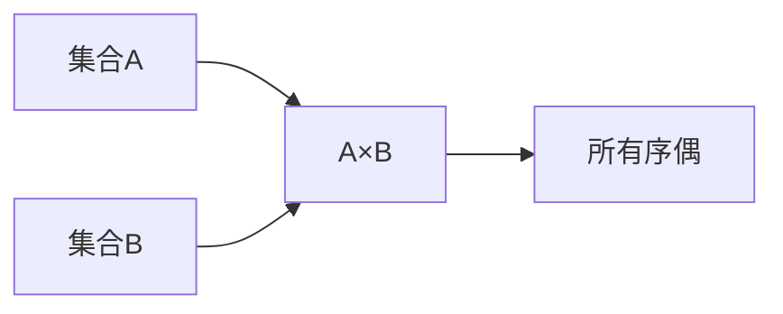

# 序偶的定义与笛卡尔积的运算性质

## 序偶：有顺序的“一对”

普通集合 $\{a, b\}$ 里元素没有先后之分，$\{a, b\} = \{b, a\}$。但如果我们要表示平面上的一个点、或者关系里的一个映射方向呢？这就需要区分谁在前、谁在后。

> [!IMPORTANT]
> **序偶（有序对）** 是由两个元素按固定顺序组成的二元组，记作 $\langle x, y \rangle$。
> 其相等的充要条件是：==$\langle x, y \rangle = \langle u, v \rangle \Leftrightarrow x = u \land y = v$==。

注意写法是尖括号 $\langle \rangle$，不是圆括号 $( )$。

## 笛卡尔积：所有可能的“配对”

有了序偶，如果把集合 $A$ 的元素全放前面，集合 $B$ 的元素全放后面，能组合出多少种序偶？这就是笛卡尔积。

> [!IMPORTANT]
> 设 $A, B$ 为集合，$A$ 与 $B$ 的**笛卡尔积**定义为：
> $$A \times B = \{\langle x, y \rangle \mid x \in A \land y \in B\}$$

如果 $|A|=m, |B|=n$，那么 $|A \times B| = m \times n$。

## 运算性质与常见坑

笛卡尔积和普通乘法很像，但有几个致命区别。先看对比表：

| 性质 | 普通乘法 | 笛卡尔积 |
| :--- | :--- | :--- |
| 交换律 | $ab = ba$ | ==一般不成立==：$A \times B \neq B \times A$ |
| 结合律 | $(ab)c = a(bc)$ | ==不成立==：$(A\times B)\times C \neq A\times(B\times C)$ |
| 分配律 | $a(b+c)=ab+ac$ | 对交、并、差、对称差均成立 |

以交集为例，分配律长这样：
$$A \times (B \cap C) = (A \times B) \cap (A \times C)$$

> [!WARNING]
> **消去律不能随便用！**
> 由 $A \times B = A \times C$ 推不出 $B = C$。反例：当 $A = \varnothing$ 时，无论 $B, C$ 是什么，$\varnothing \times B = \varnothing \times C = \varnothing$，但 $B$ 未必等于 $C$。
> 只有加上前提 ==$A \neq \varnothing$== 时，才能消去得到 $B = C$。

> [!TIP]
> 证明笛卡尔积等式（如分配律）的万能套路：**双向推导法**。
> 从 $\langle x, y \rangle \in \text{左边}$ 出发，利用定义一步步等价转化为 $\langle x, y \rangle \in \text{右边}$。

## 算对了的例子

我们来完整做一道期末考试级别的计算题，体会一下细节。

**题目**：设 $A = \{1, 2\}$，求 $A \times P(A)$。

**第一步**：先求幂集 $P(A)$。
$A$ 有两个元素，所以 $P(A)$ 有 $2^2 = 4$ 个元素：
$$P(A) = \{\varnothing, \{1\}, \{2\}, \{1, 2\}\}$$

> [!CAUTION]
> 幂集里的元素都是**集合**（包括空集 $\varnothing$）。在构造序偶时，这些集合整体作为序偶的第二个分量，千万不要把花括号拆散！

**第二步**：将 $A$ 的每个元素与 $P(A)$ 的每个元素配对。
$|A| = 2$，$|P(A)| = 4$，结果应有 $2 \times 4 = 8$ 个序偶。

- 第一个分量取 $1$：$\langle 1, \varnothing \rangle,\ \langle 1, \{1\} \rangle,\ \langle 1, \{2\} \rangle,\ \langle 1, \{1, 2\} \rangle$
- 第一个分量取 $2$：$\langle 2, \varnothing \rangle,\ \langle 2, \{1\} \rangle,\ \langle 2, \{2\} \rangle,\ \langle 2, \{1, 2\} \rangle$

**最终结果**：
$$A \times P(A) = \{\langle 1, \varnothing \rangle, \langle 1, \{1\} \rangle, \langle 1, \{2\} \rangle, \langle 1, \{1, 2\} \rangle, \langle 2, \varnothing \rangle, \langle 2, \{1\} \rangle, \langle 2, \{2\} \rangle, \langle 2, \{1, 2\} \rangle\}$$

> [!NOTE]
> 观察上例中 $\langle 1, \varnothing \rangle$ 这样的序偶：它的第二分量是空集，但这整个序偶本身**不是空的**，它是 $A \times P(A)$ 中的一个合法元素。别和空集的笛卡尔积搞混了。
