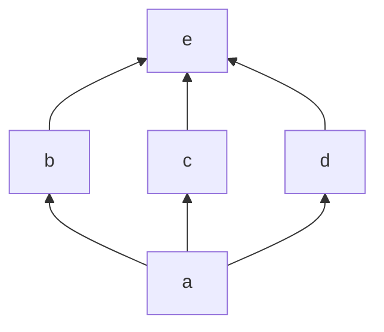
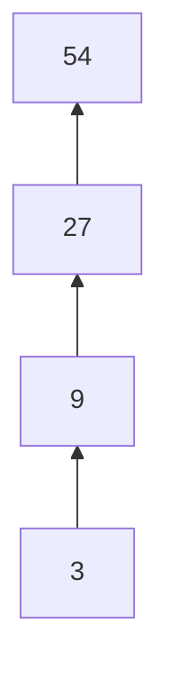

# 偏序关系、盖住关系、哈斯图(Hasse图)的画法及特殊元素（极大元、极小元、最大元、最小元、上界、下界、上确界、下确界）

## 偏序关系与偏序集

设 $R$ 是集合 $A$ 上的二元关系。若 $R$ 同时满足：

1. **自反性**：对任意 $x\in A$，有 $xRx$；
2. **反对称性**：若 $xRy$ 且 $yRx$，则 $x=y$；
3. **传递性**：若 $xRy$ 且 $yRz$，则 $xRz$；

则称 $R$ 为 $A$ 上的**偏序关系**，通常记作 $\preccurlyeq$。有序对 $\langle A,\preccurlyeq\rangle$ 称为**偏序集**。

偏序关系允许两个元素不可比较。例如，整除关系是偏序关系，但 $2$ 与 $3$ 互不整除，因此二者不可比较。

| 关系 | 是否为偏序关系 | 特点 |
|---|---:|---|
| $\le$ | 是 | 任意两数可比较 |
| $\mid$（整除） | 是 | 可能存在不可比较元素 |
| $<$ | 否 | 不满足自反性 |
| $=$ | 是 | 任意两不同元素不可比较 |

若偏序集中任意两个元素都可比较，则称该偏序关系为**全序关系**。

## 盖住关系与哈斯图

在偏序集 $\langle A,\preccurlyeq\rangle$ 中，若 $x\preccurlyeq y$，且不存在 $z\in A$ 使得

$$
x\preccurlyeq z\preccurlyeq y,\qquad z\ne x,y,
$$

则称 $y$ **盖住** $x$，或称 $x$ 与 $y$ 构成盖住关系。记作

$$
x\lessdot y.
$$

盖住关系可以理解为：$x$ 与 $y$ 之间没有其他中间元素。

画哈斯图时遵循以下规则：

1. 每个元素画成一个结点；
2. 只画盖住关系对应的边；
3. 较小元素放在下方，较大元素放在上方；
4. 去掉自环、传递产生的边和方向箭头；
5. 尽量避免边交叉，但不能漏掉盖住关系。

例如，整除偏序集

$$
A=\{3,9,27,54\}
$$

中，$3\lessdot9\lessdot27\lessdot54$，因为相邻元素之间没有其他因子。因此哈斯图是一条链：

此时任意两个元素都可比较，所以该整除关系是**全序关系**。

## 极大元、极小元与最大元、最小元

设 $B\subseteq A$。

- 若 $b\in B$，且不存在 $x\in B\setminus\{b\}$ 使 $b\preccurlyeq x$，则 $b$ 是 $B$ 的**极大元**。
- 若 $b\in B$，且不存在 $x\in B\setminus\{b\}$ 使 $x\preccurlyeq b$，则 $b$ 是 $B$ 的**极小元**。
- 若 $b\in B$，且对任意 $x\in B$ 都有 $x\preccurlyeq b$，则 $b$ 是 $B$ 的**最大元**。
- 若 $b\in B$，且对任意 $x\in B$ 都有 $b\preccurlyeq x$，则 $b$ 是 $B$ 的**最小元**。

| 概念 | 比较范围 | 个数 |
|---|---|---:|
| 极大元 | 只要求不存在更大的元素 | 可以不唯一 |
| 极小元 | 只要求不存在更小的元素 | 可以不唯一 |
| 最大元 | 必须大于等于集合中所有元素 | 至多一个 |
| 最小元 | 必须小于等于集合中所有元素 | 至多一个 |

> [!IMPORTANT]
> ==最大元一定是极大元，但极大元不一定是最大元==。哈斯图中最顶层不一定是最大元，最底层也不一定是最小元，因为可能存在多个互不可比的结点。

例如在偏序集

$$
A=\{2,3,6,12,18,24,36\}
$$

中，按整除关系，极大元为 $12,18$，极小元为 $2,3$；但整个集合既没有最大元，也没有最小元。

## 上界、下界与上确界、下确界

设 $B\subseteq A$：

- 若 $u\in A$，且对每个 $x\in B$ 都有 $x\preccurlyeq u$，则 $u$ 是 $B$ 的**上界**。
- 若 $l\in A$，且对每个 $x\in B$ 都有 $l\preccurlyeq x$，则 $l$ 是 $B$ 的**下界**。
- 若 $u_0$ 是上界，并且对任意上界 $u$ 都有 $u_0\preccurlyeq u$，则 $u_0$ 是 $B$ 的**上确界**。
- 若 $l_0$ 是下界，并且对任意下界 $l$ 都有 $l\preccurlyeq l_0$，则 $l_0$ 是 $B$ 的**下确界**。

也就是说，上确界是“==所有上界中最小的==”，下确界是“==所有下界中最大的==”。

> [!TIP]
> 解题口诀：先找全部上、下界，再在对应集合中分别找最小元、最大元。上确界和下确界不必属于原集合 $B$。

例如

$$
A=\{2,3,6,12,18,24,36\},\qquad B=\{2,3,6\}.
$$

其上界集合为 $\{6,12,18,24,36\}$，其中最小元是 $6$，所以上确界为 $6$；下界集合为 $\{2,3,6\}$，其中最大元是 $6$，所以下确界为 $6$。

> [!WARNING]
> 上界、下界必须属于偏序集 $A$，不要求属于 $B$；而极大元、极小元、最大元、最小元必须属于所讨论的子集 $B$。此外，偏序集中任意两个元素不一定都有上确界和下确界。
