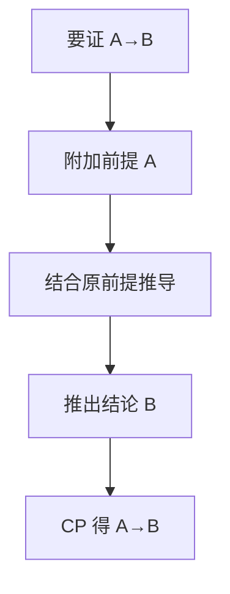

# 有效结论的推证方法（真值表法、等价演算法、CP规则附加前提法、归谬法反证法）

## 推证的目标

要证明“前提 $H_1,\dots,H_n$ 能推出结论 $C$”，记作
$$H_1,\dots,H_n\Rightarrow C,$$
就是要证明
$$H_1\land H_2\land\cdots\land H_n\rightarrow C$$
是==永真式==。注意：$\Rightarrow$ 表示推理关系，$\rightarrow$ 是命题联结词，二者不能混写。

为什么需要多种方法？真值表直观可靠，但命题变元增多时行数按 $2^m$ 增长；等价演算适合公式化简，自然推理则更接近实际证明过程。

## 四种常用方法

| 方法 | 核心做法 | 适用特点 |
|---|---|---|
| 真值表法 | 列出所有赋值，检查蕴含式是否恒为 $1$ | 变元较少时最稳妥 |
| 等价演算法 | 将 $(H_1\land\cdots\land H_n)\rightarrow C$ 化为 $T$ | 适合联结词较多的公式 |
| CP 规则附加前提法 | 结论为 $A\rightarrow B$ 时，附加 $A$，推出 $B$ | 证明条件结论最常用 |
| 归谬法（反证法） | 引入 $\neg C$，与前提共同推出矛盾 | 适合否定结论或逆向推理 |

真值表法还有两种快捷看法：只检查“所有前提均为真”的行，看结论是否也为真；或者检查是否存在“前提全真而结论为假”的赋值，若不存在，推理有效。

> [!IMPORTANT]
> CP 规则：若 $H_1,\dots,H_n,A\Rightarrow B$，则
> $$H_1,\dots,H_n\Rightarrow A\rightarrow B.$$
> 附加前提 $A$ 只在当前推导中使用，最后必须通过 CP 规则解除。

## 一个完整例子

证明：若 $P\rightarrow(Q\lor R)$，$Q\rightarrow\neg P$，$S\rightarrow\neg R$，则 $P\rightarrow\neg S$。

结论是条件式，先附加 $P$：

1. $P$（附加前提）
2. $P\rightarrow(Q\lor R)$（前提引入）
3. $Q\lor R$（1、2，假言推理）
4. $Q\rightarrow\neg P$（前提引入）
5. $\neg\neg P$（1，双重否定）
6. $\neg Q$（4、5，拒取式）
7. $R$（3、6，析取三段论）
8. $S\rightarrow\neg R$（前提引入）
9. $\neg\neg R$（7，双重否定）
10. $\neg S$（8、9，拒取式）
11. $P\rightarrow\neg S$（1—10，CP 规则）

这里第 6 步也可理解为归谬：若 $Q$ 为真，则由 $Q\rightarrow\neg P$ 得 $\neg P$，与附加前提 $P$ 矛盾，故 $\neg Q$。

## 等价演算示例

证明 $p\land q\Rightarrow p\rightarrow q$：
$$
\begin{aligned}
(p\land q)\rightarrow(p\rightarrow q)
&\Leftrightarrow\neg(p\land q)\lor(\neg p\lor q)\\
&\Leftrightarrow\neg p\lor\neg q\lor\neg p\lor q\\
&\Leftrightarrow T .
\end{aligned}
$$
因此原蕴含式成立。

> [!WARNING]
> 常见错误：把 $A\rightarrow B$ 错化为 $\neg A\land B$；由 $A\rightarrow B$ 和 $B$ 推出 $A$；由 $A\rightarrow B$ 和 $\neg A$ 推出 $\neg B$；使用 CP 规则后忘记写成条件结论。

> [!TIP]
> 选择题方法时记住：==变元少用真值表，公式能化简用等价演算，结论是蕴含式优先 CP，出现矛盾线索用归谬==。谓词公式含量词且论域无限时，不能照搬真值表法。
