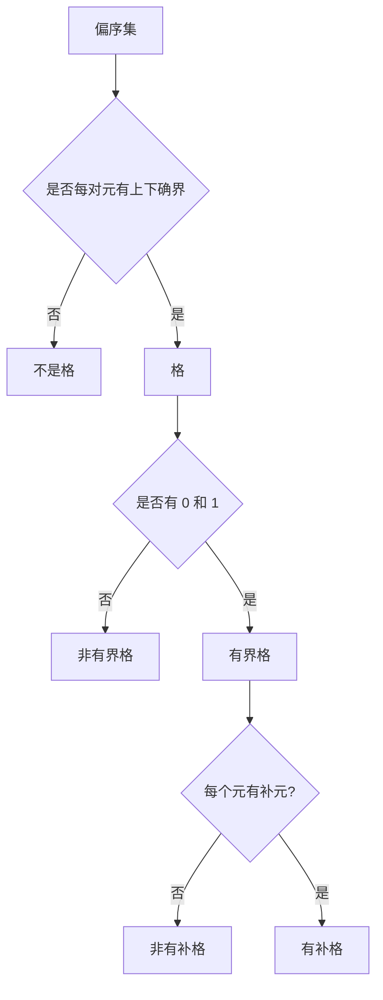

# 全上界、全下界、补元的定义及有补格的判定（实验：有补格判定）

## 为什么要先谈“界”

在一般偏序集里，最大元、最小元可能不存在；而在格里，每对元素都有最小上界和最大下界。可问题是：**整个集合 $A$ 有没有“最底端”和“最顶端”？**

这正是全下界 $0$ 和全上界 $1$ 要回答的事。

> [!IMPORTANT]
> 全下界 $0$：对任意 $x\in A$，都有 $0\leq x$。  
> 全上界 $1$：对任意 $x\in A$，都有 $x\leq 1$。  
> 若二者都存在，则称该格为==有界格==。

并且，**若存在，必唯一**。比如两个全下界 $a,b$：由 $a$ 是全下界得 $a\leq b$；由 $b$ 是全下界得 $b\leq a$，反对称即 $a=b$。

## 补元是什么

在有界格中，才谈得上“补元”。

对 $a\in A$，若存在 $x\in A$ 满足：

$$
a\vee x=1,\qquad a\wedge x=0
$$

则称 $x$ 是 $a$ 的补元，常记作 $a'$。

直观理解：  
$a$ 和它的补元“合起来到顶，交起来到底”。

> [!TIP]
> 记忆：**并到 1，交到 0**。

若==有界格中每个元素都有补元==，则称它为**有补格**。

## 怎么判定有补格

判定步骤很固定：

1. 先验证它是格；
2. 找出全下界 $0$、全上界 $1$；
3. 对每个元素 $a$，检查是否存在 $x$ 使  
   $a\vee x=1,\ a\wedge x=0$；
4. 若每个元素都找得到补元，就是有补格。

## 一个算对的例子

看幂集格 $\langle P(S),\subseteq\rangle$，其中 $S$ 是有限集。

- 全下界是 $\varnothing$
- 全上界是 $S$

所以它首先是有界格。

任取 $A\subseteq S$，它的补元就是 $S-A$，因为

$$
A\cup (S-A)=S,\qquad A\cap (S-A)=\varnothing
$$

所以 $\langle P(S),\subseteq\rangle$ 是有补格。

这也是考试里最常见的标准模型：**有补格一定是有界格**，反之不一定。

## 常见坑

| 易混点 | 正确理解 |
|---|---|
| 有界格 | 只要存在 $0,1$ |
| 有补格 | 先有界，且每个元素都有补元 |
| 补元 | 依赖整个格中的 $0,1$ 和 $\vee,\wedge$ |
| 有补格是否一定有界 | 一定有界 |

> [!WARNING]
> 不要只看哈斯图“上下各有一个点”就判定有补格。  
> 还必须==逐个元素验证补元==。

再提醒一个容易漏的点：补元不一定唯一，除非再加上额外条件，比如分配格中补元唯一。

## 和相近概念的关系

这几类格的关系是层层加强：

$$
\text{格}\supseteq \text{有界格}\supseteq \text{有补格}
$$

而**分配格 + 有补格** 才进入布尔格的核心范围。

所以做判定题时，先问自己一句：  
**“0 和 1 找到了吗？”**  
再追问一句：  
**“每个元素都能配出‘并到 1、交到 0’的伙伴吗？”**

这两步走稳，有补格判定基本不会错。
