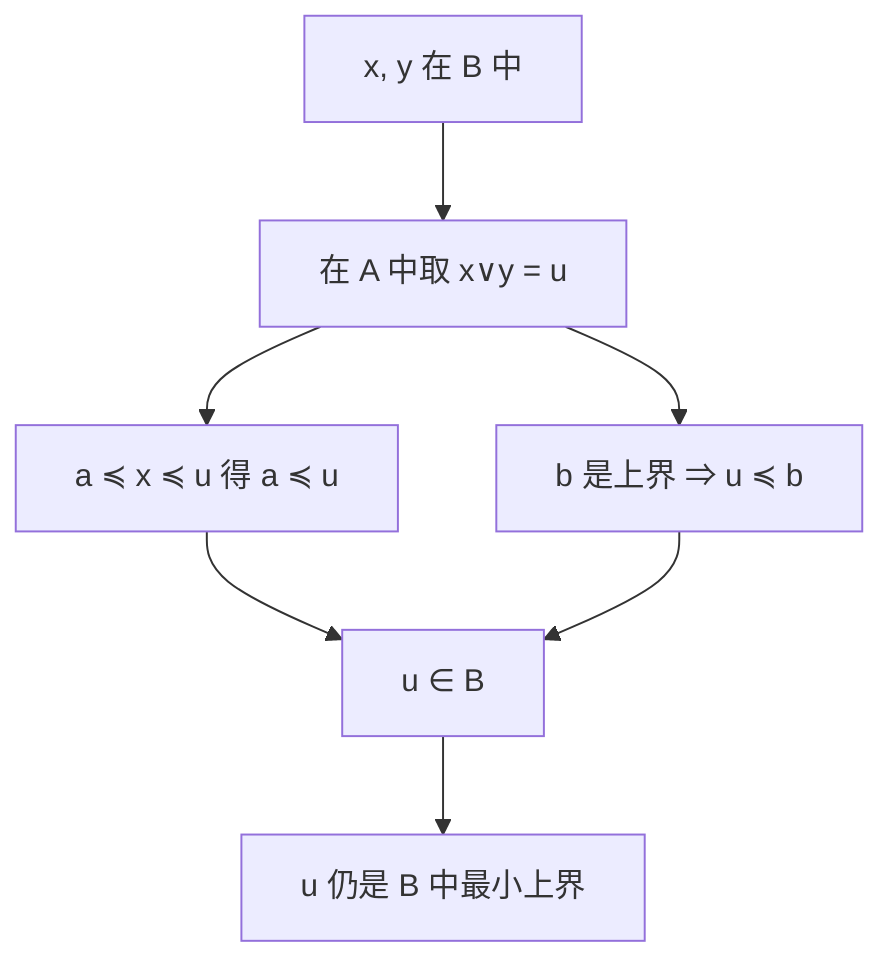

# 格作为偏序集（任意两元素有上确界和下确界）与代数系统的双重定义及性质

## 格是什么：先看偏序集

回忆偏序集 $<P, \preccurlyeq>$：关系满足自反、反对称、传递，哈斯图中"位置高"表示 $\preccurlyeq$。在偏序集里，子集 $B$ 的上界是"比 $B$ 中所有元素都大"的元素，**上确界（LUB）**是所有上界里最小的那个；下界、**下确界（GLB）**对偶。注意：上界可能存在但上确界不存在（上界们互相不可比），也可能上界根本不存在。

> [!IMPORTANT]
> **格的定义（偏序集视角）**：设 $<L, \preccurlyeq>$ 是偏序集，若对 **任意** $x, y \in L$，$\{x,y\}$ 都有上确界和下确界，则称 $<L, \preccurlyeq>$ 为**格**。

"任意两元素"是关键词——只验证几对元素可不够。

## 为什么需要代数系统视角

格中 $x,y$ 的上确界、下确界若存在则唯一（由反对称性）。于是可以干脆把它们看成两个二元运算：

$$x \vee y = \mathrm{LUB}\{x,y\}, \qquad x \wedge y = \mathrm{GLB}\{x,y\}$$

读作"并/交"或"join/meet"。这就得到**格的第二定义**：代数系统 $<L, \vee, \wedge>$，其中 $\vee,\wedge$ 满足交换律、结合律、吸收律（$x\vee(x\wedge y)=x$，$x\wedge(x\vee y)=x$）和幂等律。两种定义完全等价：由偏序格可诱导出满足这些律的运算，反之由运算可还原偏序 $x\preccurlyeq y \iff x\wedge y = x$。

> [!TIP]
> 判断哈斯图是否为格，只需检查：**每一对元素向上走能汇合、向下走也能汇合**。汇合点即 $x\vee y$、$x\wedge y$。

## 判断实例与常见反例

以整除关系为例（这是南邮常考题型）：

| 集合 $L$ | 是否格 | 关键反例 |
|---|---|---|
| $\{1,2,3,4,5\}$ | ✗ | $3\vee 5$ 不存在（最小公倍数 15 不在集中，无上界） |
| $\{1,2,3,6,12\}$ | ✓ | 任意两数的最小公倍数、最大公约数仍在集中 |
| $\{1,2,3,4,6,9,12,18,36\}$ | ✓ | 同上，对 lcm/gcd 封闭 |

> [!WARNING]
> 易错点：$\{8,12\}$ 在 $\{1,\dots,12\}$ 这类集合里**并非没有上界**（24、36…都是），而是这些上界全在集合外，所以"在 $L$ 内无上界"，不是格。另外，"有上界"≠"有上确界"：若两个上界互相不可比，上确界仍不存在。

## 算对的例子：区间子集仍是格

设 $<A,\preccurlyeq>$ 是格，$a\prec b$，取区间 $B=\{x\mid a\preccurlyeq x\preccurlyeq b\}$，证 $<B,\preccurlyeq>$ 也是格。

任取 $x,y\in B$，则 $x,y\in A$，故在 $A$ 中有最小上界 $u=x\vee y$。

- **证 $u\in B$**：$a\preccurlyeq x\preccurlyeq u$（传递性），且 $b$ 是 $\{x,y\}$ 在 $A$ 中的上界，由 $u$ 是*最小*上界得 $u\preccurlyeq b$。故 $a\preccurlyeq u\preccurlyeq b$，$u\in B$。
- **证 $u$ 是 $B$ 中的上确界**：$u$ 在 $B$ 中且仍是 $x,y$ 的上界；对 $B$ 中任一上界 $v$，它在 $A$ 中也是上界，故 $u\preccurlyeq v$。最小性保持。

下确界同理。==核心：格的性质在"闭区间"内封闭，因为确界不会跑出区间。==

## 与后续概念的关系

格是通往分配格、有界格、有补格、布尔代数的入口。判断格只是第一步：还需检查运算是否满足分配律、是否有最大/最小元（全上界 1、全下界 0）、每个元素是否有补元。这些判别都建立在"先确认它是格"这一基础上。
