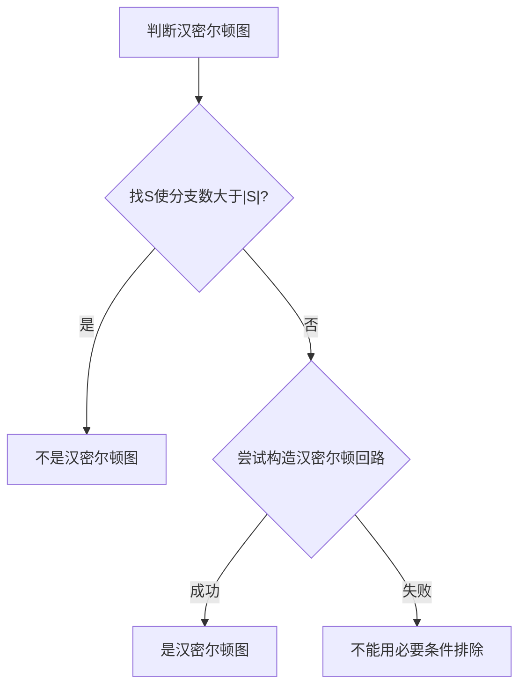

# 欧拉回路与欧拉图的判定定理、汉密尔顿回路与汉密尔顿图的充分/必要条件

## 欧拉回路与欧拉图

欧拉回路研究的是**边的遍历**问题：能不能从某点出发，每条边恰好走一次，最后回到出发点？

> [!IMPORTANT]
> 无向图 $G$ 具有欧拉回路，当且仅当 $G$ 连通且==所有结点的度数全为偶数==。

### 为什么要求度数全为偶数？

想象你在图中行走。每进入一个结点，必然要从另一条边离开它。进出成对出现，所以每个“路过”的结点度数贡献总是 $2$。起点和终点重合，起点也被“进入”和“离开”各一次。因此图中任意结点的度数都必须是偶数。

哥尼斯堡七桥问题中，$\deg(A)=5$，$\deg(B)=\deg(C)=\deg(D)=3$，四个结点度数全为奇数，所以==不存在欧拉回路==。这是历史上图论的第一条定理。

### 半欧拉图：放宽一点

如果只要求每条边恰好走一次，但不要求回到起点，这样的路径叫**欧拉路**。具有欧拉路但无欧拉回路的图叫**半欧拉图**。

> [!TIP]
> 无向图存在欧拉路的充要条件：连通且==恰有两个奇度结点==（这两个奇度结点就是起点和终点）。

### 有向图的版本

有向图中“度数”要拆成**入度**和**出度**：

> [!IMPORTANT]
> 有向图 $G$ 具有单向欧拉回路，当且仅当 $G$ 连通且==每个结点的入度等于出度==。

### 怎么看欧拉图？

一笔画问题就是欧拉路/欧拉回路的直接应用。拿到图先做两件事：

1. 检查连通性；
2. 数每个结点的度数（有向图数入度、出度）。

---

## 汉密尔顿回路与汉密尔顿图

汉密尔顿回路研究的是**点的遍历**问题：能不能找到一条经过每个结点恰好一次并回到起点的回路？

> [!IMPORTANT]
> 汉密尔顿图：具有汉密尔顿回路的图。

### 与欧拉回路的本质区别

| | 欧拉回路 | 汉密尔顿回路 |
|---|---|---|
| 遍历对象 | 每条**边**一次 | 每个**结点**一次 |
| 判定难易 | 有简洁充要条件 | 无已知充要条件 |
| 典型应用 | 一笔画、邮递员问题 | 旅行商问题、排课问题 |

### 必要条件的判定

> [!IMPORTANT]
> 若图 $G=\langle V,E\rangle$ 有汉密尔顿回路，则对 $V$ 的任意非空子集 $S$，有
> $$W(G-S)\leq |S|$$
> 其中 $W(G-S)$ 是删去 $S$ 后剩余图的连通分支数。

**如何理解？** 设 $C$ 是一条汉密尔顿回路。在回路上删去一个点，回路断开成一条路径（仍连通）；再删一个点，最多断裂成两段；删 $k$ 个点，最多断裂成 $k$ 段。整个图删点后的连通分支数不可能超过回路删点后的段数，所以 $W(G-S)\leq |S|$。

> [!WARNING]
> 这是==必要条件==，只能用来**排除**汉密尔顿图，不能用来确认。即：若存在某个 $S$ 使 $W(G-S)>|S|$，则 $G$ 必不是汉密尔顿图；但即使对所有 $S$ 都满足，也未必是汉密尔顿图。

### 充分条件的判定

> [!IMPORTANT]
> 设简单图 $G$ 有 $n$ 个结点（$n\geq 3$）。若 $G$ 中==每一对不相邻结点的度数之和 $\geq n$==，则 $G$ 是汉密尔顿图。

这同样只是==充分条件==：满足条件则一定是汉密尔顿图；不满足时仍可能是汉密尔顿图。

### 考试中怎么用？

> [!TIP]
> 解题口诀：**必要条件先排除，充分条件后判定，构造回路是王道**。期末小题中常考“是否为欧拉图/汉密尔顿图”，欧拉图看度数奇偶，汉密尔顿图优先尝试直接画出回路。
