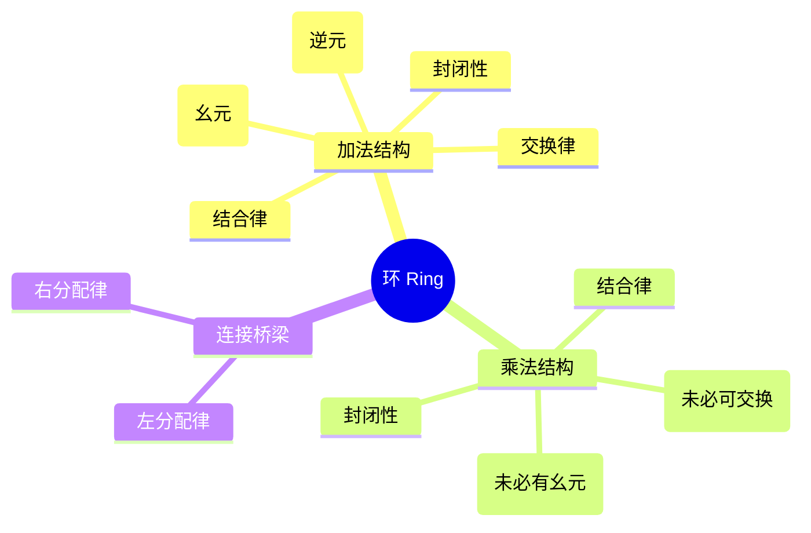

# 环的定义、加法群与乘法半群的结构要求及基本性质

# 环的定义、加法群与乘法半群的结构要求及基本性质

在代数结构中，**环（Ring）** 是介于群和域之间的重要模型。它拥有两套运算：一套像“加法”般完美（构成阿贝尔群），另一套像“乘法”般松散（构成半群），且两者通过分配律连接。

## 什么是环？

设 $\langle R, +, \cdot \rangle$ 是一个代数系统，若满足以下三个条件，则称其为环：
1. $\langle R, + \rangle$ 是 **交换群**（Abelian Group）。
2. $\langle R, \cdot \rangle$ 是 **半群**（Semigroup，即封闭且结合）。
3. 乘法 $\cdot$ 对加法 $+$ 满足 **左右分配律**。

> [!IMPORTANT]
> ==核心判定逻辑==：先看加法是否成群（重点检查**封闭性**和**逆元**），再看乘法是否成半群，最后验证分配律。

## 为什么需要环？

整数集 $\mathbb{Z}$ 是最典型的环。我们引入环的概念，是为了研究那些**加法性质优良但乘法不一定可逆**的系统。
- 与**域**的区别：域要求非零元乘法也可逆（构成群），而环不要求。例如偶数集 $2\mathbb{Z}$ 是环，但不是域（甚至没有乘法幺元）。
- 与**整环**的区别：整环是含幺、无零因子的交换环。

## 常见陷阱与解题技巧

判断一个集合是否构成环时，学生最容易在以下两点失分：

| 检查步骤 | 常见错误点 | 典型案例 |
| :--- | :--- | :--- |
| **加法封闭/逆元** | 忽略负元存在性 | 正整数集 $\mathbb{Z}^+$ 不是环（无负元） |
| **运算封闭性** | 奇数相加得偶数 | 奇数集关于加法不封闭，故不是环 |
| **乘法幺元** | 混淆“环”与“含幺环” | 偶数集 $2\mathbb{Z}$ 是环，但无乘法幺元 |

> [!WARNING]
> **易错警示**：题目若问“是否构成环”，只要满足定义即可，**不需要**乘法有幺元或可交换。但若问“是否构成整环/域”，则必须有幺元。

## 典型例题解析

**题目**：判断 $A = \{2z \mid z \in \mathbb{Z}\}$（偶数集）在普通加法和乘法下是否构成环、整环或域。

**解析步骤**：
1.  **加法检验**：
    -   封闭性：偶数+偶数=偶数。$\checkmark$
    -   结合/交换：实数运算性质继承。$\checkmark$
    -   零元：$0 \in A$。$\checkmark$
    -   逆元：$\forall 2z \in A, -2z \in A$。$\checkmark$
    -   结论：$\langle A, + \rangle$ 是交换群。
2.  **乘法检验**：
    -   封闭性：偶数$\times$偶数=偶数。$\checkmark$
    -   结合律：继承实数性质。$\checkmark$
    -   结论：$\langle A, \cdot \rangle$ 是半群。
3.  **分配律**：实数乘法对加法满足分配律。$\checkmark$

**最终结论**：
-   是 **环**。
-   不是 **整环**，因为不存在乘法幺元（$1 \notin A$）。
-   不是 **域**。

> [!TIP]
> **快速判断法**：看到子集问题，先代入特殊值（如 $0, 1, -1$）检查封闭性和幺元。若 $1$ 不在集合内，直接排除“含幺环”、“整环”和“域”的可能性，但仍可能是“环”。
